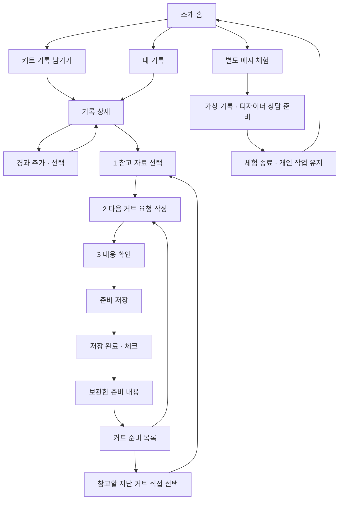

# SALU 초기 화면 계획

> 2026-10-12 정리 전 누적 기록. 본문의 실행 상태는 각 작성 시점 기준이며, 현재 기준은 [운영 문서](../../prototype-plan.md) 참조.

2026-10-12 [집중 작업 흐름](../plans/2026-10-12-focused-task-flow.md) 반영: 저장 전 확인·저장 완료·보관 상세를 분리하고, 작성 화면은 나가기/재개로 초안 보존.

현재 목표: PPT의 흐름을 React에서 확인하고 실제 기기 보관·ZIP 복원·계정 자동 저장으로 연결. 현재 저장/로그인 계약은 [personal-storage.md](../../personal-storage.md), 2026-10-11 검증은 [FR02](../../features/FR02-personal-storage-and-account-backup.md).

후속 [모바일 작성 흐름 개선](../plans/2026-10-11-mobile-writing-flow.md) 구현: `자료 고르기 → 원하는 점 적기 → 내용 확인` 유지, 핵심 입력 우선·선택 정보 접기·정확한 저장 상태와 이동 문구 적용. PC/모바일 화면 80개·인증 11개·자동 저장 5개 검증 통과.

2026-10-12 [앱 화면 개편](../plans/2026-10-11-app-ui-refinement.md) 적용: 조원 목업의 간결한 제목·사진 요약·주 행동을 기존 기능과 결합. 자료 개별 선택과 전체 선택/해제 제공. 기존 검증에 전문/사진 확인과 선택 독립·전체 선택 복귀·스냅샷 범위 검증 추가.

2026-10-10 검토안은 이전 조사 기록. 개인 자료는 IndexedDB, 예시 체험만 메모리 보관. 로그인 후 자동 저장은 사용자 확정 방향이며 상담 실제 전송은 후속.

2026-10-11 부위 전체 선택·가격 증감·디자이너 프로필 우선순위·사용자 문구 정리와 PPT 대비 미구현 화면은 [프론트 검토](../plans/2026-10-11-frontend-polish-review.md) 참고. 개인 기록/준비까지 구현한 단계이며 상담 답변·이력·후기 작성·디자이너 관리·커뮤니티는 화면 구현도 남음.

## 현재 상태와 완료 범위

| 구분 | 상태 |
|---|---|
| 기존 준비본 | `8bcace5`에 보관. Spring 로그인·세션·MySQL 기반 포함 |
| 이번 작업 | 초기 React 화면·PC/모바일 검증·실제 Spring 인증 연결 완료 |
| 기기 저장·파일 백업·계정 암호화 백업·소셜 로그인 코드 | FR02 구현. 실제 소셜 제공자 설정/동의 검증 필요 |
| 로컬 가입·기록 도메인 CRUD·상담 전송 | 후속 개발 계약에 설계 |
| 디자이너 로그인·실시간 대화·후기 작성·커뮤니티 | 후속 단계 |

최초 검증은 서버 없는 메모리 예시 기준. 현재 기본 실행의 로그인·회원 확인·로그아웃은 실제 Spring 사용. 기본 화면은 소개 홈과 빈 개인 기록으로 시작하며, 가상 기록·디자이너·매장·후기는 `/examples/*`에서만 제공. 개인 작성은 기기에 보관하고 로그인하면 계정 백업에 연결. 예시 체험은 메모리 전용으로 자동 이관하지 않음. `npm run dev:prototype`은 인증 호출만 생략하고 같은 홈·개인/예시 분리 흐름 제공.

## 화면 기준

- 캡스톤 `6주차_캡스톤발표.pptx`의 커트·경과 화면과 디자이너 상담 목업, 5주차 기록·선택 자료 흐름 참고
- 청록색 제목 영역, 흰색 카드, 둥근 입력칸, 강조 버튼. 모바일에서 한 열, PC에서 기록과 보조 내용을 나란히 배치
- 목업 이미지를 페이지 배경으로 붙이지 않고 입력·선택·이동을 React 컴포넌트로 구현
- 개인 화면은 기기 보관·계정 자동 저장 상태 안내. 예시 영역에만 가상 자료 표시·예시 초기화·체험 종료 제공. 로그인은 기기 자료를 계정에 연결하고 로그아웃은 계정 자료를 숨김. 서버 장애만으로 작성 내용 삭제 금지
- 개인 준비는 `다음 커트 요청 내용`, 대상을 정한 자료는 `상담 요청 미리보기`. 실제 전달·답변 완료를 주장하지 않음. 실제 로그인 연결은 login.md의 별도 검증 범위
- 주 메뉴의 다른 항목으로 이동했다가 돌아오면 해당 메뉴에서 마지막으로 보던 하위 화면·작성 내용·사진·펼친 정보·스크롤 위치를 이어 표시. 현재 선택된 메뉴를 다시 누르면 그 메뉴의 목록/첫 화면으로 이동하며 작성 초안은 유지. 목록/첫 화면에서 다시 누르면 맨 위로 이동
- 화면 보관은 현재 접속의 메뉴별 마지막 한 화면으로 제한. 로그인/계정 전환·예시 체험 진입/종료 시 화면 보관을 분리·폐기하고 자료 보관은 기존 기기/계정 계약 적용. 로그인·계정 설정·백업·인증 콜백 페이지는 화면 보관 대상에서 제외. 브라우저 뒤로/앞으로 이동도 지원
- 사진 확인·기기 저장 중 다른 메뉴로 이동해도 작업을 계속 처리. 저장 후 현재 메뉴를 강제로 바꾸지 않고, 이전 메뉴로 돌아왔을 때 저장 결과를 표시. 비활성 요청 화면은 현재 초안·작성 단계·URL을 변경하지 않음

## 고객 흐름과 화면

기록·경과 입력과 준비 작성에서는 주 메뉴를 숨기고 나가기로 초안을 보존. 커트 준비에만 3단계 안내를 적용하고, 저장 완료와 보관한 내용을 별도 화면으로 구분. 선택하지 않은 자료는 포함하지 않음. 디자이너 상담 준비·후기는 예시 영역에서 확인하며 실제 전송 없음.

| 경로 | 화면·입력 | 이동·동작 |
|---|---|---|
| `/` | 짧은 서비스 설명, 사용 방법 | 기록 작성·내 기록·예시 체험. 인증 조회 중에도 소개 표시 |
| `/records` | 내가 남긴 커트 목록 또는 빈 상태 | 새 기록·상세. 자동 가상 자료 없음 |
| `/records/new` | 날짜, 시술, 부위, 메모·사진, 접힌 선택 정보 | 개인 영역은 기기에 원자적으로 추가 후 상세. 예시는 메모리에 추가. 나가기는 초안 보존, 작성 내용 지우기는 별도 확인 |
| `/records/:id` | 당일 요약·날짜별 경과·준비한 내용 | 요약 아래 다음 커트 준비 강조. 경과·수정은 보조 행동 |
| `/records/:id/edit` | 날짜·시술·부위·메모·선택 정보 수정 | 기존 사진·이전 준비본 유지 |
| `/records/:id/progress/new` | 관찰 날짜·부위·불편·손질·질문·사진 | 저장 후 해당 기록 상세 |
| `/records/:id/progress/:progressId/edit` | 날짜·부위·문장 수정 | 같은 커트의 경과만 수정 |
| `/requests` | 작성 중·준비한 내용 | 새 준비·마지막 작성 단계 재진입·준비본 확인 |
| `/requests/materials` | 참고할 지난 커트 직접 선택 | 기록이 없으면 기록 작성 안내. 첫 기록 자동 선택 없음 |
| `/requests/materials?draft=:id` | 1. 참고 자료 선택 | 개인은 첨부 없이 진행 가능. 상담 예시는 자료 최소 하나 필수 |
| `/requests/write?draft=:id` | 2. 다음 커트 요청 작성 | 선택 자료 확인·문장 가져오기·내용 확인 |
| `/requests/review?draft=:id` | 3. 저장 전 내용 확인 | 자료/요청 수정·준비 저장. 확인 진입만으로 준비본 생성하지 않음 |
| `/requests/complete/:id` | 저장 완료 | 저장 성공 뒤 체크 표시·보관한 내용/목록 이동. 실제 상담 전송 없음 |
| `/requests/previews/:id` | 보관한 준비 내용 | 수정·원본 확인·대상 선택. 선택한 시점 자료 보존 |
| `/examples/*` | 위 기능의 가상 자료 체험 | 별도 repository·초안. 종료 시 예시만 폐기 |
| `/examples/designers`, `/examples/designers/:id` | 가상 목록·소개·독립된 후기 영역·접힌 소속 | 선택적 상담 준비·기존 초안 이어쓰기·개인 준비본 복사 |
| `/designers` | 상담 기능 준비 안내 | 개인 기록을 전달하지 않고 별도 예시 보기 |
| `/backup` | 기기·계정 저장 상태와 파일 백업 | ZIP 내보내기·복사본 복원·충돌 복구본·미완성 초안 재개 |
| `/account` | 로그인 상태와 소셜 계정 연결 | 설정된 Google/네이버 명시적 연결. 기존 자료 소유자 유지 |

기존 `/consultations/materials`, `/consultations/request`, `/consultations/previews/:id` 호환 경로 유지. 예시 영역에서는 `/examples`를 앞에 붙인 경로 사용. 없는 기록/초안 ID는 다른 기록으로 대체하지 않고 복구 안내. 개인 자료 ID와 참조는 재접속 후 유지. 예시에서 만든 신규 자료만 체험 종료/새로고침 후 사라짐.

### 커트·경과 입력 규칙

- 커트 날짜·시술·부위 최소 하나 필수. `좋았던 점`은 선택. 제목은 날짜와 시술로 생성
- 미용실·담당자·가격은 접힌 선택 정보. 가격은 0 이상의 정수 원 단위. 상담에 자동 첨부하지 않음
- 담당자 이름 입력만으로 프로필을 찾거나 연결하지 않음. 선택 정보에서 프로필 ID를 직접 선택하면 이름을 프로필 값으로 표시하고 해당 프로필로 이동 가능. 기록 당시 매장명과 현재 소속은 분리
- 커트·경과의 문장·날짜·부위·선택 정보를 수정 가능. 커트일을 가장 이른 기존 경과일보다 늦게 변경하지 못함. 새로 만든 요청만 현재 기록 사용, 이전 미리보기는 선택 당시 문장·사진 날짜 유지
- 다른 화면에 갔다가 돌아오면 편집 초안 유지. 명시적 취소는 해당 초안만 버리고 원본 유지. 사진 교체·삭제는 후속
- 관찰 날짜는 커트일 이상·오늘 이하. 경과 일수는 두 날짜 차이로 계산하고 `D+14`처럼 표시
- 경과 부위와 관찰 내용 하나 이상 필수. 불편·손질·질문은 각각 입력하고 전부 빈 값이면 저장 차단
- 부위: 앞머리·옆머리·윗머리·뒤·목선(한 부위)·머리끝·전체. 기록과 요청에서 같은 값 사용
- 관찰 날짜는 기록한 시점이며, 불편이 시작된 날로 자동 해석하지 않음
- 사진은 JPEG·PNG·WebP, 장당 5 MiB 이하, 한 작성 화면에 최대 6장. 실제 이미지 로딩 확인. 초기 화면의 파일명 caption은 후속 전송 전 사용자 설명으로 분리
- 잘못된 사진·날짜·입력은 해당 화면에서 설명. 입력 내용 유지
- 사진 확인 중에는 추가 선택·삭제·폼 저장을 차단하여 처리 중 파일 누락 방지. 완료 후 다시 선택·삭제·저장 가능
- 당일·경과·요청 사진은 눌러 확대. 선택한 사진의 날짜와 설명을 함께 표시. 닫기/Escape 후 누른 버튼으로 포커스 복귀

### 개인 준비와 상담 자료 규칙

- 준비 초안마다 별도 ID. 기준 커트 하나에 개인 준비·디자이너별 여러 초안을 둘 수 있음
- 개인 준비는 디자이너가 없어도 요청 작성·미리보기 가능. 첨부 없는 경우 커트 날짜·시술·부위와 본인이 새로 쓴 요청만 표시
- 상담용 준비는 대상 디자이너와 명시적으로 선택한 자료 최소 하나 필요. 개인 준비에 첨부가 없으면 문장은 유지하고 자료 선택 화면으로 이동
- 당일 메모·경과·사진은 초기 선택 없음. 경과 선택은 해당 부위·불편·손질·질문을 포함하고 사진은 별도 선택
- 가격·매장·자유 입력 담당자 등 선택 정보는 자동 첨부하지 않음. 선택하지 않은 경과와 사진은 미리보기에 없음
- 부위별 요청은 `KEEP/CHANGE/ASK`와 내용의 반복 항목. 빈 항목을 포함한 채 미리보기 생성 불가
- 선택한 기록을 작성 화면에서 확인. PC에서는 옆에 표시, 모바일에서는 위쪽 요약을 펼쳐 확인
- 사용자가 `그대로 둘 부분으로 추가` 또는 `이 불편/질문을 요청에 추가`를 눌러 문장을 옮김. 기존 작성 내용 덮어쓰기 없음. 부위·의도는 이후 직접 수정 가능
- 손질·추가 질문은 기록에 없는 내용만 선택 입력. AI가 시술이나 유지/변경 의도를 추정하지 않음
- 프로필에서 기존 초안 이어쓰기와 새 준비 만들기를 구분. 새 준비와 개인→디자이너 복사는 새 ID를 만들고 이전 초안 보존
- 자료 선택 화면의 커트 변경은 해당 대상의 기존 초안을 복원. 각각은 요청 자료 목록에서 다시 접근 가능
- 미리보기는 선택한 문장·사진 메타데이터·표시 정보를 복사한 불변 자료. 수정은 새 초안·새 미리보기를 만들고 이전 버전 유지
- 수정 중에는 당시 자료만 사용. `최신 기록에서 다시 고르기`를 눌러야 현재 원본으로 전환. 요청 문장은 유지하고 자료 선택을 다시 확인
- 사진에 커트 당일/경과 D+일수와 날짜 표시. 확정 미리보기에도 같은 시점 표시
- 모바일 자료 선택에서는 선택 수와 다음 버튼을 하단에 유지. 원본 확인 후 같은 미리보기로 돌아가기 제공
- 실제 전달·답변·알림·실시간 대화 기능 없음. 개인 준비본과 전송 전 미리보기를 상담 내역으로 표시하지 않음

## 코드와 데이터 경계

| 묶음 | 책임 |
|---|---|
| 공통 레이아웃 | 홈·내 기록·커트 준비 메뉴, 기기/계정 저장 상태, 예시 전용 표시·초기화·종료, 반응형 |
| 기록 화면 | 목록·입력·경과 타임라인, 폼 오류·초안 |
| 디자이너·요청 화면 | 프로필, 개인 준비, 명시적 선택, 부위별 요청, 복사한 미리보기, 재진입 |
| typed repository | 기록·경과 생성/수정·미리보기 생성·대상별 복사·초기화. 개인 기기 보관/자동 백업과 메모리 예시 구현 |
| React Context | ID별 초안 보관과 재개. 화면에서 DB·HTTP 코드 직접 사용 금지 |

핵심 타입: `CutRecord`, `ProgressEntry`, `RecordPhoto`, `DesignerProfile`, `RequestDraft`, `RequestPreview`, `RequestItem`. `RequestDraft.designerId`는 선택이며 후속 실제 상담 API의 designerId 필수 조건과 별개. `referencePreviewId`는 불변 자료 참조이며 개인 백업에서는 참조를 보존하고 복사 복원 시 새 ID로 연결.

공통 비동기 repository의 입력·snapshot 검증을 재사용하며, 개인 repository는 기기 commit 이후 상태를 공개. 자동 백업은 별도의 동기화 계층에서 revision·mutation·사진을 처리. 예시 메모리 ID·가상 사진은 실제 계정으로 이관하지 않음. 후속 도메인 HTTP adapter와 상담 전송은 별도 단계.

- 개인 영역은 새로고침 후 기기 자료 복원. 예시 영역만 새로고침/예시 초기화 시 샘플 복원. 체험 종료는 개인 repository·초안·사진 URL을 유지하고 예시만 폐기. 인증 성공 시 개인 기기 자료를 계정 공간에 연결. 로그아웃/계정 변경은 해당 공간을 숨기고 게스트/다른 계정 공간 표시
- 개인 기록·사진 Blob·초안은 IndexedDB에 저장. 예시 내용은 브라우저 영구 저장과 서버 업로드 금지. 인증 정보는 메모리와 HttpOnly 세션 쿠키로만 관리하며 localStorage/sessionStorage 토큰 없음. 기본 실행은 인증·개인 백업 API를 사용. 상담 WebSocket 호출 없음. 화면 전용 모드와 구분. Vite HMR는 개발 도구
- 사진 화면 URL은 임시 blob URL이며 다시 생성. 개인 사진 원본은 IndexedDB Blob로 보관. 폼 제거·명시적 취소·공간 전환·페이지 종료 때 사용이 끝난 URL을 정리하고 다른 기록/미리보기에서 사용하는 사진은 보존
- 초기화는 확인창에서 확정한 뒤 실행. 닫기/Escape/계속 작성은 내용 유지
- 기록 삭제·저장한 사진 교체/삭제·실제 디자이너 편집·후기 작성은 후속
- 외부 이미지·폰트 요청 없음. 기본 사진은 정적 파일, 디자이너 이미지는 이니셜

## Git·공동 작업

기존 파일을 새로 만들었다고 소급 분할하지 않음. 최초 커밋은 발견 당시 준비본 전체. 이후 실제 작업마다 관련 변경과 검증을 함께 기록.

| 순서 | 커밋 단위 | 확인 |
|---|---|---|
| 0 | 기존 개발 준비본 기준점 보관 | stage 범위·비밀값·기존 코드 보관 |
| 1 | 초기 화면 계획과 후속 개발 계약 정리 | PPT 기준·현재/후속 구분 |
| 2 | 화면 경로와 공통 레이아웃 추가 | TypeScript·빌드 |
| 3 | 커트·경과 화면과 메모리 저장 추가 | 입력·타임라인·사진 상태 |
| 4 | 디자이너 선택과 상담 미리보기 추가 | 선택본·요청·snapshot |
| 5 | 초기 화면 검증과 실행 안내 추가 | 브라우저 검증·실제 캡처 |
| 6 | 상담 준비 화면 흐름과 초안 보존 개선 | 선택 내용 확인·대상별 초안·모바일 진행 |
| 7 | 개인 요청 준비와 자료 재진입 흐름 추가 | 여러 초안·불변 자료·개인→상담용 복사 |
| 8 | 기록 수정과 사진 확인 흐름 추가 | 원본 수정·프로필 명시 연결·확대·초기화 확인 |

개발 브랜치 `feature/prototype-flow`. 이후 `main`에 직접 작업하지 않고 기능 브랜치→검증→PR 검토. 원격은 후속 단계에 비공개 `8192KB/SALU` 생성·공유. 조원 GitHub ID는 실제 확인 후 초대. 이 단계에서 원격 생성·push·웹 공개는 수행하지 않음.

`.env`, 계정 파일, 사진 원본 업로드, DB 데이터, node_modules, dist, 테스트 임시 결과는 Git 제외. 기본 가상 사진과 의존성 lockfile은 포함.

## 검증과 발표

- Spring·MySQL을 사용하지 않은 상태에서도 목록부터 미리보기까지 완료
- 커트·경과 작성, 사진 미리보기, 날짜 오류·필수 입력 오류 확인
- 상담용 준비는 자료를 고르지 않으면 진행 차단. 개인 준비는 첨부 없이 요청 작성 가능. 선택하지 않은 개인 메모·경과·사진이 미리보기에 나타나지 않음
- 앞뒤 이동·다른 대상 방문 후 초안 복원, 대상별 요청 분리, 원본 추가 후 기존 미리보기 불변, 새로고침/초기화 후 신규 자료 소실
- 존재하지 않는 기록/프로필/미리보기 ID, 새로고침 후 직접 URL 접근 안내
- 390px 모바일과 PC의 가로 넘침·메뉴·입력·버튼 확인
- 브라우저 콘솔 오류, `/api`/외부 네트워크 호출, 영구 저장 여부 확인
- `npm run build`, `npm run test:e2e` 실행. 기존 서버 기반 검증 결과와 초기 화면 결과 구분

발표 표현: “PPT의 예상 화면을 실제 입력·선택 가능한 초기 화면으로 구성했습니다. 이번에는 화면 흐름을 확인했고, 실제 저장과 디자이너 상담 연결은 다음 단계입니다.”

최종 캡처는 실제 브라우저 결과에서 생성. 목업 사진을 구현 완료 증거로 사용하지 않음. 검증 결과와 실제 캡처는 아래 구현 결과에 기록.

## 이미지·기술 출처

- 예시 커트 사진: [Alex Neman, Man with brown bob haircut from behind](https://commons.wikimedia.org/wiki/File:Man_with_brown_bob_haircut_from_behind.jpg), CC0. PPT와 같은 참고 사진. 가상 날짜·설명은 실제 촬영자/모델의 시술 이력이 아님
- 사진은 여러 기록의 레이아웃 예시에 재사용. 실제 전후 변화 비교 자료가 아님
- [React Router Declarative 설치](https://reactrouter.com/start/declarative/installation): Vite와 BrowserRouter 사용. 설치 버전은 package-lock.json에 고정

## 초기 구현과 후속 보완 기록 · 2026-10-10

이하 항목은 작업 순서대로 보존한 과거 검증 기록. 홈·개인/예시 분리 전의 메뉴·안내·시험 수는 해당 시점 기준이며, 현재 동선은 상단 화면 기준과 문서 마지막의 소개 홈 구현 결과를 따름. 기존 저장소 캡처도 이전 화면의 증거로 보존.

- PPT 기준 커트·경과 입력, 디자이너 프로필, 선택 자료, 부위별 요청, 미리보기 연결 완료
- `npm ci`, `npm run build`, `npm run format:check` 통과
- 최초 검증 `npm run test:e2e`: desktop 8개 + mobile 8개, 총 16개 통과. 아래 흐름 보완 후 재검증 결과 별도 기록
- 날짜·필수 항목, 초안 이동, 선택하지 않은 자료 제외, snapshot 유지, 초기화·새로고침, 사진 decode·개수·크기·URL 정리 확인
- 매 테스트에서 브라우저 실행 오류·API/외부 HTTP 요청·localStorage/sessionStorage 사용 없음 확인
- 첫 검증에서 발견한 입력 이름/오류 설명 혼합을 aria-labelledby·aria-describedby로 분리한 뒤 전체 재검증
- backend·scripts·compose·기존 DB migration은 준비본 기준점과 동일. 이 결과는 backend/DB의 새로운 검증 결과가 아님
- Git: 기준점 main + feature/prototype-flow. 준비본·계획·레이아웃·기록·상담·검증 순서, 원격 push 없음

실제 화면: [기록 목록 PC](../../screenshots/records-desktop.png) · [커트·경과 모바일](../../screenshots/record-mobile.png) · [디자이너 PC](../../screenshots/designer-desktop.png) · [상담 미리보기 모바일](../../screenshots/preview-mobile.png). 재생성: 개발 서버 실행 후 `frontend`에서 `npm run capture`.

### 화면 흐름 보완

최초 브라우저 점검에서 확인한 문제: 자료 선택 후 요청을 쓰면 선택한 경과가 보이지 않음, 대상을 바꾸면 이전 요청 소실, 모바일 다음 버튼이 자료 목록 아래에 위치. PPT의 배치를 유지하면서 아래 동작 보완.

| 보완 | 적용 범위 |
|---|---|
| 기록을 보면서 요청 작성 | 선택한 메모·경과·사진만 표시. 손질/질문을 중복 작성하지 않도록 추가 입력임을 안내 |
| 대상별 초안 보관 | 커트·디자이너 조합마다 별도 보관·복원. 다른 대상에 내용 자동 전달 없음 |
| 모바일 진행 버튼 | 자료 선택 화면 하단에 선택 수·요청 작성 버튼. 오류 안내와 화면 마지막 자료가 가리지 않게 여백 확보 |
| 원본 확인 후 돌아가기 | 미리보기 ID를 이동 경로에 유지. 같은 커트의 미리보기일 때만 돌아가기 표시 |
| 사진 소속 표시 | 커트 당일·경과 D+일수와 관찰 날짜 표시 |

흐름 보완 후 `npm run build`, `npm run format:check` 통과. 설치된 Playwright Chromium에서 desktop 9개 + mobile 9개, 총 18개 통과. 대상별 초안 복원·분리·초기화, 요청 작성 중 선택 범위 유지, 모바일 하단 버튼 노출 포함. 실제 브라우저에서 원본 확인 후 같은 미리보기 복귀도 확인.

PC·모바일 캡처를 확인하며 모바일의 미리보기 버튼 줄바꿈을 발견해 작성 화면의 하단 버튼을 한 줄에 하나씩 배치. 실제 사용자 대상 사용성 검증은 아직 수행하지 않음.

추가 개선 상태:

- **담당 디자이너로 바로 연결**: 선택한 프로필 ID로 연결. 이름만 입력하면 연결하지 않음. 소속이 옮겨도 기록 당시 매장 유지
- **개인 요청과 재진입**: 구현 반영. 아래 추가 검증 결과 참고
- **기록 수정·사진 확인**: 메모리 원본 수정·사진 확대 구현. 기존 요청 자료는 불변. 저장된 사진 교체/삭제와 실제 전송 내역은 후속

후속 첫 작업: 계획의 회원·기록 연결 단계. 화면 피드백을 먼저 반영한 뒤 신규 migration·API·HTTP adapter·소유권 검증을 기능 단위로 연결. 가상 기록을 실제 계정의 기록으로 자동 이관하지 않음.

### 추가 흐름 개선 · 개인 준비와 재진입

- 개인 준비본과 전송 전 상담 자료 분리, ID별 여러 초안·버전 보관
- 개인 준비에서 대상 선택 후 명시적 복사. 기존 상담 초안·개인 준비본 유지
- 선택한 기록의 문장을 요청에 가져오기, 미리보기의 사진 날짜 유지
- 내용 수정 시 당시 자료 유지. 최신 원본으로 바꾸는 버튼 분리
- 구현 빌드 통과. PC·모바일 브라우저 28개 시나리오 통과, 실제 개인 요청·요청 목록 캡처 확인. 디자이너 재진입 시 작업 중인 기준 커트 유지 확인

개선 완료 확인 기준:

1. 디자이너 없이 요청 준비·미리보기, 이후 상담 준비로 연결, 목록·기록에서 재진입
2. 같은 대상의 여러 초안·이전 미리보기·선택하지 않은 자료를 구분하여 보존
3. 잘못 입력한 기록·경과 수정, 담당 프로필을 이름 추측 없이 명시적으로 연결, 사진 날짜·확대 확인
4. 모바일·키보드·잘못된 주소·초기화 검증, 실제 캡처·문서·Git 기록 정리

실제 DB·전송·디자이너 계정·후기 작성·커뮤니티는 기존 후속 계획 유지. 초기 화면 결과를 해당 기능의 완료로 표시하지 않음.

### 기록 수정과 사진 확인 결과

- 커트·경과 편집, ID별 편집 초안, 취소 시 원본 유지, 날짜 순서 검사 구현
- 자유 입력 담당자와 명시적 프로필 연결 구분. 시술 당시 매장과 현재 소속 분리
- 사진 확대, 닫기/Escape/포커스 복귀, 초기화 확인창 구현
- 사진 decode 중 삭제·저장 차단. 확인 완료 후 삭제한 사진이 되살아나지 않으며 저장 가능
- 최종 `npm run build`, `npm run format:check` 통과. `npm run test:e2e`: PC 20개 + 모바일 20개, 총 40개 통과(17.4초), skip 없음
- 320·390·1440px에서 목록·기록·편집·요청 목록의 가로 넘침 없음 확인. 실제 사용자 평가와 구분

추가 캡처: [요청 작성 PC](../../screenshots/request-desktop.png) · [요청 자료 목록 모바일](../../screenshots/requests-mobile.png) · [기록 수정 모바일](../../screenshots/edit-mobile.png) · [사진 확대 모바일](../../screenshots/photo-mobile.png)

로그인 연결은 완료. 후속 첫 작업은 가입·회원별 기록 저장/조회. 기록 HTTP adapter와 로딩·저장 실패/재시도·소유권을 연결하고 재접속 보존 검증. 이후 두 실제 계정 간 상담·답변, 후기·공개 사례 순서. 현재 화면에서 답변·실제 상담 이력으로 보이는 가짜 결과를 추가하지 않음.

### 완료 확인

| 기준 | 확인 결과 |
|---|---|
| 개인 준비 → 선택적 디자이너 연결 → 목록/기록 재진입 | 브라우저 PC/mobile 통과. 디자이너 선택 전에도 요청 작성 가능 |
| 여러 초안과 과거 선택본 보존 | 같은 대상 새 초안·대상 변경·원본 추가/수정·이전 버전 재열람 확인. 선택하지 않은 개인 자료 제외 |
| 기록 수정·프로필 명시 연결·사진 날짜/확대 | 날짜 역전 차단, 편집 이동/취소, 이름 자동 연결 없음, 당시 매장 유지, 사진 확대 확인 |
| 모바일·키보드·복구·초기화·실제 캡처 | Escape/닫기 포커스 복귀, 초기화 취소/확정, 잘못된 ID 차단, 8종 실제 브라우저 캡처 확인 |
| 기존 기반과 분리 | backend/scripts/compose/기존 migration 변경 없음. 새 업무 DB/API/실제 전송 미구현 |
| Git·문서 | 기존 두 계획 문서와 README 갱신. 기능 순서대로 커밋, 원격 push 없음 |

외부 사용자 대상 사용성 평가는 미실시. 회원별 기록의 재접속 저장·디자이너 답변 검증은 다음 개발 단계의 완료 조건. 실제 인증 연결은 아래 별도 검증 범위.

## 실제 인증 연결 이후 · 홈 개선 전 작업 기록

`npm run dev`는 Spring 세션 확인과 실제 `/login` 제공. 서버 없이 화면 흐름만 보려면 `npm run dev:prototype`. 업무 기록의 메모리 repository·개인 준비·선택 자료·snapshot 계약은 유지.

예시 자료는 새로고침뿐 아니라 로그인·로그아웃·확인된 회원 변경 때 초기화. 서버 장애는 비로그인으로 간주하지 않고 기존 예시를 유지. UI 상단에 기록의 서버 저장 전 상태 표시. 실제 회원별 기록 저장·상담 전송은 아직 없음.

인증 E2E 9개와 기존 화면 E2E40개를 별도 실행해 통과. [로그인 연결 결과](../../login.md)의 실제 서버 응답/장애 재현 범위 참고. 다음 첫 업무 기능은 커트·경과 DB·HTTP adapter·소유권 검사 연결.

### 모바일 화면 보완 · 2026-10-10

- 별도 모바일 도메인·호스팅 없이 같은 React 화면의 반응형 구성 보완
- 900px 이하에서 사이드바를 본문 아래로 이동하고 상단 메뉴를 세 개의 동일 너비 탭으로 배치. 계정 영역은 브랜드 옆에 유지
- 480px 이하에서 새 기록·폼 버튼을 전체 너비로 배치하고 사진·카드 여백 조정. 입력 글자 16px 적용
- 320px 새 기록 폼에서 사진 파일 입력의 최소 너비가 grid를 넓히는 문제 수정. 내용을 숨기지 않고 grid 최소 너비 제한
- 주요 화면 8종을 320·390·600·720·800·900·1440px에서 확인: 총 56개 조합 가로 넘침 없음. 새로고침 없는 PC→모바일→PC 너비 전환 확인
- 최종 build·format:check 통과, 화면 전용 E2E PC 20개 + 모바일 20개 총 40개 통과(19.5초). 인증·backend 변경 없음, 실제 인증 검증은 이번 작업에서 재실행하지 않음
- 화면 전용 캡처: [기록 목록 모바일](../../screenshots/records-mobile.png), [새 기록 모바일](../../screenshots/new-record-mobile.png). 실제 DB 저장·사진 서버 업로드 검증과 구분

### 디자인 스킬 적용 · 모바일 기록 중심 구성

`frontend-design`, `frontend-app-builder`, `frontend-testing-debugging`, `react-best-practices` 기준으로 화면 재정리. 위 모바일 캡처는 이전 반응형 보완 당시 화면이며 이번 디자인과 구분.

- 방향: 소개 배너·반복 카드 대신 날짜별 기록 목록. 첫 화면에서 새 기록과 최근 기록 확인, 모바일은 하단 메뉴로 기록·디자이너·요청 자료 이동
- 색상: white `#FFFFFF`, ink `#183C3C`, teal `#14615B`, muted `#70817E`, line `#E3EBE8`, selected `#EEF5F3`. 한국어 시스템 sans, 모바일 제목 26px·본문 13~16px, 입력 16px
- 사진 있는 기록은 사진과 메모를 나란히 배치. 사진 없는 기록에 가짜 사진·큰 빈 상자 추가 없음
- 입력 폼 외곽 테두리 제거, 사진 선택을 한국어 버튼으로 표시, 모바일 저장 버튼 우선 배치. 실제 파일 input·기존 검증 유지
- 하단 메뉴 68px + 경계선 1px와 safe area 확보. 자료 선택 버튼은 메뉴 위에 배치하고 마지막 내용까지 스크롤 가능
- 영문 장식 제목 제거. 개인정보·선택 자료·snapshot·초안·인증 계약 유지. 이번에도 업무 데이터는 메모리 예시
- built-in Image Gen으로 모바일 목록·입력·PC 목록의 통합 시안 생성. 기존 사진·아이콘·자유 입력 시술·초기화 안내는 기존 기능과 데이터에 맞게 유지하며 시안의 가상 사진을 기록으로 사용하지 않음
- Browser plugin 미제공으로 Playwright 사용. 시안과 실제 화면을 `view_image`로 비교: 목록 구조·제목/문구·색상·사진 처리·버튼·하단 메뉴·간격 확인. 입력 화면은 기존 항목과 오류 안내를 보존하므로 세로 스크롤 제공
- 비교 시안: built-in 생성 경로 `~/.codex/generated_images/01a1247a-43c6-7350-a4aa-738c43dd3479/exec-9dba261d-039f-4bc1-af7b-2bfc09e04ba4.png`. 임시 브라우저 캡처는 `/tmp/salu-redesign-*.png`, 저장소에는 추가하지 않음
- 시안 대비 의도한 차이: 실제 가상 모드에서 로그인 대신 가상 데이터 안내 표시, 기존 초기화·소실 안내 유지, 기존 사진과 아이콘 유지, 사진 없는 기록에 시안 사진 추가 없음, 시술은 기존 자유 입력 유지. 제목·최근 커트·새 기록·요청 자료 메뉴는 시안 기준 반영. 신규 영문 장식·지표 없음
- build·format:check 통과, PC 20 + 모바일 20 총 40개 E2E 통과(25.3초). 마지막 PC 안내 정렬·하단 경계선 보완 후 관련 4개 추가 통과(3.9초)
- 320·390·600·720·900·1440px × 주요 화면 8종 = 48개 가로 넘침 없음, 브라우저 오류 없음. 390×844 모바일·1440×1000 PC에서 시안과 캡처 비교
- 추가 모바일 조작: 사진 선택 → 커트 저장 → 경과 추가 → 하단 내 기록 메뉴 → 작성 메모 확인. 자료 선택 버튼 bottom=775, 메뉴 top=775로 겹침 없음
- 실제 Spring 인증은 이번 화면 작업에서 재검증하지 않음. 물리 휴대폰·iOS Safari·가상 키보드는 후속 확인. DB 저장·업로드·상담 전송은 미구현 유지

### 모바일 터치·상태 피드백 보완

참고: [TDS Mobile](https://tossmini-docs.toss.im/tds-mobile/), [Top 예시](https://tossmini-docs.toss.im/tds-mobile/components/top/), [바텀시트 예시](https://tossmini-docs.toss.im/tds-mobile/hooks/OverlayExtension/use-bottom-sheet/). 토스 패키지·브랜드 자산을 가져오지 않고 기존 SALU 컴포넌트에서 구현. 화면 전체 재설계가 아닌 기존 디자인의 동작 보완으로 새 Image Gen 시안 생성 없음.

- 버튼·기록 행·부위 선택·하단 메뉴에 120ms 눌림 반응. 메뉴 선택 상태는 아이콘 배경으로 표시
- 화면 이동은 본문에 180ms opacity 전환. 실제 이동·저장에 인위적 지연 추가 없음
- 모바일 확인창은 하단 시트로 표시. 사진 확대는 기존 중앙 dialog 유지. 배경 클릭·Escape·닫기는 초안 보존, 포커스·스크롤 복원
- 입력 포커스 강조, 실제 처리 중인 저장/사진 확인 상태에 spinner·aria-busy·disabled 표시. 버튼 접근 이름은 기존 이름 유지
- 커트·경과 생성/수정 성공 후 3초 완료 안내. 실패에는 완료 안내 없음. 서버 저장 오해를 막도록 `예시` 명시, 계정/예시 초기화 때 안내도 초기화
- prefers-reduced-motion에서 전환·눌림·spinner 회전 제거. 오류·버튼 상태·완료 메시지는 유지
- 부위 선택 애니메이션 적용 중 span이 checkbox 클릭을 가로챈 문제를 발견하고 장식 span의 pointer-events를 제거한 뒤 전체 재검증
- 최종 build·format:check 통과. 화면 E2E PC 22 + 모바일 22 = 44개 통과(35.1초). 성공/실패 안내·배경 닫기·초안/포커스 복원 회귀 검증 추가
- 실제 Spring8081·MySQL3307에 연결한 인증 E2E 9개 통과(8.7초), skip 없음. 로그인·세션·로그아웃은 실제 응답, 장애/CSRF 복구는 기존 브라우저 응답 재현 방식. 실제 DB 중단·업무 기록 저장 검증과 구분
- Playwright에서 320·390·600·720·900·1440px × 주요 화면 6종 총 36개 가로 넘침·브라우저 오류 없음. 390×844에서 눌림·하단 시트·완료 안내·모션 감소 설정 확인, view_image로 실제 캡처 검토
- 임시 증거 `/tmp/salu-touch-{home,pressed,sheet,success}.png`. Browser plugin 미제공으로 Playwright 사용. 물리 휴대폰·iOS Safari·가상 키보드·실제 기기의 프레임 성능은 미검증

### 날짜 입력·선택 정보 동작 보완 · 2026-10-10

- 커트·관찰 날짜에 공통 `DateField` 적용. 브라우저 지역 설정과 무관하게 `2026. 10. 10`처럼 연·월·일 표시. 직접 입력 중에는 부분 문자열을 보존하고 입력을 마치면 표시 형식 정리
- 연·월·일 순서의 점/하이픈/슬래시와 숫자 8자리 입력을 기존 ISO 날짜 값으로 변환. 존재하지 않는 날짜·미래 날짜·커트 이전 경과는 기존 repository 검증으로 차단하며 입력과 오류 설명 연결 유지
- 달력 버튼으로 기기의 네이티브 날짜 선택기 사용. 호출을 지원하지 않거나 거부하면 직접 사용할 수 있는 네이티브 입력 제공. 모바일 달력의 오른쪽 잘림을 발견해 날짜 칸 전체를 기준으로 위치 수정
- 선택 정보는 native details/summary를 유지하고 220ms 높이 전환·화살표 회전 추가. 닫힌 내용은 키보드 이동에서 제외하며 미용실·담당자·가격 입력은 유지. 반복 클릭은 진행 중 높이에서 반대 방향으로 전환
- prefers-reduced-motion에서 높이·화살표 전환 제거. Enter/Space 토글과 달력 키보드 선택 확인
- Browser plugin 미제공으로 Playwright 사용. 화면 전용 `http://127.0.0.1:5190`, PC 1440×1000·모바일 390×844, 영어 `en-US` 설정에서 실제 렌더링·달력 선택·부분 날짜 삭제·양방향 전환·입력 보존·반복 토글·동작 줄이기·잘못된 날짜 입력 확인
- 최종 `npm run build`, `npm run format:check` 통과. 기존 화면 E2E PC 22 + 모바일 22 총 44개 통과(46.0초), skip 없음. pageerror·관련 console error·가로 넘침·Vite 오류 화면 없음. 실제 캡처의 한글·날짜·펼친 입력 배치와 달력 잘림 해결 확인
- 임시 증거 `/tmp/salu-ui-polish-check.json`, `/tmp/salu-ui-polish-{desktop,mobile}-{calendar,collapsed,expanded}.png`. 제품 테스트와 캡처는 메모리 예시 기준. 실제 Spring 인증·backend 변경과 재검증 없음
- 물리 기기·Safari·가상 키보드는 미검증. 업무 날짜의 Asia/Seoul 기준 불일치 R01과 인증 성공 표시 지연 R02는 [기존 검토](../reviews/FR01-current-state-review.md)의 미수정 항목 유지. 기기 저장·백업·상담 전송도 미구현 유지

## 소개 홈·개인/예시 분리·커트 준비 흐름 · 2026-10-10

확정 범위는 UI 흐름과 기존 실제 로그인 연결. 기기 영구 저장·기록 DB·회원가입·상담 전송은 이번 구현에 포함하지 않음.

- `/`에 “커트 기록, 남겨볼까요?”와 짧은 설명·기록 작성 버튼 배치. 처음 방문하면 빈 개인 기록이며, 가상 사진·디자이너·후기는 별도 예시 체험에서 제공
- 주 메뉴는 홈·내 기록·커트 준비. 기록 상세에서는 당일 요약 다음에 “이 기록으로 다음 커트 준비”를 강조하고, 수정·경과 추가는 선택 행동으로 유지. 모바일 사진은 작은 썸네일로 표시
- 커트 준비만 참고 자료 선택 → 요청 작성 → 내용 확인의 3단계로 안내. 새 준비는 참고할 지난 커트를 직접 선택하고, 초안은 마지막 자료 선택/요청 작성 단계에서 재개. 내용 확인의 주 행동은 “준비 마치기”
- 개인 repository는 예시 체험 중에도 유지. 예시 수정·초기화·종료가 개인 기록·사진 URL·입력 중 초안에 영향을 주지 않음. 체험을 나가면 예시만 폐기
- 예시 디자이너 프로필은 소개 다음에 상담 준비 행동을 두고, 소속·가상 후기는 그 뒤의 접힌 추가 정보로 제공. 개인 기록에는 예시 프로필을 자동 연결하지 않음
- 소개 홈은 최초 회원 조회 중에도 표시. 개인 작성 내용이 있으면 로그인 전 소실 확인을 제공하고, 취소/로그인 실패/서버 장애는 작성 내용 유지. 인증 성공·로그아웃·확인된 계정 변경의 초기화 계약 유지
- 기존 날짜 표시·네이티브 달력·선택 정보 애니메이션·불변 선택본·명시적 최신 자료 전환·사진 확인 계약 유지. 빈/없는 초안 ID와 객체 속성 이름 URL은 복구 안내로 처리

### 검증 결과

| 확인 | 결과·범위 |
|---|---|
| build·format:check·diff --check | 통과 |
| 화면 전용 `npm run test:e2e -- --workers=4` | PC27 + 모바일27 = 54개 통과, skip 없음, 46.5초. API/외부 요청·브라우저 실행 오류·localStorage/sessionStorage 사용 없음 |
| 실제 인증 `npm run test:auth` | 11개 통과, skip 없음, 18.9초. Spring8081·MySQL3307·등록된 확인 계정. 실제 인증과 장애 응답 재현은 [로그인 문서](../../login.md)에서 구분 |
| 마지막 프로필 정보 순서 조정 후 | build·format:check 재통과, 영향받는 기존 PC/모바일 준비·초안·수정 12개 재통과, 13.0초 |
| 정상 실행 브라우저 | `http://127.0.0.1:5174`, Chromium, 1440×1000·390×844·320×844. 홈·빈 기록·예시 목록·상세·자료 선택·디자이너·로그인 7종 × 3너비 = 21개 확인, 프로필 보완 후 3너비 재확인 |
| 화면 상태 | 제목·주요 내용 표시, Vite 오류 화면·JS 실행 오류·가로 넘침 없음. 정상 비로그인의 `/api/auth/me` 401은 유지. 마지막 프로필 확인의 실패 응답 경로가 해당 API뿐임을 확인 |
| 실제 조작 | 개인 기록·사진 작성 → 경과 없이 개인 준비 → 요청 작성 → 내용 확인 → 준비 마치기 → 준비 목록 1건 확인. 예시 프로필 준비 버튼 → 상담 자료 선택 화면 확인 |

Browser plugin 미제공으로 설치된 Playwright 사용. PC/모바일 홈·기록 상세·자료 선택·디자이너의 실제 캡처를 `view_image`로 확인. 비교 기준은 기존 청록/흰색 디자인과 승인된 화면 우선순위. 홈의 가상 기록 제거, 다음 행동 강조, 모바일 썸네일과 별도 예시 표시를 반영. 이미지 생성이나 새로운 이미지 자산 추가 없음.

임시 증거: `/tmp/salu-home-final-qa.json`, `/tmp/salu-home-final-{1440,390}.png`, `/tmp/salu-record-final-mobile.png`, `/tmp/salu-preparation-final-mobile.png`, `/tmp/salu-designer-final-mobile.png`. 저장소의 이전 캡처는 덮어쓰지 않음. 물리 휴대폰·Safari·가상 키보드·외부 사용자 평가는 미실시. 기록은 새로고침·인증 전환 시 사라지는 메모리 보관이며, 로그인으로 백업되지 않음. R01·R02와 기기 저장·파일 백업·업무 DB·실제 상담 전송은 후속 항목 유지.
