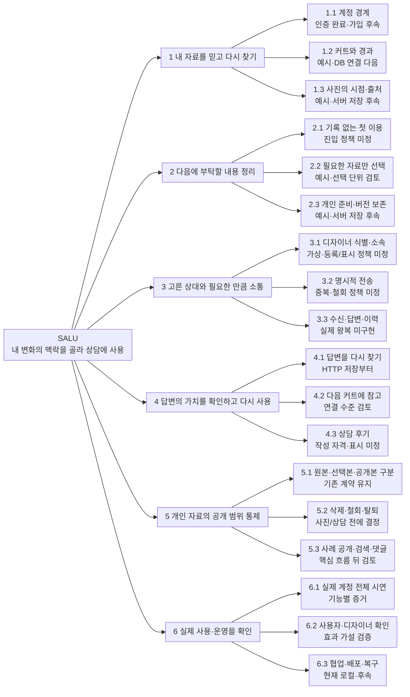
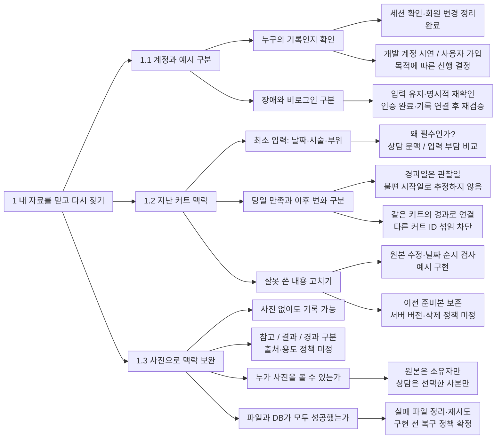
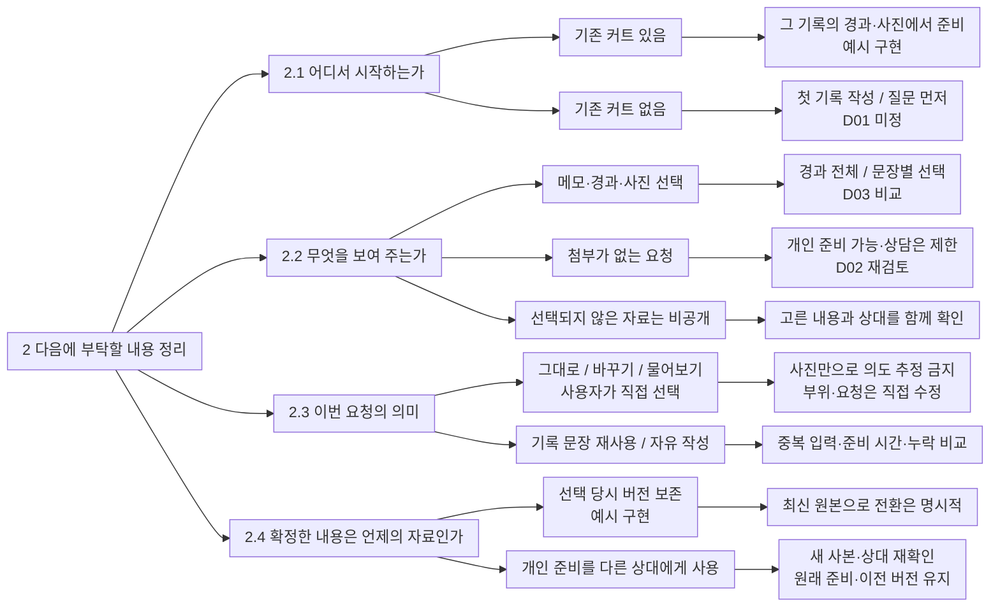
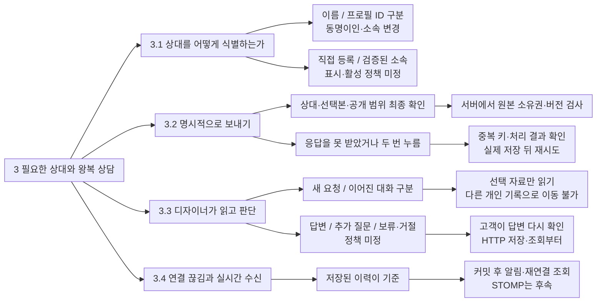
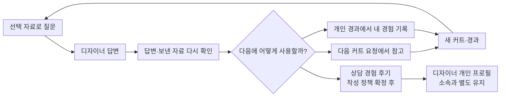

# SALU 개발계획 확장 검토안

> 당시 계획·승인 범위·검증 근거를 보존한 기록. 현재 구현 상태는 [문서 안내](../../README.md)와 점검표 기준.

상태: 사용자 검토 초안 · 후속 구현 승인 전
작성일: 2026-10-10
현재 구현 검토: [FR01-current-state-review.md](../reviews/FR01-current-state-review.md)
현재 확정 계약: [development-contract.md](../../development-contract.md), [prototype-plan.md](../../prototype-plan.md)

후속 사용자 제안: [개인 기록·선택 연결과 7주차 발표 검토안](2026-10-10-local-records-and-week7-review.md). 첫 이용의 기록/둘러보기 선택, 로그인 없는 기기 보관, 파일 백업, 필요한 기능에서의 계정 연결을 반영한 **최신 방향 검토는 새 문서 우선**. 아래 계정 중심 저장 가지와 개발 순서는 이 제안 전의 초안이며, 자료 선택·디자이너 수신·공개 범위의 상세 검토는 공통 참고.

## 이번 검토의 방향

기존 트리는 `기반 → 기록 → 상담 → 공개·운영`과 기술 작업을 잘 나눴으나, 각 기능을 만드는 이유·사용자의 선택·미결정 정책·실패 뒤 복구·완료 근거를 가지에서 읽기 어려운 상태. 기능 개수를 늘리기보다 **사용자 문제 → 요구사항 → 기능 → 상세 행동 → 정책·대안 → 확인 근거**로 연결하는 확장안.

매니패스트의 [트리 뷰 가이드](https://docs.manyfast.io/plan/features/tree-view.md)는 요구사항·기능·상세 기능의 계층과 각 항목의 상태·수용 기준을 연결. [기능 작성 가이드](https://docs.manyfast.io/plan/quick-guide.md)는 목적에 따른 충족 기준을 먼저 정하고 기능을 세분화. 이를 SALU 문서에 적용하는 제안이며 매니패스트 계정 연결·자료 업로드·에디터 사용은 수행하지 않음.

검토한 대안:

| 접근 | 장점 | 약점 | 제안 |
|---|---|---|---|
| 기존 WBS를 기술 작업으로 더 분해 | 구현 담당·순서 파악 쉬움 | 사용자 가치와 정책 결정이 여전히 바깥에 남음 | 기능 확정 후 작업 계획에 사용 |
| 사용자 여정만 중심에 두기 | 기록이 실제 상담과 다음 커트에 쓰이는 이유 명확 | 인증·정보 보호·운영 같은 공통 조건을 놓칠 수 있음 | 전체 흐름의 중심으로 사용 |
| 사용자 여정과 결정 근거 연결 | 목적·행동·정책·검증·의존 관계를 함께 확인 | 모든 예외를 한 그림에 넣으면 읽기 어려움 | 전체 지도와 작은 상세 가지로 나누어 채택 제안 |

이 초안의 추천안·후속 수용 기준은 아직 확정 요구사항이 아님. 기존 인증·DB·사진·상담 경계와 최신 발표 방향 유지. 예약·결제·AI 추천·자동 알림 추가 제안 없음.

## 상태를 읽는 방법

- **완료**: 실제 인증과 검증된 기반
- **예시**: 메모리 기록·사진·요청 준비·미리보기. 서버 저장이나 실제 상담 아님
- **다음**: 구현 순서 후보. 아직 시작하지 않음
- **미정**: 정책·대안을 확정해야 구현 가능
- **후속**: 앞 단계의 실제 흐름이 동작한 뒤 검토
- **가설**: 사용자 편익을 검증해야 하는 설명. 입증된 효과 아님

그림의 선은 분해 관계. 구현 의존 관계와 사용자 이동은 아래 별도 흐름으로 표현. 초안의 번호는 요구사항 추적용이며 작업 완료 체크는 Obsidian `20 진행 중인 일/SALU 진행상황` 한곳에서 유지.

## 1. 전체 사고 트리

## 2. 기록을 남기는 이유까지 분해

문제 가설: 사진첩과 메모에 흩어진 지난 커트 정보를 다음 요청에서 다시 설명하기 어려움. 기록이 많아지는 것 자체를 성공으로 보지 않고, 실제 요청에서 필요한 과거 정보가 다시 쓰이는지 확인.

상세 결정과 확인:

| ID | 사용자에게 필요한 행동 | 선택 이유·대안 | 완료 판단 제안 |
|---|---|---|---|
| 1.1.1 | 자기 계정으로 이전 기록 다시 찾기 | 개발 계정은 기술 시연 가능. 가입은 외부 사용자 진입에 필요 | 새로고침·재로그인 보존, 다른 회원 접근 차단. 사용자 평가 전 가입/초대 방식 확정 |
| 1.2.1 | 지난 커트를 짧게 남기기 | 자유 메모만 두면 상담 근거 찾기 어렵고, 많은 필수 항목은 기록 부담 | 사진·매장명 없이도 저장. 실제 사용자가 날짜·부위를 무리 없이 작성하는지 관찰 |
| 1.2.2 | 며칠 뒤 변화를 같은 커트에 추가 | 관찰과 추측을 구분. 이전 커트 이후 새 커트가 있으면 어떤 기록에 붙일지 명시 | 날짜 역전·다른 커트 연결 차단, 원본 수정 후 경과 의미 유지 |
| 1.2.3 | 저장 실패 뒤 이어서 처리 | 성공 응답을 못 받은 실패와 서버 저장 실패는 다름 | 입력 유지, 성공 여부 확인 후 재시도, 중복/부분 저장 없음 |
| 1.3.1 | 사진 시점과 설명을 확인 | 현재 파일명 caption을 실제 전달 문장으로 사용하지 않음 | 사진 날짜·용도·사용자 설명 일치, 원본 파일명·경로 비노출 |
| 1.3.2 | 잘못 고른 사진 취소/삭제 | 파일은 DB 롤백으로 복구되지 않음 | 실패·취소 뒤 파일 정리, 기존 상담 사본 접근 정책까지 확인 |

## 3. 준비와 선택 공유의 깊이

문제 가설: 과거 자료 전체를 보내면 상대가 읽을 부담과 사적인 내용의 과잉 공유가 생김. 고르는 기능도 부담이므로, 적은 선택으로 필요한 맥락이 전달되는지 비교할 필요.

정책 비교:

| ID | 유지안 | 대안 | 검토 추천·아직 미확정 |
|---|---|---|---|
| D01 첫 이용 | 실제 커트 기록을 먼저 남기고 준비 | 기록 없이 질문부터 시작, 나중에 연결 | 우선 최소 과거 기록 입력의 부담을 확인. 질문 먼저는 가치가 있으면 다음 범위로 채택. 허위 기록 입력을 유도하지 않음 |
| D02 첨부 조건 | 디자이너용 준비는 최소 자료 하나 | 요청 문장만으로 상담 가능, 첨부는 선택 | 첫 이용/텍스트 커트에서 막히는지 관찰하고 결정. 변경하면 기존 수용 기준·API 초안을 함께 수정 |
| D03 선택 단위 | 경과 전체 선택, 포함 항목 명확히 표시 | 불편·손질·질문을 각각 선택 | 첫 버전은 묶음의 내용을 명확히 확인하게 하는 방식이 단순. 실제 과잉 공유 사례가 있으면 세분화 |
| D04 삭제·철회 | 원본 수정과 과거 전송본 분리 | 텍스트 이력은 보존하되 사진 접근 종료, 또는 동의한 범위 보존 | 사진·상담 단계 전에 항목별로 결정. ‘불변이니 영구 접근’으로 간주하지 않음 |

## 4. 보내는 쪽과 받는 쪽을 함께 설계

문제 가설: 준비본이 있어도 상대가 찾고 읽고 답할 수 없으면 상담으로 이어지지 않음. 디자이너에게 생기는 읽기·응답 부담도 검토 대상.

| 결정 | 필요한 이유 | 확인할 실제 장면 |
|---|---|---|
| 디자이너 등록·상태 | 누구나 임의 매장 이름을 입력한 것을 인증된 소속처럼 보이면 신뢰 문제 | 직접 등록 상태 표시, 동명이인, 소속 이동 후 기존 프로필·후기 유지 |
| 자기 자신에게 상담 | 같은 계정이 개인 기록과 디자이너 역할을 함께 가짐 | 자기 요청 허용/차단 정책 결정 후 검증 |
| 받지 못하는 상대 | 프로필 비활성·탈퇴·요청 수신 중단 | 전송 전 상태 확인, 기존 대화 접근·답변 가능 범위 결정 |
| 보류·거절·재문의 | ‘전송 성공’만으로 답변을 보장할 수 없음 | 수신함·상태 설명·사용자 재진입, 없는 답변을 성공으로 표시하지 않음 |
| 중복·동시 조작 | 전송 뒤 timeout은 처리 여부 불확실 | 같은 중복 키 재전송·다른 자료로 재사용 충돌·두 탭 수정 충돌 |
| 저장과 알림 | STOMP 전송 실패가 이미 저장한 답변을 지울 수 없음 | DB 결과 확인, 알림 실패 재조회, 중복 수신 표시 |

## 5. 답변에서 다음 사용으로 돌아오는 관계

위 그림은 제품 가치의 연결 제안. 자동 추천·답변 실행 여부 추적·행동 실험의 새 시스템을 확정한 것이 아님. 첫 버전은 상담 이력을 다시 열어 참고할 수 있는 수준으로 시작하고, 다음 커트와 명시적 관계 필드를 만들지는 사용성 확인 뒤 결정.

- 상담 후기는 실제 시술 후기와 구분. 답변을 받은 사실이 방문·시술·결과를 증명하지 않음
- 후기를 작성하지 않아도 개인 기록과 상담 이력을 사용할 수 있어야 함
- 디자이너 소속이 바뀌어도 같은 개인 ID에 후기 연결. 현재 소속과 후기 당시 맥락 표시 정책 결정
- 답변 받은 상담당 하나, 작성자·수정·삭제·탈퇴 이후 표시 정책은 후기 구현 전에 확정

## 6. 개인정보와 운영은 모든 가지의 조건

| 사용자가 겪는 장면 | 반드시 결정/확인할 사항 | 해당 단계 |
|---|---|---|
| 잘못 고른 자료를 전송 전 제거 | 미리보기에서 실제 전달 내용 확인, 선택하지 않은 원본 접근 금지 | 준비·전송 |
| 이미 보낸 사진을 지우거나 공유 종료 | 원본 삭제와 상담 사본 접근 종료를 구분, 상대에게 남는 표시 설명 | 사진·상담 전에 결정 |
| 디자이너에게만 보여준 자료를 공개 | 상담 동의와 공개 동의 분리, 별도 공개 사본·ID | 공개 사례 |
| 게시글을 철회했는데 URL이 남음 | 공개 파일 접근·캐시 종료, 원본 소유자 접근 유지 | 공개 사례·배포 |
| 계정 변경·탈퇴·복구 | 권한 종료와 기록/대화/후기 보존 범위, 복구 여부 | 가입·해당 데이터 구현 전 |
| 브라우저 두 탭에서 수정 | 예전 버전 덮어쓰기 방지, 사용자가 선택할 회복 경로 | 실제 준비본 저장 |
| 서버가 저장 후 응답 전에 끊김 | 처리 여부 확인, 중복 키와 payload 일치 | 기록·전송 |
| 배포 후 파일/DB 백업 복구 | 두 저장소의 일관성, 비공개 파일 권한, 정상 재로그인 | 배포 |

테스트 결과·로그에는 비밀번호·token·사진 원본·상담 원문을 넣지 않음. 접근 정책의 상세 구현은 기존 Service·SecurityConfig·GlobalExceptionHandler 계약 유지.

## 7. 기기 보관 제안 전의 개발 순서와 진입 조건

아래는 최초 확장안의 순서 후보. 현재 추천 순서는 기기 저장·파일 복원 → 실제 프로필·선택본 HTTP 상담 → 비공개 서버 백업과 후속 기능이며, 7주차·8주차 시험 일정은 [최신 검토안](2026-10-10-local-records-and-week7-review.md) 참고.

| 순서 후보 | 작은 완료 흐름 | 선행 결정 | 완료 증거 |
|---|---|---|---|
| 0 기존 보완 | 날짜 기준 통일, 인증 성공 피드백 대기 개선 | 한국 업무 날짜 기준 재확인 | R01/R02 재현이 사라지고 기존 인증·화면 계약 유지 |
| 1 회원·텍스트 기록 | 계정 A 커트·경과 저장 → 재로그인 조회 → 수정 | 최소 필드, 가입/개발 계정 시연, 삭제 범위·중복 저장·날짜 | DB 실제 보존, A/B 접근 차단, 실패 rollback·중복 없음 |
| 2 개인 준비 저장 | 자기 기록 선택 → 요청 버전 생성 → 재접속 후 같은 자료 | D01/D02/D03, revision·원본 삭제와 버전 관계 | 과거 선택본 불변, 다른 계정 비노출, 충돌·재진입 |
| 3 사진·디자이너 | 비공개 사진 저장/확인, 상대 등록·현재 소속 조회 | D04, 파일 실패 정리, 등록/소속 표시 | 실제 사진 권한·복구, 명시적 프로필 ID·소속 이동 |
| 4 HTTP 왕복 상담 | 고객 선택본 전송 → 디자이너 읽기·답변 → 고객 재열람 | 수신/보류·탈퇴·자기 상담, 전송 중복·참여자 | 실제 두 계정 왕복, 세 번째 계정 차단, 미선택 자료 비노출 |
| 5 후기·필요한 실시간 수신 | 상담 후기 작성, 연결 복구 뒤 답변 조회 | 후기 자격·삭제, 실시간 필요성 | 답변 자격 검사·개인 ID 유지, 누락/중복 수신 회복 |
| 6 공개·배포 | 직접 고른 사례 공개/철회, 설치·백업·복구 | 핵심 흐름 편익 확인, 남은 기간, 공개 사본 정책 | 공개 철회·원본 비공개, 새 환경과 복구 후 전체 시연 |

개인 준비의 실제 저장을 HTTP 상담 전 선행 흐름으로 드러낸 순서 후보. 사진·프로필과 병행 가능한 부분은 기능 문서에서 조정. 기존 주차표는 발표 당시 목표로 보존하고, 결정·권한·실패 검증 시간을 확보하지 못하면 공개 기능을 줄임.

가입은 로그인 연결의 재구현이 아님. 개발 계정으로 기술 검증을 먼저 할 수 있지만 외부 사용자가 직접 진입해야 하는 시점 이전에는 가입 또는 명시적 계정 제공 방식을 정해야 함.

## 8. 기능을 늘리기 전에 확인할 가설

| 가설 | 비교·관찰 방법 | 결과에 따른 계획 변경 |
|---|---|---|
| 필요한 과거 맥락을 빠르게 찾을 수 있음 | 같은 내용의 사진첩+메모와 SALU에서 다음 요청 준비, 탐색 시간·놓친 사실 관찰 | 날짜/목록·연결 방식 우선 개선 |
| 선택한 자료가 의도를 더 정확히 전달 | 같은 사실로 일반 메시지와 선택본 비교, 디자이너의 재질문·과잉 해석 관찰 | 묶음/문장 선택·요청 구분 수정 |
| 기록·선택 입력 부담이 받아들일 만함 | 필수 값·첨부 없이 시작하려는 장면, 작성 중 포기와 이유 관찰 | 필수 항목 축소, D01/D02 대안 검토 |
| 디자이너에게도 반복 사용 가치가 있음 | 수신함에서 자료를 찾고 답변하는 장면, 읽기 부담·응답 의향 확인 | 수신·보류 흐름 개선, 고객 화면만 추가하지 않음 |
| 답변과 이전 선택본을 다시 찾음 | 후속 커트 준비에서 이전 상담을 실제로 참고하는지 확인 | 명시적 연결 필요성 판단, 자동 기능은 근거 뒤 검토 |

참가자·결과 없음. 수치 목표는 파일 개수·화면 개수로 대신하지 않고 실제 평가 조건을 정한 뒤 설정. 개발 계정 시연과 외부 사용자 편익 검증은 별개.

## 9. 확정 전에 도전할 가정

- 기록이 먼저 있어야만 가치가 생기는가? 첫 이용자를 막으면서 기존 사용자 흐름만 최적화할 가능성
- 첨부 최소 하나가 ‘맥락 있는 상담’을 보장하는가? 빈 메모를 억지로 쓰게 한다면 질문 내용 자체를 근거로 삼는 대안 필요
- 작은 자료 선택 화면이 개인정보 통제를 보장하는가? 경과 전체 선택과 공개/상담 동의를 이해하는지 별도 확인
- 상담을 보내면 답변이 오는가? 디자이너의 수신·응답 이유와 시간 부담을 확인해야 왕복 흐름을 설명할 수 있음
- 이력 불변이면 사진도 계속 볼 수 있는가? 텍스트 기록과 파일 접근·철회는 다른 정책
- 실시간과 커뮤니티가 먼저 필요한가? HTTP 왕복과 재열람에서 먼저 가치가 생긴다면 후속 범위를 줄일 수 있음

이 가정들은 ‘현재 구현 실패’가 아니라 계획을 확정하기 전에 줄일 불확실성. 기존 기록·상담 기능의 시장 유사성과 차별화 미입증 상태는 [자료 조사 목록](../reviews/2026-10-10-document-inventory.md) 유지.

## 다음 확정 절차

1. 최신 제안의 첫 이용 선택·기기 보관 방향과 7주차 시연 범위 검토
2. 사진·파일 복원·기기/계정 경계를 정하고, D01 기록 없는 질문·D02/D03 상담 조건과 기존 계약의 변경 여부 확인
3. 승인한 기능만 `feature-docs` NEW로 구현 범위·수용 기준·작업 계획 작성
4. `implement-feature`는 확정된 기능 문서와 구현 승인 뒤 시작

이번 초안은 기능 코드를 변경하거나 이후 구현을 승인한 결과가 아님. 코드 검토 결과와 계획의 추천·미정 상태를 구분해 보관.
