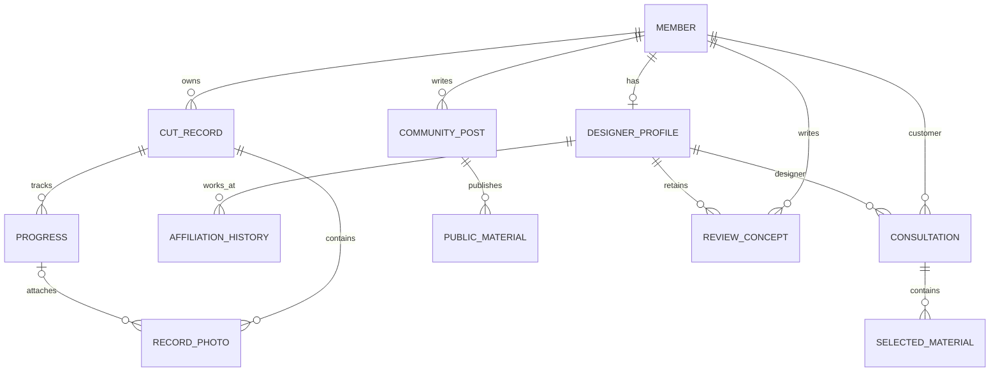

# SALU 개발 기준

현재 작업: PPT 기준 React 초기 화면과 실제 Spring 인증 연결. 기본 실행에서 로그인·회원 확인·로그아웃·CSRF는 서버 연결, 업무 기록은 메모리 예시. `dev:prototype`만 서버 호출 없는 화면 전용 모드. 기록 DB·사진 업로드·상담 전송은 후속. 개인 준비·선택 자료·전송 전 미리보기의 화면 기준은 [prototype-plan.md](prototype-plan.md), 실제 저장·전송 계획은 아래 후속 업무 구현 계약 참고.

2026-10-10 후속 제안: 로그인 없는 기기 기록·파일 백업·선택 계정 연결은 [검토안](plans/2026-10-10-local-records-and-week7-review.md)에서 검토 중. 아래 내용은 현재 코드와 서버 중심 후속 설계의 기준. 새 기기 저장 모드의 구현·수명·계정 관계는 아직 확정/구현되지 않음.

## 기술과 코드 구조

Java 17, Spring Boot 4.1.1, MyBatis Starter 4.1.0, MySQL 8.4 LTS. React 19, Vite 8, TypeScript 7, React Router 8.4.0. Maven Wrapper와 npm lockfile로 빌드 기준 고정.

하나의 Spring Boot 서버에서 `kr.salu` 아래 기능별 패키지 사용. 현재 `config`, `auth`, `member` 인증 조회, `health`, `common.error` 구현. 다음 단계에 `record`, `designer`, `consultation`, `review`, `community`, `photo` 추가. 각 기능 안에 controller·service·mapper·요청/응답 DTO 배치. 기능 코드 없이 빈 클래스를 먼저 만들지 않음.

Controller는 입력·응답, Service는 소유권·참여자 검사와 트랜잭션, MyBatis Mapper는 조회·저장 담당. DB 객체를 React에 그대로 노출하지 않고 DTO로 공개 범위를 한정. 목록·상세·사진·수정·삭제 모두 권한 검사 대상.

## 공통 예외·트랜잭션 기준

Salon의 `CLAUDE.md:47-48`, `docs/발표.md:575-591`, `docs/websocket.md:263`에서 인증 집중·예외 중앙화·롤백·외부 전송 주의사항 선별 적용. JSP·예약·결제 코드는 복사하지 않음.

공통 응답은 `ApiError(code, message)`. Security filter의 인증/CSRF 오류는 `SecurityConfig`, MVC 입력·업무·예상 밖 오류는 `GlobalExceptionHandler` 한 곳에서 처리. Controller별 catch·오류 redirect를 추가하지 않음. health의 연결 상태 응답은 기존 HealthResponse 유지.

| 오류 | HTTP / code |
|---|---|
| 필수 값·Bean Validation·깨진 JSON | 400 / INVALID_REQUEST |
| 인증 필요 | 401 / AUTHENTICATION_REQUIRED |
| 권한 거부·CSRF 실패 | 403 / ACCESS_DENIED 또는 CSRF_INVALID |
| 대상/경로 없음 | 404 / RESOURCE_NOT_FOUND |
| 요청 방식 불일치 | 405 / METHOD_NOT_ALLOWED, Allow header 유지 |
| 명시적 업무 충돌·DB 중복 key | 409 / RESOURCE_CONFLICT |
| 업로드 한도·지원하지 않는 입력 형식 | 413 / UPLOAD_TOO_LARGE, 415 / UNSUPPORTED_MEDIA_TYPE |
| 예상 밖 오류 | 500 / INTERNAL_ERROR, 고정 사용자 메시지 |

원문 예외·SQL·입력/비밀번호는 응답과 로그에 넣지 않음. 예상 밖 오류 로그는 예외 타입과 발생 위치만 기록. 모든 IllegalArgumentException을 무조건 400으로 바꾸지 않으며, 의도한 입력/업무 실패만 ApiException의 명시적 factory 사용. API DTO에는 `@Valid`와 제약 적용.

로그인은 단일 SELECT 인증이며 다중 변경 업무 Service는 아직 없음. 현재 `@Transactional` 적용 예제는 src/test의 검증용 Service. 다음 업무 Service는 아래 기준 적용.

- 여러 DB 변경을 한 작업으로 묶는 Service 메서드에 Spring `@Transactional` 적용. 조회 전용은 필요 시 `readOnly=true`
- 기본 RuntimeException/Error 롤백. checked exception도 변경을 취소해야 하면 `rollbackFor` 명시
- 같은 객체 안의 내부 호출만으로 새 트랜잭션이 생긴다고 가정하지 않음. Spring proxy를 경유하는 Service 호출로 구성
- 예외를 삼켜 성공으로 반환하거나 부분 저장을 남기지 않음. 조건부 UPDATE의 0행·중복 key는 해당 업무 실패로 처리
- 파일·외부 HTTP·STOMP 전송은 DB 롤백으로 복구되지 않음. 해당 기능 전에 커밋 후 전송·파일 정리·실패 재처리 기준 확정. outbox 등의 업무 구현은 현재 범위 밖
- 실제 검증은 테스트 자체의 @Transactional 자동 롤백을 사용하지 않고 Service 종료 후 별도 DB 조회로 commit/rollback 확인

`scripts/verify-backend.sh`는 별도 `salu_test`와 제한된 테스트 계정 사용. 회원 테이블 V1과 테스트 전용 V900만 적용. 테스트용 Controller·보안 허용 경로·Mapper·테이블은 src/test에만 배치하고 일반 jar·salu_dev에는 포함하지 않음.

## 검증 범위와 다음 단계

기존 backend를 변경할 때: 서버 빌드, MySQL·Flyway, 실제 HTTP 오류·세션·CSRF, DB 커밋/롤백·중단/복구, 일반 jar에서 테스트 코드 제외 확인. 화면 전용 gate는 frontend 빌드·브라우저 E2E·API 요청 없음. 인증 연결은 실제 Spring·DB에서 별도 test:auth 실행. backend 변경 없이는 전체 DB 기반 검증을 반복하지 않음. 기존 검증 결과는 docs/verification.md와 docs/login.md에 보관.

현재 로그인·세션·로그아웃 검증은 docs/login.md 참고. 기록 화면은 메모리 예시이며 인증은 실제 서버 연결. 이후 가입·기록 연결 → 기본 디자이너 프로필·상담 → 실시간 대화·소속 이력·상담 후기 → 공개 사례 순서로 구현. 각 기능의 소유권·참여자·동시성·파일/외부 전송 검증은 해당 기능을 구현할 때 수행. 공통 테스트 통과로 이 기능들의 완료를 주장하지 않음.


## 계정과 데이터 관계

회원 계정은 로그인과 모든 개인 기록의 소유 주체. 디자이너도 같은 계정으로 자신의 개인 기록 사용. 고객과 디자이너를 배타적인 계정 종류로 구분하지 않음. 디자이너 프로필은 계정 하나에 최대 하나 연결하고, 변경되지 않는 별도 디자이너 개인 ID 부여.



관계도는 설계 개념이며 실제 DB 테이블은 현재 `members`와 Flyway 이력만 존재. 특히 `REVIEW_CONCEPT`는 관계 표현이며 후기 테이블 정의가 아님.

| 대상 | 연결 기준 | 다음 기능 구현 시 제약 |
|---|---|---|
| 회원 | `members.id` | 이메일 trim·소문자 정규화 후 중복 검사, BCrypt hash 저장. 디자이너 권한은 프로필·검증 상태로 별도 판단 |
| 디자이너 프로필 | 고유 디자이너 ID + unique member ID | 프로필·개인 후기·상담 대상의 ID 유지. 소속 변경으로 계정이나 개인 ID 재생성 금지 |
| 소속 이력 | 디자이너 ID·매장명·시작/종료일 | 이전 소속 덮어쓰기 금지. 소속 인증과 기간 겹침 기준은 해당 기능 전에 결정 |
| 커트 | 소유 member ID + 커트 날짜 | 한 커트에 날짜별 경과 0..N 연결. 경과는 독립 소유자를 받지 않고 커트에서 소유권 도출 |
| 경과·사진 | 커트 ID, 사진의 선택적 경과 ID | 경과 사진의 커트 ID가 경과의 커트 ID와 같아야 함. 날짜 순서·사진 삭제 정책은 기록 단계에서 확정 |
| 상담 | 고객 member ID·디자이너 ID | 양쪽 참여자만 조회/발송 가능. 고객이 소유한 자료 중 명시적으로 고른 항목만 첨부 |
| 상담 선택 자료 | 상담 ID + 원본 참조 + 선택 내용 snapshot | 문장·사진의 선택 범위를 서버에서 확인. 원본 전체 목록이나 나머지 사진으로 이동할 권한 부여 금지 |
| 개인 후기 | 작성 member ID·대상 디자이너 개인 ID | 소속 변경 후 대상 유지. 첫 버전은 답변 받은 고객의 상담 후기. 작성·중복·수정/삭제 제안은 아래 계약 참고. 실제 DDL은 해당 기능 단계에 작성 |
| 커뮤니티 공개 자료 | 게시글 ID + 공개 선택본 | 원본은 비공개 유지. 공개 사진은 별도 저장본/식별자로 관리. 원본의 private URL 재사용 금지 |

처음 적용할 `V1__create_members.sql`은 ID·email·password_hash·display_name·status·생성/수정 시각만 정의. OAuth, 관리자, 휴면/탈퇴 개인정보 처리, 디자이너 검증은 필요 시 새 migration으로 추가. 이미 적용한 migration은 수정하지 않고 다음 버전으로 변경. 이메일은 MySQL unique constraint로 중복 방지하며 애플리케이션 정규화 정책과 함께 사용.

상담 첨부 snapshot은 이후 원본 수정이 이미 전송한 내용을 바꾸지 않는 기준. 선택 사진 접근은 상담 참여자 검사로 제한. 사진 삭제·동의 철회 후 기존 상담 자료의 보존/가림 정책은 사진·상담 기능 구현 전에 결정. 공개 철회는 공개 사본의 접근 종료를 포함하고 원본의 소유자 접근은 유지.

## 접근 권한

| 요청자 | 개인 기록·원본 사진 | 상담·선택 첨부 | 커뮤니티 공개본 | 프로필·후기 |
|---|---|---|---|---|
| 비로그인 | 불가 | 불가 | 공개 상태만 읽기 | 공개 상태만 읽기, 기능 구현 후 적용 |
| 기록 소유 회원 | 자신의 것만 읽기/수정/삭제 | 자신이 고객인 상담만 접근 | 자신의 게시글 작성/공개/철회 | 자기 프로필 관리, 답변 받은 상담의 후기 작성 예정 |
| 상담 대상 디자이너 | 자신의 개인 기록만 접근 | 참여 상담과 선택본만 읽기/답변 | 일반 회원과 동일 | 자신의 디자이너 프로필 관리 |
| 다른 회원/디자이너 | 불가 | 불가 | 공개 상태만 읽기 | 공개 상태만 읽기 |

디자이너 여부만으로 다른 회원의 기록 접근 허용 금지. 매장 관리자는 준비 범위에 없고 매장 소속을 상담 참여 권한으로 사용하지 않음. ID를 바꾼 상세/파일 요청, 첨부 대상 위조, 다른 상담으로 메시지 전송을 각 기능의 통합 검증에 포함.

사진은 `SALU_PHOTO_ROOT` 절대 경로에 저장. 저장 경로는 배포 폴더 밖. 파일 크기·MIME·실제 signature 검증 후 UUID 저장명 사용. 원본 파일명·경로를 공개 응답에 반환하지 않음. private/public 저장 공간과 접근 경로를 구분하고 `/upload/**` 공개 매핑을 만들지 않음. 이번 준비 단계에서 사진 저장 디렉터리를 생성하거나 업로드 API를 제공하지 않음.

## 세션·CSRF와 API 계약

인증 수단은 서버 세션과 `SALU_SESSION` cookie. HttpOnly, SameSite=Lax, 30분 세션 만료. HTTPS 배포에서는 `SALU_COOKIE_SECURE=true`. 개발은 Vite `/api` proxy, 배포는 같은 origin reverse proxy 사용. 비밀번호·세션·상담 내용 로그 출력 금지. JWT/localStorage 토큰 도입 없음.

`GET /api/csrf`로 세션 기반 masked token과 `headerName` 수신. React는 변경 요청에 받은 header/token과 세션 cookie 전송. Spring Security 기본 BREACH 보호 유지. 다음 로그인 구현 시 세션 ID 변경, 인증 성공 후 SecurityContext 저장, 로그인/로그아웃 후 token 다시 조회. 현재 로컬 로그인·로그아웃 API와 명시적으로 생성한 로컬 개발 계정 존재. 자동 생성 계정·기본 비밀번호 없음. docs/login.md 참고.

| 현재 경로/상태 | 응답 |
|---|---|
| `GET /api/health`, 200 | `status=UP`, `server=UP`, `database=UP`, UTC `checkedAt`, `message`. MyBatis `SELECT 1` 실행 |
| `GET /api/health`, 503 | `status=DEGRADED`, `server=UP`, `database=DOWN`, `code=DATABASE_UNAVAILABLE`. 접속 정보·원본 예외 제외 |
| `GET /api/csrf`, 200 | `headerName`, `token`, 필요 시 세션 cookie 발급. no-store |
| 보호 경로, 401 | JSON `code=AUTHENTICATION_REQUIRED`, `message`. 로그인 화면으로 redirect 없음 |
| CSRF 누락/불일치, 403 | JSON `code=CSRF_INVALID`, `message`. 인증 여부와 관계없이 변경 요청 CSRF 적용 |
| 권한 거부, 403 | JSON `code=ACCESS_DENIED`, `message` |

공개 허용 경로는 GET health·csrf와 POST auth/login. 로그인·로그아웃도 CSRF 적용. 회원·프로필·커뮤니티 공개 API는 구현할 때 명시적으로 허용. CSRF 유효성 검사와 인증이 모두 필요한 요청에서는 CSRF 실패가 먼저 403으로 반환될 수 있음.

DB 시작 실패는 Flyway가 서버 시작을 중단. 잘못된 schema를 정상 상태로 표시하지 않음. 시작한 뒤 DB가 중단되면 health가 503으로 응답. 서버가 실행되지 않은 경우 화면은 서버 연결 실패/DB 확인 불가 표시. 환경변수 누락과 DB 오류의 구체적 원인은 서버 로그에서 확인.

## Salon에서 선별 이식할 목록

원본 저장소: `../Salon`. 다음 경로는 Salon 기준. 해당 기능 단계에서 로직을 옮기고 Spring Boot 4·React 요청/응답에 맞춰 검토. 로그인은 BCrypt/principal ID 구조를 재구현했고 기존 업무 전체를 복사하지 않음. 재점검 결과와 이식 제외 사항은 salon-security-audit.md 참고.

| 영역 | 원본 파일 | 참고할 로직 | 제거/변경할 의존성 |
|---|---|---|---|
| 회원 | `src/main/java/com/soldesk/controller/UserController.java`, `src/main/java/com/soldesk/service/UserService.java`, `src/main/resources/mapper/UserMapper.xml` | BCrypt, 이메일 회원 조회, 입력 검증 | 회원가입 평문 비밀번호 debug 출력 제거, JSP·쿠폰·점주 요청·포인트 제거 |
| 로그인 | `src/main/java/com/soldesk/config/SecurityConfig.java`, `src/main/java/com/soldesk/security/UserDetailService.java`, `src/main/java/com/soldesk/security/CustomUserDetails.java` | 세션 principal 식별 | role를 디자이너 프로필 권한과 분리, 전역 CSRF 적용, JSON 401/403, React 응답 |
| 사진 | `src/main/java/com/soldesk/service/CapstoneCardService.java`, `src/main/java/com/soldesk/controller/CapstoneCardController.java`, `src/main/java/com/soldesk/service/FileService.java` | signature/크기 검증, UUID 파일, 소유자 범위 조회 | 공개 `/upload/**` 제거, 비공개/공개본 저장과 전달 경로 분리, 외부 영구 저장 경로 |
| 커트·경과 | `src/main/java/com/soldesk/service/CapstoneRecordService.java`, `src/main/resources/mapper/CapstoneRecordMapper.xml` | 커트-경과 관계, 소유자가 포함된 조회·수정 | SALU member ID와 DTO에 맞춤. 기존 SQL·공유 링크 모델 일괄 복사 금지 |
| 상담 | `src/main/java/com/soldesk/service/CapstoneConsultationService.java`, `src/main/resources/mapper/CapstoneConsultationMapper.xml` | HTTP 상담 참여자 조회·메시지 저장 | 기존 Stylists·Salons·매장 영업/승인 상태 join을 디자이너 개인 ID로 변경 |
| STOMP | `src/main/java/com/soldesk/handler/StompAuthChannelInterceptor.java`, `src/main/java/com/soldesk/ws/WebSocketConfig.java`, `src/main/java/com/soldesk/service/ChatService.java` | CONNECT 세션 인증과 서비스 참여자 검사 | 기존 채팅 room·매장 관계 제거, 허용 origin 한정, SUBSCRIBE와 SEND 모두 상담 참여자 검사 |
| 후기 | `src/main/java/com/soldesk/service/ReviewService.java`, `src/main/resources/mapper/ReviewMapper.xml` | 내용/평점 검증과 조회 패턴 | 예약·매장·포인트 의존 제거, 개인 디자이너 ID 연결. 작성 자격 확정 전 테이블 이식 금지 |
| 커뮤니티 | `src/main/java/com/soldesk/controller/CommunityController.java`, `src/main/java/com/soldesk/service/PostServiceImpl.java` | 작성자 확인, 게시글·댓글 처리 | JSP view·일반 공개 파일 처리 제거, 선택 공개 snapshot과 React DTO 연결 |

Salon Capstone 상담은 HTTP REST이며 STOMP는 별도 채팅 구현. 두 경로를 이미 통합된 상담 기능으로 간주하지 않음. 원본 `sql/schema.sql`은 기존 `salu`를 삭제/재생성하므로 실행·복사 금지. 원본 `properties/*.properties`, 초기 SQL, 기존 화면 초안도 SALU에 복사하지 않음.

예약·결제·쿠폰·포인트·AI와 Salon 전면 리팩터링은 이번 범위 밖.

## 이후 순서와 검증

아래 후속 업무 구현 계약의 단계·완료 기준 사용. 실제 서버 기반 검증과 초기 화면 검증은 분리. 업무 기능은 DB·권한·브라우저 연결을 확인한 뒤 완료 표시.

## 확인한 공식 기준

- [Spring Boot 요구사항](https://docs.spring.io/spring-boot/system-requirements.html): 4.1.1과 Java 17
- [MyBatis 4.1.0 릴리스](https://github.com/mybatis/spring-boot-starter/releases/tag/mybatis-spring-boot-4.1.0): Boot 4.1 기반
- [Spring Boot DB 초기화](https://docs.spring.io/spring-boot/how-to/data-initialization.html): Flyway starter와 MySQL 모듈, 단일 migration 도구
- [Spring Security CSRF](https://docs.spring.io/spring-security/reference/servlet/exploits/csrf.html): 세션·masked token, 인증 후 token 갱신
- [Vite 시작하기](https://vite.dev/guide/): 지원 Node 버전
- [MySQL 일반 바이너리 설치](https://dev.mysql.com/doc/refman/8.4/en/binary-installation.html): 별도 datadir와 시스템 라이브러리

## 후속 업무 구현 계약

아래 내용은 실제 저장·전송 단계의 제안 설계. 현재 `members` 외 업무 테이블·아래 API는 미구현. 초기 화면 계약은 [prototype-plan.md](prototype-plan.md)에 분리.

### 단계와 완료 기준

| 단계 | 구현 | 완료 기준 |
|---|---|---|
| 1. 회원·기록 연결 | 로그인 연결 완료. 가입, 커트·경과·사진 후속 | 재접속 후 보존, 다른 회원의 ID/파일 접근 차단 |
| 2. 디자이너·상담 | 프로필·현재 소속, 명시적 첨부, 요청·HTTP 답변·이력 | 두 실제 계정이 선택한 자료로 상담, 제3자 접근 차단 |
| 3. 상담 후속 | WebSocket/STOMP, 소속 이력, 상담 후기 | 메시지 저장 후 전송, 이동 후 개인 ID·후기 유지 |
| 4. 공개 사례 | 선택 공개 게시글·댓글·검색 | 비공개 원본 분리, 공개 철회·삭제 확인 |
| 5. 통합·배포 | 실제 사용자 흐름·오류 개선·시연 | 기능별 증거, 백업·배포·복구 절차 검증 |

주차를 채우려고 미구현 기능을 완료로 표시하지 않음. 각 단계는 화면+서버+DB를 함께 연결. 계획 변경은 PR에서 문서와 함께 기록.

### 후속 DB 초안

실행 SQL이 아닌 논리 필드 계약. V1 수정 없이 단계마다 새 Flyway migration 작성. 공통 ID는 BIGINT, 신규 업무 JSON에서는 문자열로 전달해 JavaScript 정수 범위 문제 방지. 기존 auth 회원 ID의 숫자 응답은 유지하고 후속 HTTP adapter에서 문자열로 정규화. 날짜는 DATE/ISO 날짜, 오늘의 업무 기준은 Asia/Seoul. 생성·변경 시각은 UTC로 저장.

| 대상 | 주요 필드·관계 | 제약 |
|---|---|---|
| `members` 추가 | 기존 id/email/hash/name/status + 후속 가입 처리 | 인증 주체는 세션 principal. client memberId/role 신뢰 금지 |
| `cut_records` | id, owner_member_id, cut_date, service, good_note, optional salon/designer/price, nullable recorded_designer_profile_id, timestamps | 날짜 오늘 이하, 가격 nonnegative, 삭제·변경 소유자 검사. 프로필 단계에서 연결 필드 추가 |
| `cut_record_areas` | cut_id, area | cut+area unique, 정해진 부위 code |
| `progress_entries` | id, cut_id, observed_on, discomfort, styling, question, timestamps | 커트일 이상·오늘 이하, 소유자는 cut에서 도출 |
| `progress_areas` | progress_id, area | 중복 부위 방지 |
| `record_photos` | id, cut_id, nullable progress_id, storage_key, MIME, bytes, status | 경과와 커트 일치, storage key 외부 비노출 |
| `designer_profiles` | id, unique member_id, name, introduction, specialties, visibility | 소속과 독립한 개인 ID 유지. 본인만 수정 |
| `designer_affiliations` | id, designer_id, salon_name, location, starts_on, ends_on | 현재 소속 하나, 변경 시 이전 기간 종료. 첫 단계는 직접 등록·미인증 표시 |
| `consultations` | id, customer_member_id, designer_id, source_cut_id, status, created_at | 프로필 활성 상태 확인, 고객·디자이너만 접근 |
| `consultation_materials` | id, consultation_id, kind, source_id, snapshot_json, photo_copy_key | 명시적 선택 범위 검증. 원본 기록 전체 반환 금지 |
| `consultation_requests` | id, consultation_id, area, intent, content, sort_order | KEEP/CHANGE/ASK 중 하나, 내용 필수 |
| `consultation_messages` | id, consultation_id, sender_member_id, content, client_message_id, sent_at | 참여자 검사, consultation+sender+clientMessageId unique |
| `designer_reviews` | id, consultation_id unique, designer_id, author_member_id, content, status | 첫 버전은 답변 받은 고객의 상담 후기. 시술 후기·랭킹 제외 |
| 공개 게시글·댓글 | owner, 공개 선택 snapshot, 공개 상태, timestamps | 상담 내용 자동 공개 금지. 원본 private 파일 URL 재사용 금지 |

사진의 cut_id/progress_id 일치는 Service 검사와 복합 FK 가능한 구조로 확인. 디자이너가 일반 개인 기록도 남길 수 있으므로 회원을 고객/디자이너 배타적 종류로 나누지 않음.

### 개인 준비본의 후속 저장

초기 화면에서 디자이너 없이 준비 가능하도록 흐름 확장. 실제 `consultations.designer_id`는 필수 유지하고 개인 준비를 상담 row로 저장하지 않음. 아래는 서버 연결 단계의 제안이며 현재 테이블·API 없음.

| 대상 | 제안 | 기준 |
|---|---|---|
| `request_preparations` | owner_member_id, source_cut_id, optional target_designer_id, form_json, revision, timestamps | 소유자만 초안 조회·변경. 선택 원본 ID·요청 문장 저장, client owner 무시 |
| `prepared_request_versions` | preparation_id, snapshot_json, created_at | 생성 시 원본 소유권·선택 범위 검사. 버전 불변, 개인 사진은 owner만 접근 |
| 상담 전환 | 준비 버전과 designerId를 명시적으로 선택하여 새 상담 생성 | 원본 준비와 이전 상담 유지. 상담 참여자에게 허용한 내용만 복사 |

제안 경로: GET/POST `/api/preparations`, GET/PATCH `/api/preparations/{id}`, POST `/api/preparations/{id}/versions`. 소유권·CSRF 적용. 변경 충돌은 revision으로 검사하고 구버전을 덮어쓰지 않음. 실제 전송은 POST `/api/consultations`에 명시적 designerId와 preparedVersionId를 전달하는 경로로 연결할 계획. 서버는 버전의 소유권을 확인하고 보관된 선택본을 상담 전용 사본으로 복사. 현재 원본을 자동 재조회하거나 client snapshot을 그대로 신뢰하지 않음. 기존 원본 ID·선택 자료 방식과 버전 방식은 요청에서 동시 사용하지 않음. 전송 없는 프로필 선택만으로 상담을 생성하지 않음.

개인 준비는 첨부 없이 요청 문장부터 작성 가능. 실제 상담으로 전환할 때 designerId·선택 자료·원본 소유권을 검사. 프론트의 UUID 초안 ID·referencePreviewId·blob URL을 서버 ID/파일 key로 그대로 저장하지 않음.

### 화면 타입과 서버 요청

초기 화면의 `RecordPhoto.url`은 로컬 파일/임시 blob 주소. 후속 서버는 사진 ID·서버 제공 접근 경로·caption·date만 반환. blob URL과 가상 ID는 서버 저장 데이터가 아님. `DesignerProfile`의 가상 후기는 서버 후기 응답으로 교체. 목업 사진 caption은 로컬 파일명이며 실제 전송 전에 사용자가 작성한 설명/서버 기본 설명으로 분리. HTTP adapter에서 로컬 파일명을 caption으로 자동 전송하지 않음.

| 예정 경로 | 입력·응답 | 검사 |
|---|---|---|
| POST `/api/members` | email/password/displayName → 공개 회원 DTO, 201 | 이메일 정규화·중복·입력 검증·CSRF |
| GET/POST `/api/records` | 페이지 목록 / cutDate·service·areas·goodNote·선택 정보 → 기록 DTO | owner는 principal, client owner 무시 |
| GET/PATCH/DELETE `/api/records/{id}` | 상세+경과 / 변경 필드 / 삭제 | 매 요청 소유자 검사 |
| POST `/api/records/{id}/progress` | observedOn·areas·discomfort·styling·question → 경과 DTO, 201 | 소유자·날짜·한 내용 이상 |
| PATCH `/api/records/{id}/progress/{progressId}` | 관찰 날짜·부위·문장 수정 → 경과 DTO | cut 소유자·경과 소속·날짜 검사. 이전 선택본 불변 |
| POST `/api/records/{id}/photos` | multipart file·caption·optional progressId → photo DTO, 201 | 소유자·크기·signature·경과 연결 |
| GET/DELETE `/api/records/{id}/photos/{photoId}` | 인증 파일 전달 / 삭제 | 사진과 커트 연결·소유자 검사 |
| GET `/api/designers`, GET `/api/designers/{id}` | 공개 프로필·현재 소속·상담 후기 | 비공개/탈퇴 프로필 제외, 민감 회원 정보 제외 |
| POST/PATCH `/api/designers/me` | 소개·분야·소속 → 본인 프로필 | principal→프로필 연결, 본인만 변경 |
| POST `/api/consultations` | designerId + (preparedVersionId 또는 cutId·선택 ID·요청 문장) → 상담 DTO, 201 | 모든 source ID 소유권·같은 cut, 선택본 복사 |
| GET `/api/consultations`, GET `/api/consultations/{id}` | 참여 상담 목록 / 선택 자료·요청·메시지 | 양쪽 참여자. designer role만으로 허용 금지 |
| POST `/api/consultations/{id}/messages` | content·clientMessageId → 저장된 message DTO | 참여자·중복 전송 확인·저장 성공 후 알림 |
| POST `/api/consultations/{id}/reviews` | content → 상담 후기, 201 | 고객 principal, 디자이너 답변 존재, 상담당 한 후기 |

목록 조회는 기본 page=0,size=20,max=50, 최신 순. 표의 API는 외부 제공 목적이 아니라 React 화면이 Spring 서버에 저장·조회·전송을 요청하는 내부 인터페이스.

상담 요청 예시:

```json
{
  "designerId": "42",
  "cutId": "105",
  "materials": { "includeGoodNote": true, "progressIds": ["207"], "photoIds": ["310"] },
  "requests": [{ "area": "SIDE", "intent": "ASK", "content": "옆머리 아래와 위 길이를 어떻게 나누면 좋을까요?" }],
  "homeStyling": "드라이만 합니다",
  "additionalQuestion": ""
}
```

서버에서 memberId, source 원문, 공개용 URL을 받아 그대로 저장하지 않음. 선택 ID를 검사하고 해당 시점 내용으로 snapshot 생성. 오류는 기존 ApiError 계약 사용. 존재하지 않거나 본인 소유가 아닌 비공개 자원은 404로 응답하고 원본 존재 노출 제한.


기록 수정 때 같은 커트의 경과보다 커트일이 늦어지지 않도록 검사. 경과 생성/수정과 커트 날짜 수정은 같은 부모 커트 row를 먼저 잠그고 순서 검사와 변경을 하나의 트랜잭션으로 수행할 계획. 동시 요청 사이의 날짜 역전도 서버 통합 검증 대상. 화면 검증을 서버 검증으로 대체하지 않음.

담당 프로필 연결은 nullable ID로 직접 선택. 이름 검색 결과를 자동 연결하지 않고, 존재·공개 상태를 서버에서 확인. 기록 당시 매장명/담당자 표시와 현재 프로필 소속은 별개. 프로필 테이블을 구현하는 단계에 연결 migration 추가. 원본 날짜/메모/부위 수정은 이미 만든 준비 버전·상담 snapshot을 갱신하지 않음.

후속 화면 순서: 로그인·가입/내 기록 실제 저장 → 프로필·상담 요청·답변 대기/추가 질문/이력 → 답변 받은 상담의 후기 작성 → 공개 선택본·검색. 서버 로딩·실패·재시도·빈 목록을 각 단계에서 구현. 가상 화면을 실제 전송/답변 상태로 자동 바꾸지 않음.

### 사진·snapshot·철회

- 첫 사진 범위: JPEG/PNG/WebP, 장당 5 MiB, 한 기록/경과 생성 요청당 최대 6장. MIME·magic bytes·실제 decode 결과 함께 검사. 서버가 브라우저 검사를 반복
- 저장 key UUID, private 디렉터리와 DB 상태 `PENDING/READY/DELETING`로 실패 정리. 원본 파일명·EXIF를 공개하지 않고 업로드 때 메타데이터 제거
- 파일은 staging에 먼저 기록. DB 작업 실패 시 staging 정리, DB commit 후 확정 이동. 이동 실패 시 READY로 표시하지 않고 재처리. 재처리 작업과 고아 파일 정리는 사진 단계 완료 조건
- 커트와 경과 원문 수정은 이미 만든 상담 snapshot을 변경하지 않음. 선택 사진은 상담 전용 비공개 사본으로 보관하고 원본 파일 삭제와 독립
- 공유 철회는 해당 선택 자료·사진의 접근을 종료하고 `철회된 자료` 상태만 남김. 고객 원본은 유지. 활성 공유 링크가 있다면 revoke 즉시 신규 조회 차단
- 공개 사례는 별도 동의와 공개 사본 사용. 상담 참여 허용이 커뮤니티 공개 동의가 되지 않음
- 보관 기간·탈퇴·개인정보 삭제는 실제 공개 배포 전 확정·문서화할 운영 조건. 초기 화면 완료로 처리하지 않음

### 프로필·후기·실시간 대화

소속은 디자이너가 직접 등록. 매장 인증 완료로 표현하지 않음. 소속이 바뀌어도 프로필·상담·후기의 designer ID 유지. 기본 프로필과 상담을 먼저 연결한 뒤 소속 이력과 후기를 구현.

첫 후기 범위는 상담 답변을 받은 고객의 텍스트 후기. 상담당 하나, 본인 후기 수정·삭제 가능. 예약 없는 서비스이므로 방문·시술을 인증한 후기라고 주장하지 않음. 평점 순위·추천 알고리즘·시술 인증은 후속 검토.

첫 상담은 HTTP로 저장·조회하고 WebSocket은 후속 추가. STOMP CONNECT에 세션·CSRF, SUBSCRIBE·SEND에 상담 참여자 검사. 메시지를 DB에 확정한 뒤 이벤트 발행. DB rollback으로 전송이 취소된다고 가정하지 않음. 재연결은 마지막 message ID 이후 조회, 전송 중복은 clientMessageId로 방지. HTTP와 STOMP가 같은 Service 규칙 사용.

### 단계별 검증·이전

1. 가상 repository 계약을 HTTP adapter에 연결. 응답 로딩·실패·재시도 추가. 메모리 가상 기록 자동 업로드 금지
2. `salu_test` fixture에서 Flyway 최초 적용/재실행, unique/FK/date, 저장 후 재조회와 트랜잭션 실패 확인
3. 실제 고객 두 명·디자이너 한 명으로 타인 ID·사진·상담·메시지 접근 차단. 소속 변경 후 후기 대상 유지 확인
4. 기록/선택 자료/후기 수정·삭제·공유 철회와 파일 실패 복구 확인. 기존 세션·CSRF 기준 유지
5. 모바일에서 로그인부터 상담 답변·후기까지 실제 저장 흐름 확인. 이때 초안 캡처와 구현 결과를 구분해 발표

### Git·CI·배포 준비

- 원격 기본안: 비공개 `8192KB/SALU`, main 보호와 PR 검토. 박도율·장용찬의 GitHub 계정을 확인한 뒤 최소 권한 초대
- 기능 단위 브랜치와 작업 범위 합의. 같은 화면/Service를 동시 수정하지 않고 타입·인터페이스를 먼저 PR에서 합의
- PR 기본 gate: frontend npm ci/build/화면 전용 E2E. 인증 연결 변경은 실제 Spring·등록된 테스트 계정으로 test:auth 추가. 백엔드 변경 PR에는 Java 17 Maven verify와 독립 MySQL 통합 검증 추가. 실제 DB 검증 skip을 통과로 기록하지 않음
- `.env.example`만 공유. DB·회원 fixture·사진·비밀번호·운영 로그 제외. CI secret은 환경별 분리
- 컨테이너는 후속 단계에 web(Nginx+React dist), backend(JRE17+jar), MySQL 구성. 개발도 같은 Docker Compose 경로를 마련하고 호스트별 MySQL 스크립트는 대체 경로로 정리
- 배포 기본안: cwsn NAS, `salu.doyul.dev`, 기존 Nginx Proxy Manager 사용. 실제 확인한 proxy network `nginx-proxy-manager_default`에 SALU web만 연결. backend/DB는 SALU 전용 내부 network
- GHCR 이미지에 commit SHA 태그. CI 이미지 생성과 실제 배포 분리, 첫 배포는 검토 후 수동. SPA 경로는 index.html로 fallback, 같은 origin `/api` proxy, HTTPS cookie Secure, STOMP 연결 추가 때 Upgrade header 적용
- SALU 전용 DB/photo volume·백업 사용. 기존 Nextcloud·DB·proxy 컨테이너와 volume 변경 금지
- 게시 전 공유 범위·DNS/TLS·환경변수·migration·사진 경로·backup/restore 확인. 이전 SHA 이미지로 앱 복구하고 DB schema 호환성은 migration 단위로 확인. 적용 migration 삭제/수정으로 rollback하지 않음

현재 완료는 로컬 초기 화면과 Spring 인증 연결·계획 문서까지. 원격 생성·초대·CI·Docker 앱 구성·DNS·실제 배포는 각 단계에서 실행·검증한 뒤 완료로 기록.
