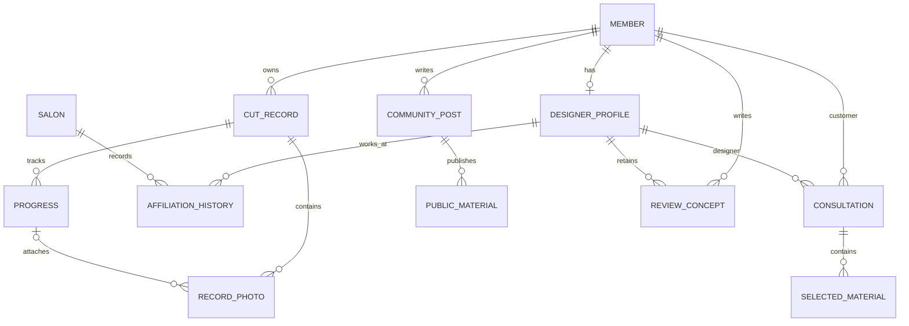

# SALU 개발 기준

준비 단계: 별도 저장소·Spring Boot·React·독립 MySQL·Flyway·권한 기반. 로컬 로그인·세션 조회·로그아웃까지 구현. 회원가입과 기록 기능은 다음 단계.

## 기술과 코드 구조

Java 17, Spring Boot 4.1.1, MyBatis Starter 4.1.0, MySQL 8.4 LTS. React 19, Vite 8, TypeScript 7. Maven Wrapper와 npm lockfile로 빌드 기준 고정.

하나의 Spring Boot 서버에서 `kr.salu` 아래 기능별 패키지 사용. 현재 `config`, `auth`, `member` 인증 조회, `health`, `common.error` 구현. 다음 단계에 `record`, `designer`, `consultation`, `review`, `community`, `photo` 추가. 각 기능 안에 controller·service·mapper·요청/응답 DTO 배치. 기능 코드 없이 빈 클래스를 먼저 만들지 않음.

Controller는 입력·응답, Service는 소유권·참여자 검사와 트랜잭션, MyBatis Mapper는 조회·저장 담당. DB 객체를 React에 그대로 노출하지 않고 DTO로 공개 범위를 한정. 목록·상세·사진·수정·삭제 모두 권한 검사 대상.

## 공통 예외·트랜잭션 기준

Salon의 `CLAUDE.md:47-48`, `docs/발표.md:575-591`, `docs/websocket.md:263`에서 인증 집중·예외 중앙화·롤백·외부 전송 주의사항 선별 적용. JSP·예약·결제 코드는 복사하지 않음.

공통 응답은 `ApiError(code, message)`. Security filter의 인증/CSRF 오류는 `SecurityConfig`, MVC 입력·업무·예상 밖 오류는 `GlobalExceptionHandler` 한 곳에서 처리. Controller별 catch·오류 redirect를 추가하지 않음. health의 연결 상태 응답은 기존 HealthResponse 유지.

| 오류 | HTTP / code |
|---|---|
| 필수 값·Bean Validation·깨진 JSON | 400 / INVALID_REQUEST |
| 인증 필요 | 401 / AUTHENTICATION_REQUIRED |
| 권한 거부·CSRF 실패 | 403 / ACCESS_DENIED 또는 CSRF_INVALID |
| 대상/경로 없음 | 404 / RESOURCE_NOT_FOUND |
| 요청 방식 불일치 | 405 / METHOD_NOT_ALLOWED, Allow header 유지 |
| 명시적 업무 충돌·DB 중복 key | 409 / RESOURCE_CONFLICT |
| 업로드 한도·지원하지 않는 입력 형식 | 413 / UPLOAD_TOO_LARGE, 415 / UNSUPPORTED_MEDIA_TYPE |
| 예상 밖 오류 | 500 / INTERNAL_ERROR, 고정 사용자 메시지 |

원문 예외·SQL·입력/비밀번호는 응답과 로그에 넣지 않음. 예상 밖 오류 로그는 예외 타입과 발생 위치만 기록. 모든 IllegalArgumentException을 무조건 400으로 바꾸지 않으며, 의도한 입력/업무 실패만 ApiException의 명시적 factory 사용. API DTO에는 `@Valid`와 제약 적용.

로그인은 단일 SELECT 인증이며 다중 변경 업무 Service는 아직 없음. 현재 `@Transactional` 적용 예제는 src/test의 검증용 Service. 다음 업무 Service는 아래 기준 적용.

- 여러 DB 변경을 한 작업으로 묶는 Service 메서드에 Spring `@Transactional` 적용. 조회 전용은 필요 시 `readOnly=true`
- 기본 RuntimeException/Error 롤백. checked exception도 변경을 취소해야 하면 `rollbackFor` 명시
- 같은 객체 안의 내부 호출만으로 새 트랜잭션이 생긴다고 가정하지 않음. Spring proxy를 경유하는 Service 호출로 구성
- 예외를 삼켜 성공으로 반환하거나 부분 저장을 남기지 않음. 조건부 UPDATE의 0행·중복 key는 해당 업무 실패로 처리
- 파일·외부 HTTP·STOMP 전송은 DB 롤백으로 복구되지 않음. 해당 기능 전에 커밋 후 전송·파일 정리·실패 재처리 기준 확정. outbox 등의 업무 구현은 현재 범위 밖
- 실제 검증은 테스트 자체의 @Transactional 자동 롤백을 사용하지 않고 Service 종료 후 별도 DB 조회로 commit/rollback 확인

`scripts/verify-backend.sh`는 별도 `salu_test`와 제한된 테스트 계정 사용. 회원 테이블 V1과 테스트 전용 V900만 적용. 테스트용 Controller·보안 허용 경로·Mapper·테이블은 src/test에만 배치하고 일반 jar·salu_dev에는 포함하지 않음.

## 지금 실행해서 확인할 것과 다음 단계

지금 필수: 서버·React 빌드, MySQL 연결, Flyway 최초/재실행, 기본 오류의 실제 HTTP 상태/JSON, 세션·CSRF, MyBatis 변경의 실제 커밋/롤백, DB 중단/복구와 브라우저 상태·재시도, 일반 jar에서 테스트 코드 제외 확인.

현재 로그인·세션·로그아웃 검증은 docs/login.md 참고. 다음 단계: 회원가입과 실제 다중 변경 회원 Service 검증. 이후 기록·사진·디자이너·상담·후기·커뮤니티를 원래 순서대로 구현. 각 기능의 소유권·참여자·동시성·파일/외부 전송 검증은 해당 기능을 구현할 때 수행. 공통 테스트 통과로 이 기능들의 완료를 주장하지 않음.

## 계정과 데이터 관계

회원 계정은 로그인과 모든 개인 기록의 소유 주체. 디자이너도 같은 계정으로 자신의 개인 기록 사용. 고객과 디자이너를 배타적인 계정 종류로 구분하지 않음. 디자이너 프로필은 계정 하나에 최대 하나 연결하고, 변경되지 않는 별도 디자이너 개인 ID 부여.

관계도는 설계 개념이며 실제 DB 테이블은 현재 `members`와 Flyway 이력만 존재. 특히 `REVIEW_CONCEPT`는 관계 표현이며 후기 테이블 정의가 아님.

| 대상 | 연결 기준 | 다음 기능 구현 시 제약 |
|---|---|---|
| 회원 | `members.id` | 이메일 trim·소문자 정규화 후 중복 검사, BCrypt hash 저장. 디자이너 권한은 프로필·검증 상태로 별도 판단 |
| 디자이너 프로필 | 고유 디자이너 ID + unique member ID | 프로필·개인 후기·상담 대상의 ID 유지. 소속 변경으로 계정이나 개인 ID 재생성 금지 |
| 소속 이력 | 디자이너 ID·매장 ID·시작/종료일 | 이전 소속 덮어쓰기 금지. 소속 인증과 기간 겹침 기준은 해당 기능 전에 결정 |
| 커트 | 소유 member ID + 커트 날짜 | 한 커트에 날짜별 경과 0..N 연결. 경과는 독립 소유자를 받지 않고 커트에서 소유권 도출 |
| 경과·사진 | 커트 ID, 사진의 선택적 경과 ID | 경과 사진의 커트 ID가 경과의 커트 ID와 같아야 함. 날짜 순서·사진 삭제 정책은 기록 단계에서 확정 |
| 상담 | 고객 member ID·디자이너 ID | 양쪽 참여자만 조회/발송 가능. 고객이 소유한 자료 중 명시적으로 고른 항목만 첨부 |
| 상담 선택 자료 | 상담 ID + 원본 참조 + 선택 내용 snapshot | 문장·사진의 선택 범위를 서버에서 확인. 원본 전체 목록이나 나머지 사진으로 이동할 권한 부여 금지 |
| 개인 후기 | 작성 member ID·대상 디자이너 개인 ID | 소속 변경 후 대상 유지. 상담 후기/시술 후기 구분, 작성 자격·증빙·중복·수정/삭제 정책은 구현 전 결정. 현 단계 DDL 작성 금지 |
| 커뮤니티 공개 자료 | 게시글 ID + 공개 선택본 | 원본은 비공개 유지. 공개 사진은 별도 저장본/식별자로 관리. 원본의 private URL 재사용 금지 |

처음 적용할 `V1__create_members.sql`은 ID·email·password_hash·display_name·status·생성/수정 시각만 정의. OAuth, 관리자, 휴면/탈퇴 개인정보 처리, 디자이너 검증은 필요 시 새 migration으로 추가. 이미 적용한 migration은 수정하지 않고 다음 버전으로 변경. 이메일은 MySQL unique constraint로 중복 방지하며 애플리케이션 정규화 정책과 함께 사용.

상담 첨부 snapshot은 이후 원본 수정이 이미 전송한 내용을 바꾸지 않는 기준. 선택 사진 접근은 상담 참여자 검사로 제한. 사진 삭제·동의 철회 후 기존 상담 자료의 보존/가림 정책은 사진·상담 기능 구현 전에 결정. 공개 철회는 공개 사본의 접근 종료를 포함하고 원본의 소유자 접근은 유지.

## 접근 권한

| 요청자 | 개인 기록·원본 사진 | 상담·선택 첨부 | 커뮤니티 공개본 | 프로필·후기 |
|---|---|---|---|---|
| 비로그인 | 불가 | 불가 | 공개 상태만 읽기 | 공개 상태만 읽기, 기능 구현 후 적용 |
| 기록 소유 회원 | 자신의 것만 읽기/수정/삭제 | 자신이 고객인 상담만 접근 | 자신의 게시글 작성/공개/철회 | 자기 프로필 관리, 후기 작성 조건은 미확정 |
| 상담 대상 디자이너 | 자신의 개인 기록만 접근 | 참여 상담과 선택본만 읽기/답변 | 일반 회원과 동일 | 자신의 디자이너 프로필 관리 |
| 다른 회원/디자이너 | 불가 | 불가 | 공개 상태만 읽기 | 공개 상태만 읽기 |

디자이너 여부만으로 다른 회원의 기록 접근 허용 금지. 매장 관리자는 준비 범위에 없고 매장 소속을 상담 참여 권한으로 사용하지 않음. ID를 바꾼 상세/파일 요청, 첨부 대상 위조, 다른 상담으로 메시지 전송을 각 기능의 통합 검증에 포함.

사진은 `SALU_PHOTO_ROOT` 절대 경로에 저장. 저장 경로는 배포 폴더 밖. 파일 크기·MIME·실제 signature 검증 후 UUID 저장명 사용. 원본 파일명·경로를 공개 응답에 반환하지 않음. private/public 저장 공간과 접근 경로를 구분하고 `/upload/**` 공개 매핑을 만들지 않음. 이번 준비 단계에서 사진 저장 디렉터리를 생성하거나 업로드 API를 제공하지 않음.

## 세션·CSRF와 API 계약

인증 수단은 서버 세션과 `SALU_SESSION` cookie. HttpOnly, SameSite=Lax, 30분 세션 만료. HTTPS 배포에서는 `SALU_COOKIE_SECURE=true`. 개발은 Vite `/api` proxy, 배포는 같은 origin reverse proxy 사용. 비밀번호·세션·상담 내용 로그 출력 금지. JWT/localStorage 토큰 도입 없음.

`GET /api/csrf`로 세션 기반 masked token과 `headerName` 수신. React는 변경 요청에 받은 header/token과 세션 cookie 전송. Spring Security 기본 BREACH 보호 유지. 다음 로그인 구현 시 세션 ID 변경, 인증 성공 후 SecurityContext 저장, 로그인/로그아웃 후 token 다시 조회. 현재 로컬 로그인·로그아웃 API와 명시적으로 생성한 로컬 개발 계정 존재. 자동 생성 계정·기본 비밀번호 없음. docs/login.md 참고.

| 현재 경로/상태 | 응답 |
|---|---|
| `GET /api/health`, 200 | `status=UP`, `server=UP`, `database=UP`, UTC `checkedAt`, `message`. MyBatis `SELECT 1` 실행 |
| `GET /api/health`, 503 | `status=DEGRADED`, `server=UP`, `database=DOWN`, `code=DATABASE_UNAVAILABLE`. 접속 정보·원본 예외 제외 |
| `GET /api/csrf`, 200 | `headerName`, `token`, 필요 시 세션 cookie 발급. no-store |
| 보호 경로, 401 | JSON `code=AUTHENTICATION_REQUIRED`, `message`. 로그인 화면으로 redirect 없음 |
| CSRF 누락/불일치, 403 | JSON `code=CSRF_INVALID`, `message`. 인증 여부와 관계없이 변경 요청 CSRF 적용 |
| 권한 거부, 403 | JSON `code=ACCESS_DENIED`, `message` |

공개 허용 경로는 GET health·csrf와 POST auth/login. 로그인·로그아웃도 CSRF 적용. 회원·프로필·커뮤니티 공개 API는 구현할 때 명시적으로 허용. CSRF 유효성 검사와 인증이 모두 필요한 요청에서는 CSRF 실패가 먼저 403으로 반환될 수 있음.

DB 시작 실패는 Flyway가 서버 시작을 중단. 잘못된 schema를 정상 상태로 표시하지 않음. 시작한 뒤 DB가 중단되면 health가 503으로 응답. 서버가 실행되지 않은 경우 화면은 서버 연결 실패/DB 확인 불가 표시. 환경변수 누락과 DB 오류의 구체적 원인은 서버 로그에서 확인.

## Salon에서 선별 이식할 목록

원본 저장소: `../Salon`. 다음 경로는 Salon 기준. 해당 기능 단계에서 로직을 옮기고 Spring Boot 4·React 요청/응답에 맞춰 검토. 로그인은 BCrypt/principal ID 구조를 재구현했고 기존 업무 전체를 복사하지 않음. 재점검 결과와 이식 제외 사항은 salon-security-audit.md 참고.

| 영역 | 원본 파일 | 참고할 로직 | 제거/변경할 의존성 |
|---|---|---|---|
| 회원 | `src/main/java/com/soldesk/controller/UserController.java`, `src/main/java/com/soldesk/service/UserService.java`, `src/main/resources/mapper/UserMapper.xml` | BCrypt, 이메일 회원 조회, 입력 검증 | 회원가입 평문 비밀번호 debug 출력 제거, JSP·쿠폰·점주 요청·포인트 제거 |
| 로그인 | `src/main/java/com/soldesk/config/SecurityConfig.java`, `src/main/java/com/soldesk/security/UserDetailService.java`, `src/main/java/com/soldesk/security/CustomUserDetails.java` | 세션 principal 식별 | role를 디자이너 프로필 권한과 분리, 전역 CSRF 적용, JSON 401/403, React 응답 |
| 사진 | `src/main/java/com/soldesk/service/CapstoneCardService.java`, `src/main/java/com/soldesk/controller/CapstoneCardController.java`, `src/main/java/com/soldesk/service/FileService.java` | signature/크기 검증, UUID 파일, 소유자 범위 조회 | 공개 `/upload/**` 제거, 비공개/공개본 저장과 전달 경로 분리, 외부 영구 저장 경로 |
| 커트·경과 | `src/main/java/com/soldesk/service/CapstoneRecordService.java`, `src/main/resources/mapper/CapstoneRecordMapper.xml` | 커트-경과 관계, 소유자가 포함된 조회·수정 | SALU member ID와 DTO에 맞춤. 기존 SQL·공유 링크 모델 일괄 복사 금지 |
| 상담 | `src/main/java/com/soldesk/service/CapstoneConsultationService.java`, `src/main/resources/mapper/CapstoneConsultationMapper.xml` | HTTP 상담 참여자 조회·메시지 저장 | 기존 Stylists·Salons·매장 영업/승인 상태 join을 디자이너 개인 ID로 변경 |
| STOMP | `src/main/java/com/soldesk/handler/StompAuthChannelInterceptor.java`, `src/main/java/com/soldesk/ws/WebSocketConfig.java`, `src/main/java/com/soldesk/service/ChatService.java` | CONNECT 세션 인증과 서비스 참여자 검사 | 기존 채팅 room·매장 관계 제거, 허용 origin 한정, SUBSCRIBE와 SEND 모두 상담 참여자 검사 |
| 후기 | `src/main/java/com/soldesk/service/ReviewService.java`, `src/main/resources/mapper/ReviewMapper.xml` | 내용/평점 검증과 조회 패턴 | 예약·매장·포인트 의존 제거, 개인 디자이너 ID 연결. 작성 자격 확정 전 테이블 이식 금지 |
| 커뮤니티 | `src/main/java/com/soldesk/controller/CommunityController.java`, `src/main/java/com/soldesk/service/PostServiceImpl.java` | 작성자 확인, 게시글·댓글 처리 | JSP view·일반 공개 파일 처리 제거, 선택 공개 snapshot과 React DTO 연결 |

Salon Capstone 상담은 HTTP REST이며 STOMP는 별도 채팅 구현. 두 경로를 이미 통합된 상담 기능으로 간주하지 않음. 원본 `sql/schema.sql`은 기존 `salu`를 삭제/재생성하므로 실행·복사 금지. 원본 `properties/*.properties`, 초기 SQL, 기존 화면 초안도 SALU에 복사하지 않음.

예약·결제·쿠폰·포인트·AI와 Salon 전면 리팩터링은 이번 범위 밖.

## 이후 순서와 검증

1. 회원·권한: 가입/로그인/로그아웃 화면과 API, BCrypt 저장, 중복 가입, 세션 ID 변경, CSRF 재발급 검증
2. 커트·경과·사진: 기록 화면과 API, 다른 고객의 ID/사진 접근 차단, 소유권 위조·파일 검증
3. 디자이너·소속: 고정 개인 ID, 개인 기록 사용, 소속 이력과 검증 정책 확정
4. 선택 자료 상담: 고객·디자이너 화면, HTTP/STOMP 참여자 검사, 선택하지 않은 원본 노출 차단
5. 개인 후기: 작성 자격 확정 후 DDL·화면·API, 소속 변경 후 후기 유지 검증
6. 커뮤니티: 공개/철회·검색·댓글 화면과 API, 비공개 원본 노출 차단

매 단계에서 화면과 백엔드를 연결한 실제 요구 검증으로 완료 판단. 준비 단계의 테스트는 인프라·오류 처리·CSRF·연결 표시 범위.

## 확인한 공식 기준

- [Spring Boot 요구사항](https://docs.spring.io/spring-boot/system-requirements.html): 4.1.1과 Java 17
- [MyBatis 4.1.0 릴리스](https://github.com/mybatis/spring-boot-starter/releases/tag/mybatis-spring-boot-4.1.0): Boot 4.1 기반
- [Spring Boot DB 초기화](https://docs.spring.io/spring-boot/how-to/data-initialization.html): Flyway starter와 MySQL 모듈, 단일 migration 도구
- [Spring Security CSRF](https://docs.spring.io/spring-security/reference/servlet/exploits/csrf.html): 세션·masked token, 인증 후 token 갱신
- [Vite 시작하기](https://vite.dev/guide/): 지원 Node 버전
- [MySQL 일반 바이너리 설치](https://dev.mysql.com/doc/refman/8.4/en/binary-installation.html): 별도 datadir와 시스템 라이브러리
