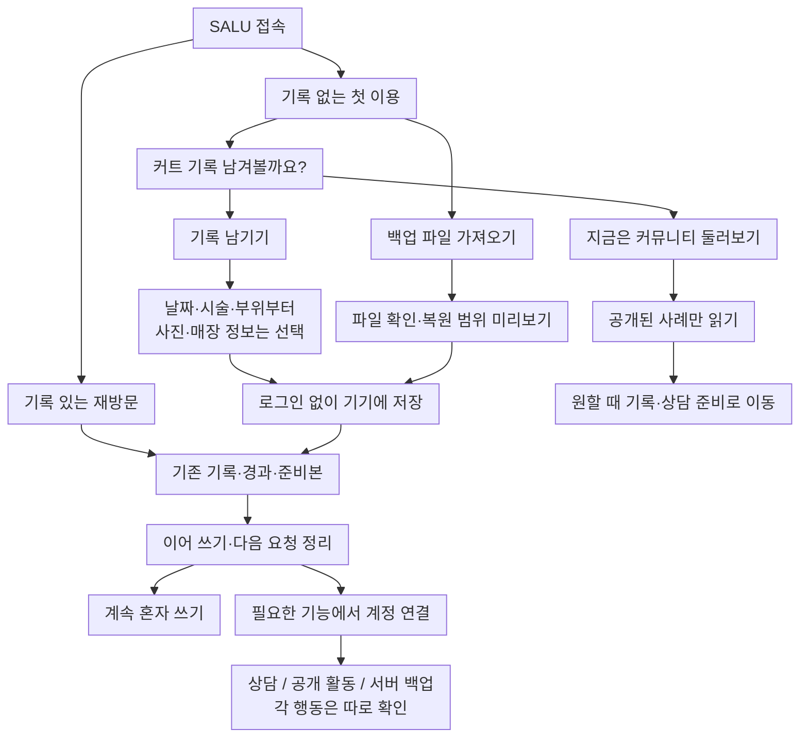
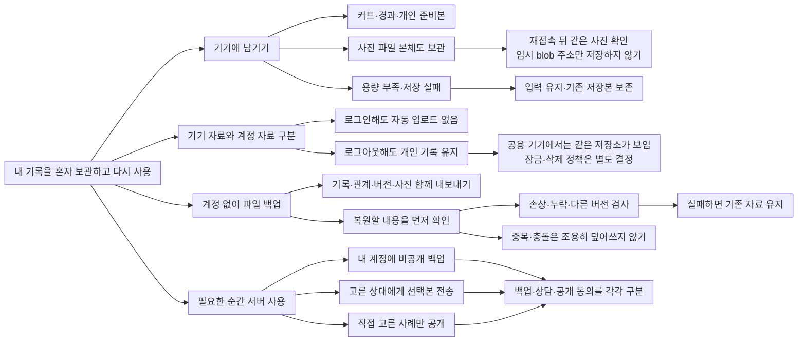
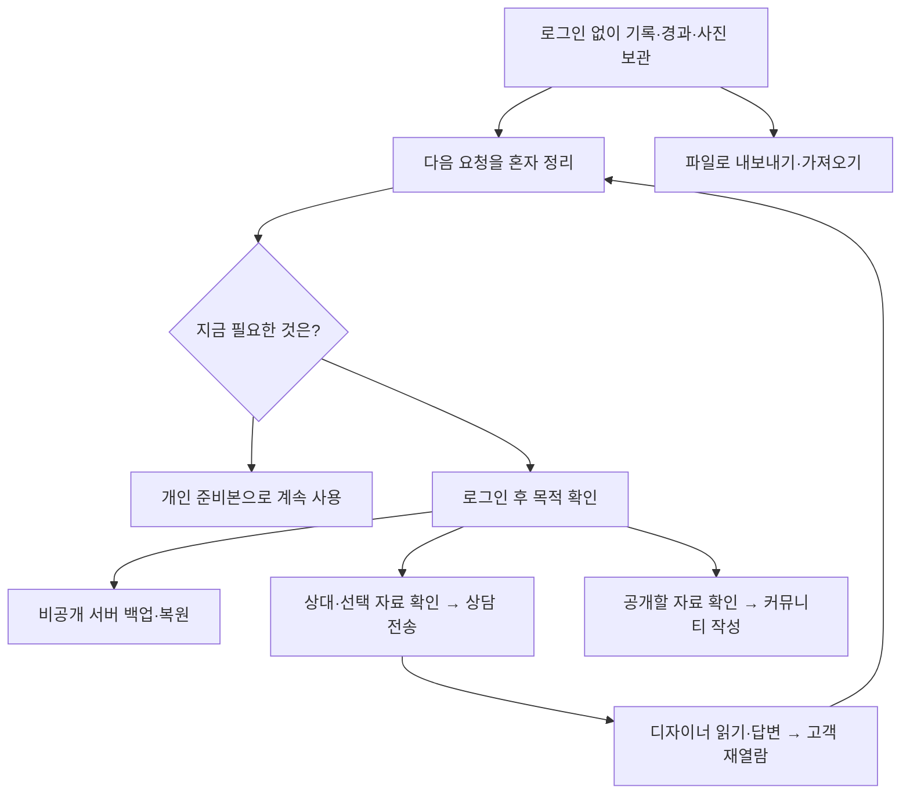

# SALU 개인 기록·선택 연결과 7주차 발표 검토안

상태: 사용자 제안 반영 초안 · 기능 구현 전 · 발표 범위 확정 전
작성일: 2026-10-10
근거: 사용자 제안, 실제 `6주차_캡스톤발표.pptx`, [현재 구현 검토](../features/FR01-current-state-review.md)

## 제안 방향

처음에는 “커트 기록 남겨볼까요?”로 시작하고, 기록 작성·커뮤니티 둘러보기·기존 백업 가져오기를 선택. 개인 기록과 이번 요청 준비는 로그인 없이 기기에 보관. 상담 전송·커뮤니티 작성·서버 백업이 필요한 시점에 계정을 연결하고, 해당 행동에 쓸 자료를 직접 확인.

혼자 쓰는 경로도 완결된 사용 방식. 계정 연결을 끝까지 하지 않아도 기록·경과·사진·개인 준비본·파일 백업을 이용하는 방향. 재방문 때는 첫 제안을 반복하기보다 기존 기록과 이어 쓰던 준비본부터 표시.

이것은 제품의 장기 방향. 7주차 최소 범위는 텍스트 기록부터이며, 사진과 파일 복원은 실제 보관·복원 검증까지 끝난 경우에만 시연. 백업 화면에도 현재 포함되는 자료 범위를 표시해야 함.

제품의 중심은 **기록한 맥락을 필요한 만큼 골라 다음 요청과 디자이너 상담에 사용**하는 것. 개인 저장은 진입 부담을 줄이는 방법이며, 6주차 피드백의 ‘개인 일기에 치우침’을 다시 강화하지 않도록 상담 연결도 함께 설명.

현재는 실제 Spring 인증과 메모리 예시 화면만 구현. 기기 영구 저장·백업/복원·첫 진입 선택·커뮤니티 열람은 아직 없음. 아래 흐름과 완료 기준은 검증할 목표이며 실행 결과가 아님.

## 플랫폼 대안과 추천

| 방식 | 얻는 것 | 추가로 해결할 것 | 판단 |
|---|---|---|---|
| 현재 React 웹에서 저장 흐름부터 검증, 필요하면 PWA | 기존 화면을 사용해 7주차에 한 흐름을 검증 가능 | 브라우저 저장 공간·삭제, 오프라인 시작은 별도 준비 | **7주차 추천 범위. 사용자의 웹/앱 선택은 아직 미확정** |
| React 화면을 포함한 Capacitor 앱 | 화면 재사용, 앱 전용 DB·파일 저장과 기기 기능 연결 가능 | 실제 기기의 DB·사진·파일 선택·쿠키/CSRF·앱 업데이트 검증 | 개인 보관이 핵심이면 후속 앱 후보 |
| 별도 네이티브 앱 | 플랫폼 저장·보안·기기 기능을 직접 구성 가능 | 화면 재작성과 OS별 빌드·배포·검증 부담 | 현재 발표 일정에서는 우선순위 낮음 |

앱 후보는 웹 화면을 설치 파일에 포함하고 필요한 서버 API를 호출하는 구조. Capacitor의 외부 사이트 `server.url` 로딩은 공식 문서에서 개발용 live reload 목적이며 운영용으로 권장하지 않음. 따라서 사이트 주소만 불러오는 방식으로 오프라인 개인 기록까지 완성됐다고 볼 수 없음. [Capacitor 설정](https://capacitorjs.com/docs/config)

웹에서는 IndexedDB 같은 저장소를 사용할 수 있으나 기본 보관은 best-effort. 영구 저장 요청도 브라우저가 거절할 수 있고 사용자가 사이트 데이터를 지우면 없어짐. 다른 주소·포트·브라우저의 저장소는 자동 연결되지 않으므로, 발표와 배포 주소를 바꾸는 경우에도 파일 이동 경로 필요. [MDN 저장 기준](https://developer.mozilla.org/en-US/docs/Web/API/Storage_API/Storage_quotas_and_eviction_criteria)

설치형 앱의 핵심 기록은 WebView 저장소만 믿기보다 네이티브 DB와 앱 파일 저장소를 검토. Capacitor Preferences는 작은 설정용이고 대량 기록·조회에는 SQLite 등의 선택지가 있음. 플러그인 선정·암호화·키 복구·OS 자동 백업 범위는 앱 단계에서 결정. [Capacitor 저장 가이드](https://capacitorjs.com/docs/guides/storage)

## 1. 첫 이용과 재방문 트리

둘러보기는 회원가입 안내를 반복하는 막다른 화면이 되지 않아야 함. 다만 실제 공개 게시글 API와 데이터가 없으므로, 7주차에 이 진입점을 만든다면 ‘예시 둘러보기’ 또는 실제 빈 상태로 명시. 쓰기·댓글·검색·신고 전체를 첫 진입 화면과 함께 앞당기지 않음.

기록 없이 질문을 먼저 보내는 정책은 별도 D01/D02 결정. ‘기록을 건너뛰어 둘러보기’ 제안만으로 첨부 없는 실제 상담까지 승인된 것은 아님.

## 2. 기기 보관을 깊게 분해한 트리

여기서 ‘기기 보관’은 계정 로그인 상태와 별개인 개인 보관함의 제안. 기기의 접근 권한이 곧 계정별 접근 차단은 아님. 반면 서버의 백업·상담·공개 자료는 세션 회원과 참여자 기준으로 관리하며 계정 전환 시 이전 계정의 비공개 서버 자료가 남지 않도록 분리.

## 3. 개인 사용에서 연결 기능으로 넘어가는 흐름

비공개 백업·상담 첨부·공개 사례는 서로 다른 서버 사본과 접근 범위. 로그인이나 백업 동의만으로 나머지 행동을 실행하지 않음. 상담을 하려는 사용자에게 전체 기록 백업부터 강요하지 않는 방향.

## 기존 구현과 충돌하는 부분

| 현재 기준 | 새 방향에서 필요한 변경 | 유지할 경계 |
|---|---|---|
| 업무 자료는 `PrototypeRepository`의 메모리 예시 | 실제 기기 저장 adapter와 빈 첫 이용 추가 | 예시 자료를 실제 개인 자료로 자동 저장·이관하지 않음 |
| 로그인·로그아웃·회원 변경 때 `memoryEpoch`로 예시 전체 교체 | 기기 보관함의 수명을 로그인과 분리 | 이전 계정의 서버 비공개 자료와 임시 인증 정보는 정리 |
| 최초 `/me` 확인이 화면 진입을 기다리게 함 | 개인 기록은 인증 서버 응답 없이 열기 | 서버 동작은 확인된 인증·CSRF를 사용 |
| 사진은 임시 object URL, 새로고침 뒤 초기화 | 사진 본체와 연결 정보를 실제 저장 | 원문 파일 경로·임시 URL을 백업 파일에 넣어 복원했다고 주장하지 않음 |
| 개인 기록의 주체가 모두 서버 회원인 설계 | 기기 자료와 서버 회원 소유 사본의 관계 재정의 | 서버 memberId/role은 요청 값 대신 principal에서 도출 |
| 상담 첨부는 서버 원본 ID의 소유권을 확인하는 초안 | 백업하지 않은 기기 자료도 명시적으로 선택 전송할 수 있는 경로 | 로컬 ID를 서버 소유권 증거로 신뢰하지 않고 입력·파일·참여자 검사 |
| 목업을 영구 저장소에 넣지 않는 화면 검증 | 실제 저장 모드의 검증을 별도로 추가 | 기존 예시/인증 검증을 기기 저장·상담 검증으로 확대하지 않음 |

서버 사진 업로드는 DB 롤백만으로 복구되지 않음. 상담 선택본 전송도 파일 실패 정리·저장 중복·커밋 후 응답/알림 기준을 먼저 정해야 함. 기기 저장을 도입해도 기존 Spring 공통 오류·Service 소유권/트랜잭션·CSRF 계약 유지.

## 저장·복원에서 먼저 정할 정책

| 장면 | 추천 기준 | 아직 확정할 부분 |
|---|---|---|
| 백업 파일 만들기 | 기록·경과·준비본의 관계와 실제 사진 포함, 형식 버전 명시 | 파일 형식·용량 한도, 암호화와 키 복구 |
| 파일 가져오기 | 자료 개수와 복원 범위 확인 후 진행. 검사 실패는 현재 자료를 바꾸지 않음 | 중복 건너뛰기/별도 사본/교체 선택. 첫 버전은 조용한 병합 금지 |
| 계정 연결 중 취소·실패 | 기록·선택 자료·초안을 그대로 남기고 개인 사용으로 복귀 | 인증 복귀 주소와 임시 서버 업로드 정리 |
| 서버에 백업한 뒤 기기에서 수정 | 마지막 백업 시각을 보여주고 사용자가 새 백업을 명시적으로 실행 | 백업 버전·복원 범위. 다중 기기 자동 동기화는 별도 기능 |
| 기기의 기록 삭제 | 삭제 범위와 파일 백업 상태 확인 | 서버 백업·상담 사본·공개 사본은 각각 별도 삭제/철회 |
| 개인 자료를 서버로 전송 | 사용자가 만든 입력으로 검증, 인증된 회원의 업로드 파일만 연결 | 시술·디자이너 출처가 확인된 기록처럼 표현하지 않음 |
| 완전 오프라인 재시작 | 화면 파일까지 기기에 있어야 실행 가능 | PWA 캐시·업데이트 또는 앱 번들. 기기 DB 구현만으로 완료 처리 금지 |
| ‘기기에만 보관’ 안내 | SALU 서버 자동 전송 없음으로 정확히 설명 | 앱의 OS 자동 백업 포함 여부. 비밀값·세션·CSRF는 파일 백업 대상 제외 |

7주차 최소 복원 시연은 **빈 보관함에 파일을 가져와 같은 기록·경과·사진을 다시 여는 것**. 자료가 있는 보관함의 충돌 정책도 정해야 실제 제공 가능하며, 결정이 안 됐다면 교체/병합 기능을 완료했다고 표시하지 않음.

## PPT와 현재 구현 대조

대상: [실제 6주차 발표본](</home/chuwe/Documents/Nextcloud Files/학교/4학년/캡스톤/6주차_캡스톤발표.pptx>). `6주차_준비`의 수정본과 구분. 현재 폴더에 7주차 발표본은 없음.

| PPT | 발표의 약속 | 현재 구현 | 추가 확인/개발 |
|---|---|---|---|
| 2장 피드백 | 레퍼런스 명확화, 개인 기록에서 소통으로 연결 | 기록에서 자료 선택·상담 준비로 이동 | 실제 디자이너가 받는 화면과 답변까지 연결 |
| 4장 핵심 흐름 01 | 커트·경과를 상담 자료로 묶기 | 입력·수정·선택·불변 미리보기는 메모리 예시 | 기기 저장·재열람·파일 복원은 새 제안, 미구현 |
| 4장 핵심 흐름 02, 5장 | 디자이너 프로필에서 상대 선택 | 가상 목록·프로필, 명시적 프로필 ID 연결 | 실제 등록·조회·소속·수신 가능 상태 |
| 4장 핵심 흐름 03, 7~8장 | 선택 자료로 1:1 질문·답변·이력 | 전송 전 준비·미리보기만 구현 | 실제 전송·수신·답변·재접속 이력, 제3자 차단 |
| 4장 핵심 흐름 04 | 상담 후기·선택 공개 | 후기 가상 표시 | 작성 자격·공개 사본·철회·커뮤니티 저장 |
| 6장 기록과 경과 | 당일과 이후 변화를 같은 커트에 연결 | 예시 생성·수정과 날짜 검사 | 실제 저장, 시간대 차이 R01 보완, 재접속 |
| 9장 우선순위 | 계정/기록/기본 프로필/상담 먼저, 최소 커뮤니티 후속 | 실제 인증 완료, 업무 흐름은 예시 | 진입용 둘러보기와 본격 커뮤니티 개발을 구분 |
| 12장 다음 주·완료 기준 | 커트·경과 저장·조회, 재로그인 유지, 타인 접근 차단 | 실제 로그인 완료, 기록 DB 미구현 | 기기 저장 선행으로 순서 변경 설명. DB·권한 약속은 후속에 남김 |

판정: **PPT의 고객 준비 화면은 상당 부분 클릭 가능하지만, 실제 개인 기록 보존과 두 사람의 왕복 상담은 아직 완성되지 않음.** 기기 저장으로 기존 PPT의 회원별 DB 저장·타인 서버 접근 차단까지 완료했다고 설명할 수 없음.

## 흐름 검증은 지금부터 두 번

먼저 현재 예시 화면으로 진입·선택·이동의 막힘을 확인하고 기획을 확정. 저장을 연결한 뒤에는 실제 데이터와 서버 경계까지 다시 검증. 모든 기능을 만든 뒤 처음 흐름을 확인하지 않음.

| 확인할 시나리오 | 기대 결과 | 현재 증거 |
|---|---|---|
| 기록 없는 첫 진입 → 작성/둘러보기 | 강제 로그인·허위 기록 없이 원하는 경로 선택 | 새 화면 미구현 |
| 비로그인 커트 → 같은 커트 경과 → 재시작 | 실제 입력한 날짜·문장·사진 유지 | 메모리 예시 입력만 검증, 보존 미구현 |
| 저장 실패·용량 부족 | 성공 표시 없음, 입력과 기존 자료 보존 | 기기 저장 실패 검증 없음 |
| 파일 내보내기 → 빈 보관함에 복원 | 관계·사진·준비본 버전이 일치 | 미구현 |
| 손상 파일·사진 누락·중복 파일 | 적용 전에 설명, 기존 자료 보존, 중복 정책대로 처리 | 미구현 |
| 로그인 취소/실패·로그아웃·계정 전환 | 기기 기록 유지, 이전 계정 서버 자료 비노출 | 현재는 예시 초기화 계약 검증. 새 경계 미검증 |
| 선택 자료 → 상대 지정 → 미리보기 | 미선택 자료 제외, 원본 수정 뒤 과거 선택본 유지 | 메모리 예시 검증 완료 |
| 두 실제 계정 질문·답변 → 재접속 | 선택본과 답변만 참여자가 열람, 제3자 차단 | 미구현 |
| 공개 선택 → 공개 철회 | 비로그인 읽기는 공개 상태만, 원본은 계속 비공개 | 미구현 |

현재 검증 기록은 [FR01](../features/FR01-current-state-review.md): 화면 44개·실제 인증 9개·백엔드 기반 21개 통과. 저장·백업·커뮤니티·상담 표의 미구현 행을 대신 검증한 결과가 아님. 이번 후속 작업은 문서 검토이며 제품 테스트 재실행 없음.

## 7주차 발표 범위 추천

주차 정보: 사용자 확인상 다음은 7주차 발표, 8주차는 시험으로 발표 없음. 정확한 발표일·시험일은 확인 전이며 기존 PPT의 날짜별 개발 기간과 발표 주차를 같은 것으로 단정하지 않음.

추천 필수 목표는 **현재 React 웹에서 로그인 없이 텍스트 커트·경과를 남기고 다시 접속해 확인한 뒤, 같은 기록에서 상담 준비로 이어가기**. 파일 백업/복원은 제품 방향에 포함하되 7주차 추가 목표로 분리. 일정 추정은 아직 하지 않았으므로 확정 기능 문서에서 작업량 확인 필요.

| 우선순위 | 7주차 목표 | 보여줄 증거 |
|---|---|---|
| 필수 1 | 첫 진입 제안·건너뛰기·빈 기록 시작 | 예시가 없는 상태에서 작성, 둘러보기 경로는 예시/빈 상태 명시 |
| 필수 2 | 기기 커트·경과 저장·조회·수정 | 새로고침·브라우저 종료/재접속 뒤 동일 내용 |
| 필수 3 | 기존 자료 선택·개인 준비·상대 선택·미리보기로 연결 | 새 기능을 넓히지 않고 같은 기록에서 기존 준비 흐름으로 연결. 실제 전송 전임을 표시 |
| 저장의 필수 조건 | 인증과 개인 보관 수명 분리 | 로그인/로그아웃으로 기기 기록 소실 없음, 자동 서버 업로드 없음. 서버 계정별 자료 검증은 별도 |
| 추가 목표 | 파일 내보내기·가져오기 | 별도 빈 보관함에서 복원, 손상 파일은 기존 자료 유지. 복원 전이면 백업 기능 완성으로 설명하지 않음 |
| 추가 목표 | 사진의 실제 기기 저장·복원 | 사진 본체의 재열람/복원까지 통과하면 포함. 못 끝내면 텍스트 범위로 발표 |
| 후속 | 실제 상담·서버 백업·커뮤니티 작성·설치형 앱 | 7주차에 완료 약속을 추가하지 않고 후속 순서 설명 |

사진 기능을 시연에 넣으면 사진 보관을 실제 확인하고, 파일 백업도 제공한다면 사진을 포함해야 함. 기존 blob 미리보기만으로 사진 저장을 시연하지 않음. 서버 백업 완료나 설치형 앱 완성을 7주차 필수로 잡지 않는 추천안. 필수 흐름의 저장 검증이 밀리면 추가 목표를 뒤로 미룸.

발표 구성은 4장 안팎:

1. **왜 순서를 바꿨는가**: 기록 시작 때 가입 부담을 줄이고, 원할 때 상담·공유·서버 백업을 연결. 6주차의 DB 저장 약속은 기기 저장 다음으로 조정했다고 명시.
2. **한 사용 흐름**: 첫 진입 → 커트 → 경과 → 재접속 → 자료 선택 → 상담 준비. 실제 전송·프로필은 구현 상태에 맞게 표시.
3. **정말 남았는가**: 재시작 결과와 저장 실패 시 기존 기록 보존. 파일 복원은 실제 끝난 경우만 포함. 계정별 서버 권한 검증과 구분.
4. **다음 발표까지**: 8주차 시험·무발표를 일정에 반영, 이후 파일 복원·프로필·왕복 상담 연결 순서 설명.

완료했을 때만 쓸 발표 문안:

> 개인 기록은 가입 없이 기기에 남기고, 필요할 때 계정을 연결하는 방향으로 진입 흐름을 조정했습니다. 이번에는 텍스트 커트와 경과의 기기 저장과 재접속을 확인했습니다. 같은 기록에서 필요한 자료를 골라 상담 준비로 이어지며, 실제 전송과 디자이너 답변은 다음 단계입니다.

파일 복원도 끝났으면 그 결과를 추가. 끝나지 않은 경우 파일 백업·사진 보관은 후속 목표로 명시.

현재 시점의 문안:

> React의 기록·경과·자료 선택·미리보기와 실제 Spring 인증은 구현했습니다. 기록은 아직 메모리 예시이며, 다음 구현 후보는 기기 저장과 파일 복원입니다. 6주차에서 제안한 회원별 DB 저장은 이 진입 흐름을 확정한 뒤 연결할 계획입니다.

## 발표 일정과 이후 개발 후보

| 주차 | 발표 | 개발·검증 목표 후보 | 다음 단계 진입 조건 |
|---|---|---|---|
| 7주차 | 있음, 정확한 날짜 확인 전 | 텍스트 개인 저장·재접속·기존 상담 준비 연결. 파일 복원은 추가 목표 | 실제 보존 근거, 기기/계정 경계 확인 |
| 8주차 | **시험, 발표 없음** | 개발 산정에서 제외. 여유가 있을 때만 흐름/문서 확인 | 새 기능 납기 약속 없음 |
| 9주차 | 발표일 확인 전 | 남은 파일 복원 확인 → 기본 프로필·선택본 HTTP 상담 연결 착수 후보 | 목표 작업량 재추정. 왕복 완료는 두 계정과 제3자·미선택 자료 차단 검증 필요 |
| 10주차 | 발표일 확인 전 | 기록부터 답변 재열람까지 통합, 필요 시 비공개 서버 백업/복원 | 파일/DB 일관성·중복 전송·계정 전환, 백업/공유 동의 분리 |
| 11주차 이후 | 기존 일정의 재검토 대상 | 상담 후기·소속 이력 → 최소 공개 사례·사용성 → 배포·복구 | 핵심 상담이 먼저 동작. 실시간·앱 포장은 필요성과 남은 기간 보고 채택 |

8주차에 발표가 없다는 사실을 개발 여유 한 주가 생긴 것으로 계산하지 않음. 9주차는 실제 상담 연결의 착수 후보이며 왕복 완성을 약속한 일정이 아님. 백업·커뮤니티·Android/iOS 앱을 한 번에 확정하면 상담 일정이 밀릴 가능성.

이후 첫 기능 문서에서는 개인 저장·복원을 좁게 확정하고 기존 예시 모드를 보존. 다음 기능은 실제 프로필과 선택 자료로 하는 HTTP 상담. 비공개 서버 백업은 독립된 보존 기능으로 작게 시작하고 자동 동기화는 별도 검토. 공개 사례와 댓글, 상담 후기·실시간은 핵심 왕복과 재열람의 가치가 확인된 뒤 조정.

## 다음 확정에 필요한 것

사용자가 제시한 첫 진입·기기 보관·선택 로그인·수동 백업 방향은 이 초안에 반영. 확정할 범위는 7주차 웹 시연 여부, 사진을 포함할지, 파일 복원 충돌 처리, 공용 기기 접근과 계정 변경 경계. 상세 구현 계약은 그 결정 뒤 기능 문서로 작성.

현재 [development-contract.md](../development-contract.md)와 [prototype-plan.md](../prototype-plan.md)는 기존 코드의 기준. 이 초안은 변경 제안이며 기존 계약을 덮어쓰지 않음. 새 기능 승인 시 ‘회원이 모든 기록의 소유 주체’와 목업 저장 금지를 실제 기기 모드와 구분해서 함께 갱신해야 함.

## 참고

문서 확인: 관련 로컬 파일 링크·코드 블록 검사 통과. 이 검토안·최초 확장안·Obsidian 개발계획/개요의 Mermaid 18개를 11.12.0으로 구문 검사·렌더링 확인. 기능 코드와 PPT 파일은 변경하지 않았으며 기기 저장·복원의 제품 테스트 결과는 아직 없음.

- [기존 개발계획 확장 검토](2026-10-10-development-plan-review.md): 기록 선택·디자이너 수신·정책·검증의 상세 가지
- [현재 구현 검토](../features/FR01-current-state-review.md): 완료 범위와 R01/R02
- [현재 개발 계약](../development-contract.md), [초기 화면 계약](../prototype-plan.md), [실제 인증 계약](../login.md)
- [Capacitor 저장](https://capacitorjs.com/docs/guides/storage), [Capacitor 설정](https://capacitorjs.com/docs/config), [파일 API](https://capacitorjs.com/docs/apis/filesystem)
- [IndexedDB 표준](https://www.w3.org/TR/IndexedDB/): 사진 Blob/File 저장과 임시 URL의 구분
- [오프라인 웹 화면 준비](https://web.dev/articles/offline-cookbook): 앱 파일의 캐시와 개인 DB 저장은 별도
- [Android 앱 자동 백업](https://developer.android.com/identity/data/autobackup): 기기 보관 안내와 OS 백업 범위 확인
