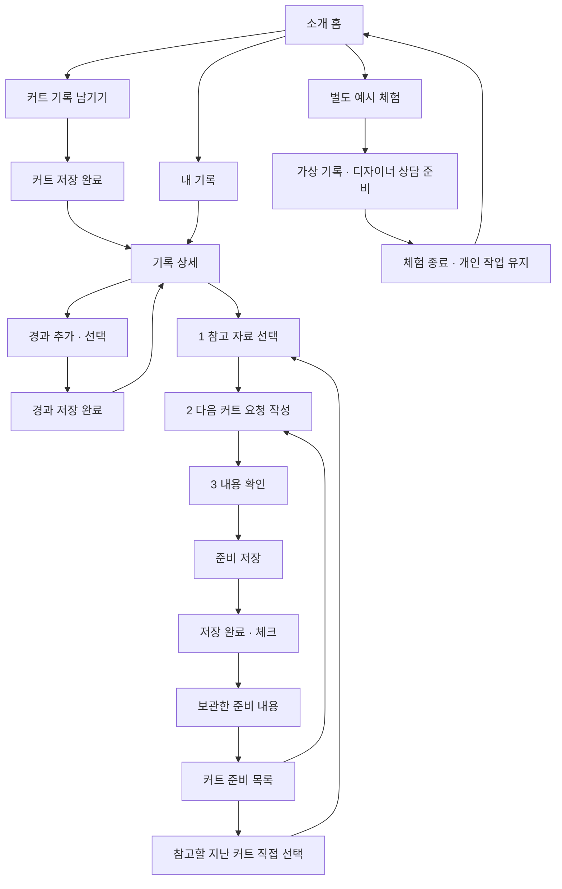

# SALU 화면 계약

2026-10-12 기준. 경로·입력·자료 선택의 현재 계약. [최신 지적사항과 검증](issue-tracker.md), [초기 구현 이력](archive/implementation/2026-10-12-prototype-history.md) 참조. 저장·인증은 각각 [저장 계약](personal-storage.md)과 [로그인](login.md) 적용.

## 현재 상태와 완료 범위

| 구분 | 상태 |
|---|---|
| 커트·경과·개인 준비·공통 저장 결과·앱 달력 | 구현, FR04 검증·NAS 반영 |
| 기기 보관·ZIP·계정 암호화 백업 | 구현, FR02 실제 저장 검증 |
| 이메일 가입·구글/네이버 연결 | 코드·설정 구현, 새 가입/외부 동의·콜백 검증 보류 |
| 자체 미용실·공개 디자이너 등록/조회/선택 | 구현, FR04 실제 API·DB 검증 |
| 도메인 기록 CRUD·상담 전송·후기·커뮤니티·앱 | 후속 |

최초 검증은 서버 없는 메모리 예시 기준. 현재 기본 실행의 로그인·회원 확인·로그아웃은 실제 Spring 사용. 기본 화면은 소개 홈과 빈 개인 기록으로 시작하며, 가상 기록·디자이너·매장·후기는 `/examples/*`에서만 제공. 개인 작성은 기기에 보관하고 로그인하면 계정 백업에 연결. 예시 체험은 메모리 전용으로 자동 이관하지 않음. `npm run dev:prototype`은 인증 호출만 생략하고 같은 홈·개인/예시 분리 흐름 제공.

## 화면 기준

- 캡스톤 `6주차_캡스톤발표.pptx`의 커트·경과 화면과 디자이너 상담 목업, 5주차 기록·선택 자료 흐름 참고
- 약한 색의 밝은 배경·독립 구역·큰 제목·주 행동 강조, 다크 모드 지원. 터치 기기는 방향과 관계없이 하단 메뉴, 데스크톱은 상단 고정. 작성 중 주 메뉴를 숨기고 한 작업에 집중
- 목업 이미지를 페이지 배경으로 붙이지 않고 입력·선택·이동을 React 컴포넌트로 구현
- 개인 화면은 기기 보관·계정 자동 저장 상태 안내. 예시 영역에만 가상 자료 표시·예시 초기화·체험 종료 제공. 로그인은 기기 자료를 계정에 연결하고 로그아웃은 계정 자료를 숨김. 서버 장애만으로 작성 내용 삭제 금지
- 개인 준비는 `다음 커트 요청 내용`, 대상을 정한 자료는 `상담 요청 미리보기`. 실제 전달·답변 완료를 주장하지 않음. 실제 로그인 연결은 login.md의 별도 검증 범위
- 주 메뉴의 다른 항목으로 이동했다가 돌아오면 해당 메뉴에서 마지막으로 보던 하위 화면·작성 내용·사진·펼친 정보·스크롤 위치를 이어 표시. 현재 선택된 메뉴를 다시 누르면 그 메뉴의 목록/첫 화면으로 이동하며 작성 초안은 유지. 목록/첫 화면에서 다시 누르면 맨 위로 이동
- 화면 보관은 현재 접속의 메뉴별 마지막 한 화면으로 제한. 로그인/계정 전환·예시 체험 진입/종료 시 화면 보관을 분리·폐기하고 자료 보관은 기존 기기/계정 계약 적용. 로그인·계정 설정·백업·인증 콜백 페이지는 화면 보관 대상에서 제외. 브라우저 뒤로/앞으로 이동도 지원
- 사진 확인·기기 저장 중 다른 메뉴로 이동해도 작업을 계속 처리. 저장 후 현재 메뉴를 강제로 바꾸지 않고, 이전 메뉴로 돌아왔을 때 저장 결과를 표시. 비활성 요청 화면은 현재 초안·작성 단계·URL을 변경하지 않음

## 고객 흐름과 화면

기록·경과 입력과 준비 작성에서는 주 메뉴를 숨기고 나가기로 초안을 보존. 커트 준비에만 3단계 안내를 적용하고, 저장 완료와 보관한 내용을 별도 화면으로 구분. 선택하지 않은 자료는 포함하지 않음. 실제 공개 프로필과 예시 영역을 분리. 실제 상담 전송·후기는 후속.

| 경로 | 화면·입력 | 이동·동작 |
|---|---|---|
| `/` | 짧은 서비스 설명, 사용 방법 | 기록 작성·내 기록·예시 체험. 인증 조회 중에도 소개 표시 |
| `/records` | 내가 남긴 커트 목록 또는 빈 상태 | 새 기록·상세. 자동 가상 자료 없음 |
| `/records/new` | 날짜, 시술, 부위, 메모·사진, 접힌 선택 정보 | 기기 저장 성공 후 공통 완료 화면, 사용자 조작으로 상세 이동. 예시는 메모리 저장 후 체험 결과. 나가기는 초안 보존, 작성 내용 지우기는 별도 확인 |
| `/records/:id` | 당일 요약·날짜별 경과·준비한 내용 | 요약 아래 다음 커트 준비 강조. 경과·수정은 보조 행동 |
| `/records/:id/edit` | 날짜·시술·부위·메모·선택 정보 수정 | 기존 사진·이전 준비본 유지, 저장 성공 후 공통 완료 화면 |
| `/records/:id/progress/new` | 관찰 날짜·부위·불편·손질·질문·사진 | 저장 성공 후 공통 완료 화면 → 해당 기록 상세 |
| `/records/:id/progress/:progressId/edit` | 날짜·부위·문장 수정 | 같은 커트의 경과만 수정, 저장 성공 후 공통 완료 화면 |
| `/requests` | 작성 중·준비한 내용 | 새 준비·마지막 작성 단계 재진입·준비본 확인 |
| `/requests/materials` | 참고할 지난 커트 직접 선택 | 기록이 없으면 기록 작성 안내. 첫 기록 자동 선택 없음 |
| `/requests/materials?draft=:id` | 1. 참고 자료 선택 | 개인은 첨부 없이 진행 가능. 상담 예시는 자료 최소 하나 필수 |
| `/requests/write?draft=:id` | 2. 다음 커트 요청 작성 | 선택 자료 확인·문장 가져오기·내용 확인 |
| `/requests/review?draft=:id` | 3. 저장 전 내용 확인 | 자료/요청 수정·준비 저장. 확인 진입만으로 준비본 생성하지 않음 |
| `/requests/complete/:id` | 저장 완료 | 저장 성공 뒤 체크 표시·보관한 내용/목록 이동. 실제 상담 전송 없음 |
| `/requests/previews/:id` | 보관한 준비 내용 | 수정·원본 확인·대상 선택. 선택한 시점 자료 보존 |
| `/examples/*` | 위 기능의 가상 자료 체험 | 별도 repository·초안. 종료 시 예시만 폐기 |
| `/examples/designers`, `/examples/designers/:id` | 가상 목록·소개·독립된 후기 영역·접힌 소속 | 선택적 상담 준비·기존 초안 이어쓰기·개인 준비본 복사 |
| `/designers`, `/designers/:id` | 실제 공개 목록·프로필 | 공개 프로필만 조회, 실제 후기는 준비 중 |
| `/account/designer` | 본인 디자이너 프로필·미용실 등록 | 로그인 계정 소유 프로필만 등록/수정, 공개 여부 선택 |
| `/backup` | 기기·계정 저장 상태와 파일 백업 | ZIP 내보내기·복사본 복원·충돌 복구본·미완성 초안 재개 |
| `/account` | 로그인 상태와 소셜 계정 연결 | 설정된 Google/네이버 명시적 연결. 기존 자료 소유자 유지 |

기존 `/consultations/materials`, `/consultations/request`, `/consultations/previews/:id` 호환 경로 유지. 예시 영역에서는 `/examples`를 앞에 붙인 경로 사용. 없는 기록/초안 ID는 다른 기록으로 대체하지 않고 복구 안내. 개인 자료 ID와 참조는 재접속 후 유지. 예시에서 만든 신규 자료만 체험 종료/새로고침 후 사라짐.

### 커트·경과 입력 규칙

- 커트 날짜·시술·부위 최소 하나 필수. `좋았던 점`은 선택. 제목은 날짜와 시술로 생성
- 미용실·담당자·가격은 접힌 선택 정보. 가격은 0 이상의 정수 원 단위. 상담에 자동 첨부하지 않음
- 담당자 이름 입력만으로 프로필을 찾거나 연결하지 않음. 선택 정보에서 프로필 ID를 직접 선택하면 이름을 프로필 값으로 표시하고 해당 프로필로 이동 가능. 기록 당시 매장명과 현재 소속은 분리
- 커트·경과의 문장·날짜·부위·선택 정보를 수정 가능. 커트일을 가장 이른 기존 경과일보다 늦게 변경하지 못함. 새로 만든 요청만 현재 기록 사용, 이전 미리보기는 선택 당시 문장·사진 날짜 유지
- 다른 화면에 갔다가 돌아오면 편집 초안 유지. 명시적 취소는 해당 초안만 버리고 원본 유지. 사진 교체·삭제는 후속
- 관찰 날짜는 커트일 이상·오늘 이하. 경과 일수는 두 날짜 차이로 계산하고 `D+14`처럼 표시
- 경과 부위와 관찰 내용 하나 이상 필수. 불편·손질·질문은 각각 입력하고 전부 빈 값이면 저장 차단
- 부위: 앞머리·옆머리·윗머리·뒤·목선(한 부위)·머리끝·전체. 기록과 요청에서 같은 값 사용
- 관찰 날짜는 기록한 시점이며, 불편이 시작된 날로 자동 해석하지 않음
- 사진은 JPEG·PNG·WebP, 장당 5 MiB 이하, 한 작성 화면에 최대 6장. 실제 이미지 로딩 확인. 초기 화면의 파일명 caption은 후속 전송 전 사용자 설명으로 분리
- 잘못된 사진·날짜·입력은 해당 화면에서 설명. 입력 내용 유지
- 사진 확인 중에는 추가 선택·삭제·폼 저장을 차단하여 처리 중 파일 누락 방지. 완료 후 다시 선택·삭제·저장 가능
- 당일·경과·요청 사진은 눌러 확대. 선택한 사진의 날짜와 설명을 함께 표시. 닫기/Escape 후 누른 버튼으로 포커스 복귀

### 개인 준비와 상담 자료 규칙

- 준비 초안마다 별도 ID. 기준 커트 하나에 개인 준비·디자이너별 여러 초안을 둘 수 있음
- 개인 준비는 디자이너가 없어도 요청 작성·미리보기 가능. 첨부 없는 경우 커트 날짜·시술·부위와 본인이 새로 쓴 요청만 표시
- 상담용 준비는 대상 디자이너와 명시적으로 선택한 자료 최소 하나 필요. 개인 준비에 첨부가 없으면 문장은 유지하고 자료 선택 화면으로 이동
- 당일 메모·경과·사진은 초기 선택 없음. 경과 선택은 해당 부위·불편·손질·질문을 포함하고 사진은 별도 선택
- 가격·매장·자유 입력 담당자 등 선택 정보는 자동 첨부하지 않음. 선택하지 않은 경과와 사진은 미리보기에 없음
- 부위별 요청은 `KEEP/CHANGE/ASK`와 내용의 반복 항목. 빈 항목을 포함한 채 미리보기 생성 불가
- 선택한 기록을 작성 화면에서 확인. PC에서는 옆에 표시, 모바일에서는 위쪽 요약을 펼쳐 확인
- 사용자가 `그대로 둘 부분으로 추가` 또는 `이 불편/질문을 요청에 추가`를 눌러 문장을 옮김. 기존 작성 내용 덮어쓰기 없음. 부위·의도는 이후 직접 수정 가능
- 손질·추가 질문은 기록에 없는 내용만 선택 입력. AI가 시술이나 유지/변경 의도를 추정하지 않음
- 프로필에서 기존 초안 이어쓰기와 새 준비 만들기를 구분. 새 준비와 개인→디자이너 복사는 새 ID를 만들고 이전 초안 보존
- 자료 선택 화면의 커트 변경은 해당 대상의 기존 초안을 복원. 각각은 요청 자료 목록에서 다시 접근 가능
- 미리보기는 선택한 문장·사진 메타데이터·표시 정보를 복사한 불변 자료. 수정은 새 초안·새 미리보기를 만들고 이전 버전 유지
- 수정 중에는 당시 자료만 사용. `최신 기록에서 다시 고르기`를 눌러야 현재 원본으로 전환. 요청 문장은 유지하고 자료 선택을 다시 확인
- 사진에 커트 당일/경과 D+일수와 날짜 표시. 확정 미리보기에도 같은 시점 표시
- 모바일 자료 선택에서는 선택 수와 다음 버튼을 하단에 유지. 원본 확인 후 같은 미리보기로 돌아가기 제공
- 실제 전달·답변·알림·실시간 대화 기능 없음. 개인 준비본과 전송 전 미리보기를 상담 내역으로 표시하지 않음

## 코드와 데이터 경계

| 묶음 | 책임 |
|---|---|
| 공통 레이아웃 | 홈·내 기록·커트 준비 메뉴, 기기/계정 저장 상태, 예시 전용 표시·초기화·종료, 반응형 |
| 기록 화면 | 목록·입력·경과 타임라인, 폼 오류·초안 |
| 디자이너·요청 화면 | 프로필, 개인 준비, 명시적 선택, 부위별 요청, 복사한 미리보기, 재진입 |
| typed repository | 기록·경과 생성/수정·미리보기 생성·대상별 복사·초기화. 개인 기기 보관/자동 백업과 메모리 예시 구현 |
| React Context | ID별 초안 보관과 재개. 화면에서 DB·HTTP 코드 직접 사용 금지 |

핵심 타입: `CutRecord`, `ProgressEntry`, `RecordPhoto`, `DesignerProfile`, `RequestDraft`, `RequestPreview`, `RequestItem`. `RequestDraft.designerId`는 선택이며 후속 실제 상담 API의 designerId 필수 조건과 별개. `referencePreviewId`는 불변 자료 참조이며 개인 백업에서는 참조를 보존하고 복사 복원 시 새 ID로 연결.

공통 비동기 repository의 입력·snapshot 검증을 재사용하며, 개인 repository는 기기 commit 이후 상태를 공개. 자동 백업은 별도의 동기화 계층에서 revision·mutation·사진을 처리. 예시 메모리 ID·가상 사진은 실제 계정으로 이관하지 않음. 후속 도메인 HTTP adapter와 상담 전송은 별도 단계.

- 개인 영역은 새로고침 후 기기 자료 복원. 예시 영역만 새로고침/예시 초기화 시 샘플 복원. 체험 종료는 개인 repository·초안·사진 URL을 유지하고 예시만 폐기. 인증 성공 시 개인 기기 자료를 계정 공간에 연결. 로그아웃/계정 변경은 해당 공간을 숨기고 게스트/다른 계정 공간 표시
- 개인 기록·사진 Blob·초안은 IndexedDB에 저장. 예시 내용은 브라우저 영구 저장과 서버 업로드 금지. 인증 정보는 메모리와 HttpOnly 세션 쿠키로만 관리하며 localStorage/sessionStorage 토큰 없음. 기본 실행은 인증·개인 백업 API를 사용. 상담 WebSocket 호출 없음. 화면 전용 모드와 구분. Vite HMR는 개발 도구
- 사진 화면 URL은 임시 blob URL이며 다시 생성. 개인 사진 원본은 IndexedDB Blob로 보관. 폼 제거·명시적 취소·공간 전환·페이지 종료 때 사용이 끝난 URL을 정리하고 다른 기록/미리보기에서 사용하는 사진은 보존
- 초기화는 확인창에서 확정한 뒤 실행. 닫기/Escape/계속 작성은 내용 유지
- 기록 삭제·저장한 사진 교체/삭제·후기 작성은 후속. 자신의 실제 공개 디자이너 프로필 편집은 FR04 구현
- 외부 이미지·폰트 요청 없음. 기본 사진은 정적 파일, 디자이너 이미지는 이니셜

## 검증과 발표

화면 전용 `test:e2e`, 실제 Spring 인증 `test:auth`, 실제 기기·계정 저장 `test:storage` 구분. 테스트 전용 DB·임시 계정 사용, 사용자 자료로 검증하지 않음. 최신 결과·수정한 실패·실기기 미확인은 [점검표](issue-tracker.md) 기준.

발표에서 현재 개인 저장/준비와 실제 상담 전송을 구분. 예시 사진·디자이너·후기를 운영 자료로 설명하지 않음. [7주차 발표 초안](presentations/week07/README.md)은 조원 피드백 반영 후 확정.

## 이미지·기술 출처

- 예시 커트 사진: [Alex Neman, Man with brown bob haircut from behind](https://commons.wikimedia.org/wiki/File:Man_with_brown_bob_haircut_from_behind.jpg), CC0. PPT와 같은 참고 사진. 가상 날짜·설명은 실제 촬영자/모델의 시술 이력이 아님
- 사진은 여러 기록의 레이아웃 예시에 재사용. 실제 전후 변화 비교 자료가 아님
- [React Router Declarative 설치](https://reactrouter.com/start/declarative/installation): Vite와 BrowserRouter 사용. 설치 버전은 package-lock.json에 고정
