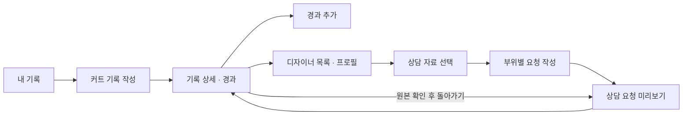

# SALU 초기 화면 계획

현재 목표: PPT의 예상 화면을 실제로 클릭할 수 있는 React 화면으로 구성하고, 후속 DB·상담 구현에 필요한 기준 확정. 저장과 요청 미리보기는 브라우저 메모리에서만 수행.

## 현재 상태와 완료 범위

| 구분 | 상태 |
|---|---|
| 기존 준비본 | `8bcace5`에 보관. Spring 로그인·세션·MySQL 기반 포함 |
| 이번 작업 | 계획 문서·초기 React 화면·PC/모바일 검증 완료 |
| 실제 회원가입·기록 DB·사진 업로드·상담 전송 | 미구현. 후속 개발 계약에 설계 |
| 디자이너 로그인·실시간 대화·후기 작성·커뮤니티 | 후속 단계 |

현재 서버 기반과 초기 화면은 독립. 초기 화면은 로그인하거나 `.env`를 만들지 않아도 실행 가능. 화면의 인물·매장·후기는 가상 데이터. 실제 개발 계정과 연결하지 않음.

## 화면 기준

- 캡스톤 `6주차_캡스톤발표.pptx`의 커트·경과 화면과 디자이너 상담 목업, 5주차 기록·선택 자료 흐름 참고
- 청록색 제목 영역, 흰색 카드, 둥근 입력칸, 강조 버튼. 모바일에서 한 열, PC에서 기록과 보조 내용을 나란히 배치
- 목업 이미지를 페이지 배경으로 붙이지 않고 입력·선택·이동을 React 컴포넌트로 구현
- 전체 화면에 `초기 화면 · 가상 데이터` 표시. 새로고침 시 초기화 안내와 초기화 버튼 제공
- 마지막 문구는 `상담 요청 미리보기`. 실제 전달·답변·로그인 완료를 주장하지 않음

## 고객 흐름과 화면

| 경로 | 화면·입력 | 이동·동작 |
|---|---|---|
| `/` | 커트 목록, 사진·날짜·시술·부위, 경과 수 | 기록 상세, 새 기록, 디자이너 찾기 |
| `/records/new` | 커트 날짜, 시술, 부위, 좋았던 점, 사진 | 메모리에 추가 후 상세. 취소하면 목록 |
| `/records/:id` | 커트와 당일 사진·메모, 날짜별 경과·사진 | 경과 추가, 해당 커트로 디자이너 선택. 미리보기에서 진입하면 돌아가기 링크 |
| `/records/:id/progress/new` | 관찰 날짜, 부위, 불편, 평소 손질, 물어볼 점, 사진 | 저장 후 해당 기록 상세 |
| `/designers` | 소개·상담 분야·현재 소속을 가진 가상 디자이너 목록 | 개인 프로필. 기록에서 진입하면 선택 커트 유지 |
| `/designers/:id` | 소개, 상담 분야, 현재 소속·이전 소속, 가상 상담 후기 | 자료 선택으로 이동 |
| `/consultations/materials?designer=:id&record=:id` | 기준 커트 하나, 당일 메모, 경과, 사진 각각 선택 | 선택 내용 확인 후 요청 작성 |
| `/consultations/request` | 선택한 기록·사진 요약, 부위별 요청, 추가 손질·질문 | 자료를 보면서 작성, 자료 선택으로 돌아가기, 미리보기 확정 |
| `/consultations/previews/:id` | 디자이너·커트 기준, 선택본, 요청 | 작성 화면으로 돌아가 수정, 기록으로 이동 |

### 커트·경과 입력 규칙

- 커트 날짜·시술·부위 최소 하나 필수. `좋았던 점`은 선택. 제목은 날짜와 시술로 생성
- 미용실·담당자·가격은 접힌 선택 정보. 가격은 0 이상의 정수 원 단위. 상담에 자동 첨부하지 않음
- 관찰 날짜는 커트일 이상·오늘 이하. 경과 일수는 두 날짜 차이로 계산하고 `D+14`처럼 표시
- 경과 부위와 관찰 내용 하나 이상 필수. 불편·손질·질문은 각각 입력하고 전부 빈 값이면 저장 차단
- 부위: 앞머리·옆머리·윗머리·뒤·목선(한 부위)·머리끝·전체. 기록과 요청에서 같은 값 사용
- 관찰 날짜는 기록한 시점이며, 불편이 시작된 날로 자동 해석하지 않음
- 사진은 JPEG·PNG·WebP, 장당 5 MiB 이하, 한 작성 화면에 최대 6장. 브라우저에서 실제 이미지 로딩 여부 확인. 업로드 파일명은 로컬 미리보기 설명에만 표시하고 후속 서버에서는 별도 사진 설명으로 분리
- 잘못된 사진·날짜·입력은 해당 화면에서 설명. 입력 내용은 유지하고 수정 가능

### 상담 자료·요청 규칙

- 디자이너 한 명과 커트 한 건을 기준으로 시작. 디자이너가 없는 직접 경로는 안내 후 목록으로 이동 가능
- 당일 메모·경과·사진은 초기 선택 없음. 적어도 한 자료를 직접 골라야 요청 작성 가능
- 경과 선택은 그 경과의 부위·불편·손질·질문을 포함. 경과 사진은 별도 선택. 선택하지 않은 경과와 사진은 첨부하지 않음
- 커트 날짜·시술·부위는 기준 기록 표시용 최소 정보. 가격·매장·담당자 등 선택 정보는 자동 포함하지 않음
- 요청은 부위·종류(`KEEP`, `CHANGE`, `ASK`)·내용의 반복 항목. 최소 한 항목 작성. 빈 항목을 포함한 채 미리보기 확정 불가
- 집에서 손질하는 정도와 추가 질문은 선택 입력. 경과에 이미 적은 내용은 자동 첨부하므로 추가 내용만 작성. 유지/변경 의도나 시술 종류를 AI가 결정하지 않음
- 선택한 자료는 요청 작성 화면에서도 확인. PC에서는 옆에 펼쳐 표시하고 모바일에서는 위쪽 접힌 요약을 열어 확인
- 기준 커트·디자이너별로 선택본과 요청 초안을 메모리에 분리 보관. 다른 대상의 요청을 자동 복사하지 않고 같은 대상으로 돌아오면 기존 초안 복원. 새로고침·전체 초기화 때 모두 제거
- 사진에 커트 당일/경과 D+일수와 날짜 표시. 모바일 자료 선택에서는 선택 수와 다음 버튼을 하단에 유지
- 미리보기 확정 때 선택한 문장·사진 메타데이터·디자이너 표시 정보를 복사. 이후 원본에 경과가 추가돼도 기존 미리보기 내용 유지
- 미리보기는 전송 내역이 아니며 답변·알림·실시간 대화 기능 없음

## 코드와 데이터 경계

| 묶음 | 책임 |
|---|---|
| 공통 레이아웃 | 메뉴, 가상 데이터 안내, 화면 제목, 초기화, 반응형 |
| 기록 화면 | 목록·입력·경과 타임라인, 폼 오류·초안 |
| 디자이너·상담 화면 | 프로필, 명시적 선택, 부위별 요청, 복사한 미리보기 |
| typed repository | 조회·생성·경과 추가·미리보기 생성·초기화. 현재 메모리 구현 |
| React Context | 저장소와 화면 초안 제공. 화면에서 DB·HTTP 코드 직접 사용 금지 |

핵심 타입: `CutRecord`, `ProgressEntry`, `RecordPhoto`, `DesignerProfile`, `ConsultationDraft`, `ConsultationPreview`, `RequestItem`. 식별자는 문자열, 날짜는 `YYYY-MM-DD`, 금액은 원 단위 정수.

메모리 repository는 비동기 메서드와 구독 가능한 상태를 제공. 화면은 조회 상태와 명령을 사용하고, 후속 HTTP adapter는 같은 계약에 서버 응답 캐시·로딩·오류를 연결. 서버 ID를 포함한 DTO 대응은 개발 계약에서 정의. 메모리 ID는 서버에 그대로 업로드하지 않음.

- 샘플 목록은 새로고침/초기화 때 복원. 기록·경과·미리보기와 작성 중인 초안은 메모리에만 존재
- localStorage·sessionStorage·IndexedDB·쿠키에 목업 내용 저장 금지. 초기 화면에서 `/api`·상담 WebSocket 호출 없음. Vite 개발 서버의 HMR 연결은 개발 도구
- 사진은 `URL.createObjectURL`로 미리보기. 삭제·초기화·페이지 종료 시 URL 해제. 폼을 오가며 사용하는 동안에는 유지
- 기록 삭제·수정, 디자이너 편집·후기 작성은 이번 범위 밖. 없는 ID와 초기화로 사라진 ID는 안내 화면 제공
- 화면에 외부 이미지·폰트 요청 없음. 사진은 정적 파일, 디자이너 이미지는 이니셜 표시

## Git·공동 작업

기존 파일을 새로 만들었다고 소급 분할하지 않음. 최초 커밋은 발견 당시 준비본 전체. 이후 실제 작업마다 관련 변경과 검증을 함께 기록.

| 순서 | 커밋 단위 | 확인 |
|---|---|---|
| 0 | 기존 개발 준비본 기준점 보관 | stage 범위·비밀값·기존 코드 보관 |
| 1 | 초기 화면 계획과 후속 개발 계약 정리 | PPT 기준·현재/후속 구분 |
| 2 | 화면 경로와 공통 레이아웃 추가 | TypeScript·빌드 |
| 3 | 커트·경과 화면과 메모리 저장 추가 | 입력·타임라인·사진 상태 |
| 4 | 디자이너 선택과 상담 미리보기 추가 | 선택본·요청·snapshot |
| 5 | 초기 화면 검증과 실행 안내 추가 | 브라우저 검증·실제 캡처 |

개발 브랜치 `feature/prototype-flow`. 이후 `main`에 직접 작업하지 않고 기능 브랜치→검증→PR 검토. 원격은 후속 단계에 비공개 `8192KB/SALU` 생성·공유. 조원 GitHub ID는 실제 확인 후 초대. 이 단계에서 원격 생성·push·웹 공개는 수행하지 않음.

`.env`, 계정 파일, 사진 원본 업로드, DB 데이터, node_modules, dist, 테스트 임시 결과는 Git 제외. 기본 가상 사진과 의존성 lockfile은 포함.

## 검증과 발표

- Spring·MySQL을 사용하지 않은 상태에서도 목록부터 미리보기까지 완료
- 커트·경과 작성, 사진 미리보기, 날짜 오류·필수 입력 오류 확인
- 자료를 고르지 않으면 진행 차단. 선택하지 않은 개인 메모·경과·사진이 미리보기에 나타나지 않음
- 앞뒤 이동·다른 대상 방문 후 초안 복원, 대상별 요청 분리, 원본 추가 후 기존 미리보기 불변, 새로고침/초기화 후 신규 자료 소실
- 존재하지 않는 기록/프로필/미리보기 ID, 새로고침 후 직접 URL 접근 안내
- 390px 모바일과 PC의 가로 넘침·메뉴·입력·버튼 확인
- 브라우저 콘솔 오류, `/api`/외부 네트워크 호출, 영구 저장 여부 확인
- `npm run build`, `npm run test:e2e` 실행. 기존 서버 기반 검증 결과와 초기 화면 결과 구분

발표 표현: “PPT의 예상 화면을 실제 입력·선택 가능한 초기 화면으로 구성했습니다. 이번에는 화면 흐름을 확인했고, 실제 저장과 디자이너 상담 연결은 다음 단계입니다.”

최종 캡처는 실제 브라우저 결과에서 생성. 목업 사진을 구현 완료 증거로 사용하지 않음. 검증 결과와 실제 캡처는 아래 구현 결과에 기록.

## 이미지·기술 출처

- 예시 커트 사진: [Alex Neman, Man with brown bob haircut from behind](https://commons.wikimedia.org/wiki/File:Man_with_brown_bob_haircut_from_behind.jpg), CC0. PPT와 같은 참고 사진. 가상 날짜·설명은 실제 촬영자/모델의 시술 이력이 아님
- 사진은 여러 기록의 레이아웃 예시에 재사용. 실제 전후 변화 비교 자료가 아님
- [React Router Declarative 설치](https://reactrouter.com/start/declarative/installation): Vite와 BrowserRouter 사용. 설치 버전은 package-lock.json에 고정

## 구현 결과 · 2026-10-10

- PPT 기준 커트·경과 입력, 디자이너 프로필, 선택 자료, 부위별 요청, 미리보기 연결 완료
- `npm ci`, `npm run build`, `npm run format:check` 통과
- 최초 검증 `npm run test:e2e`: desktop 8개 + mobile 8개, 총 16개 통과. 아래 흐름 보완 후 재검증 결과 별도 기록
- 날짜·필수 항목, 초안 이동, 선택하지 않은 자료 제외, snapshot 유지, 초기화·새로고침, 사진 decode·개수·크기·URL 정리 확인
- 매 테스트에서 브라우저 실행 오류·API/외부 HTTP 요청·localStorage/sessionStorage 사용 없음 확인
- 첫 검증에서 발견한 입력 이름/오류 설명 혼합을 aria-labelledby·aria-describedby로 분리한 뒤 전체 재검증
- backend·scripts·compose·기존 DB migration은 준비본 기준점과 동일. 이 결과는 backend/DB의 새로운 검증 결과가 아님
- Git: 기준점 main + feature/prototype-flow. 준비본·계획·레이아웃·기록·상담·검증 순서, 원격 push 없음

실제 화면: [기록 목록 PC](screenshots/records-desktop.png) · [커트·경과 모바일](screenshots/record-mobile.png) · [디자이너 PC](screenshots/designer-desktop.png) · [상담 미리보기 모바일](screenshots/preview-mobile.png). 재생성: 개발 서버 실행 후 `frontend`에서 `npm run capture`.

### 화면 흐름 보완

최초 브라우저 점검에서 확인한 문제: 자료 선택 후 요청을 쓰면 선택한 경과가 보이지 않음, 대상을 바꾸면 이전 요청 소실, 모바일 다음 버튼이 자료 목록 아래에 위치. PPT의 배치를 유지하면서 아래 동작 보완.

| 보완 | 적용 범위 |
|---|---|
| 기록을 보면서 요청 작성 | 선택한 메모·경과·사진만 표시. 손질/질문을 중복 작성하지 않도록 추가 입력임을 안내 |
| 대상별 초안 보관 | 커트·디자이너 조합마다 별도 보관·복원. 다른 대상에 내용 자동 전달 없음 |
| 모바일 진행 버튼 | 자료 선택 화면 하단에 선택 수·요청 작성 버튼. 오류 안내와 화면 마지막 자료가 가리지 않게 여백 확보 |
| 원본 확인 후 돌아가기 | 미리보기 ID를 이동 경로에 유지. 같은 커트의 미리보기일 때만 돌아가기 표시 |
| 사진 소속 표시 | 커트 당일·경과 D+일수와 관찰 날짜 표시 |

흐름 보완 후 `npm run build`, `npm run format:check` 통과. 설치된 Playwright Chromium에서 desktop 9개 + mobile 9개, 총 18개 통과. 대상별 초안 복원·분리·초기화, 요청 작성 중 선택 범위 유지, 모바일 하단 버튼 노출 포함. 실제 브라우저에서 원본 확인 후 같은 미리보기 복귀도 확인.

PC·모바일 캡처를 확인하며 모바일의 미리보기 버튼 줄바꿈을 발견해 작성 화면의 하단 버튼을 한 줄에 하나씩 배치. 실제 사용자 대상 사용성 검증은 아직 수행하지 않음.

다음 제품 결정:

- **담당 디자이너로 바로 연결**: 현재 담당자 이름은 자유 입력. 동명이인을 자동 연결하지 않고 실제 프로필 ID를 선택하는 방법부터 결정
- **디자이너 선택 전에 개인 요청 준비**: 개인 기록만으로 다음 커트를 준비하는 진입점. 현재 상담 초안의 디자이너 필수 조건과 선택 순서를 바꾸는 일이므로 별도 범위로 결정
- **기록 수정·요청 자료 다시 찾기**: 실제 사용 단계에서 필요한 후속 화면. 이번에는 기록 편집이나 전송 내역 화면을 새로 추가하지 않음

후속 첫 작업: 계획의 회원·기록 연결 단계. 화면 피드백을 먼저 반영한 뒤 신규 migration·API·HTTP adapter·소유권 검증을 기능 단위로 연결. 가상 기록을 실제 계정의 기록으로 자동 이관하지 않음.
