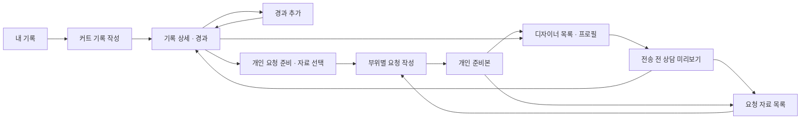

# SALU 초기 화면 계획

현재 목표: PPT의 예상 화면을 실제로 클릭할 수 있는 React 화면으로 구성하고, 후속 DB·상담 구현에 필요한 기준 확정. 저장과 요청 미리보기는 브라우저 메모리에서만 수행.

## 현재 상태와 완료 범위

| 구분 | 상태 |
|---|---|
| 기존 준비본 | `8bcace5`에 보관. Spring 로그인·세션·MySQL 기반 포함 |
| 이번 작업 | 초기 React 화면·PC/모바일 검증·실제 Spring 인증 연결 완료 |
| 실제 회원가입·기록 DB·사진 업로드·상담 전송 | 미구현. 후속 개발 계약에 설계 |
| 디자이너 로그인·실시간 대화·후기 작성·커뮤니티 | 후속 단계 |

이 문서의 최초 화면 검증은 서버 없는 메모리 예시 기준. 2026-10-10 인증 연결 이후 기본 실행의 로그인·회원 확인·로그아웃은 실제 Spring 사용. 기록·인물·매장·후기는 계속 가상 데이터이며 실제 회원 데이터로 이관하지 않음. `npm run dev:prototype`으로 서버 없이 화면 확인 가능.

## 화면 기준

- 캡스톤 `6주차_캡스톤발표.pptx`의 커트·경과 화면과 디자이너 상담 목업, 5주차 기록·선택 자료 흐름 참고
- 청록색 제목 영역, 흰색 카드, 둥근 입력칸, 강조 버튼. 모바일에서 한 열, PC에서 기록과 보조 내용을 나란히 배치
- 목업 이미지를 페이지 배경으로 붙이지 않고 입력·선택·이동을 React 컴포넌트로 구현
- 화면 전용 모드의 가상 데이터 표시, 서버 연결 모드의 `예시 기록 · 서버 저장 전` 표시. 새로고침·로그인·로그아웃 초기화 안내와 초기화 버튼 제공
- 개인 준비는 `이번 요청 미리보기`, 대상을 정한 자료는 `상담 요청 미리보기`. 실제 전달·답변 완료를 주장하지 않음. 실제 로그인 연결은 login.md의 별도 검증 범위

## 고객 흐름과 화면

기록 상세에서 먼저 개인 요청 준비. 디자이너를 먼저 선택하는 기존 흐름도 제공. 개인 준비본에서 대상 선택 후 `이 자료로 상담 준비`를 명시적으로 눌러 복사. 실제 전송 없음.

| 경로 | 화면·입력 | 이동·동작 |
|---|---|---|
| `/` | 커트 목록, 사진·날짜·시술·부위, 경과 수 | 기록 상세, 새 기록, 디자이너 찾기 |
| `/records/new` | 커트 날짜, 시술, 부위, 좋았던 점, 사진 | 메모리에 추가 후 상세. 취소하면 목록 |
| `/records/:id` | 당일 기록, 날짜별 경과·사진, 작성한 요청 자료 | 경과 추가, 개인 요청 준비, 디자이너 선택, 미리보기 재진입 |
| `/records/:id/edit` | 날짜·시술·부위·메모·선택 정보 수정 | 기존 사진 유지, 원본 변경은 이전 미리보기에 반영하지 않음 |
| `/records/:id/progress/:progressId/edit` | 관찰 날짜·부위·문장 수정 | 같은 커트의 경과만 수정. 저장 후 상세 |
| `/records/:id/progress/new` | 관찰 날짜, 부위, 불편, 평소 손질, 물어볼 점, 사진 | 저장 후 해당 기록 상세 |
| `/requests` | 작성 중인 초안과 만든 요청 자료 | 기존 초안 이어쓰기·개인 준비본·상담 미리보기 다시 열기 |
| `/requests/materials?draft=:id` | 기준 커트, 메모·경과·사진 선택 | 개인 준비는 첨부 없이 시작 가능. 상담용은 자료 최소 하나 필요 |
| `/requests/write?draft=:id` | 선택 자료 요약, 부위별 요청, 추가 손질·질문 | 기록 문장을 명시적으로 가져오기, 자료 다시 선택, 미리보기 생성 |
| `/requests/previews/:id` | 개인 준비본 또는 대상이 정해진 전송 전 자료 | 원본 확인, 내용 수정, 요청 목록, 디자이너 선택 |
| `/designers` | 소개·상담 분야·현재 소속을 가진 가상 디자이너 목록 | 개인 프로필. 기록 또는 준비본에서 진입하면 해당 문맥 유지 |
| `/designers/:id` | 소개, 현재·이전 소속, 가상 상담 후기 | 기존 초안 이어쓰기·새 준비. 개인 준비본은 별도 복사 |

기존 `/consultations/materials`, `/consultations/request`, `/consultations/previews/:id`는 호환 경로. 새 화면의 초안 주소는 ID를 포함하여 브라우저 뒤로 가기에도 다른 초안으로 바뀌지 않음. 메모리 ID이므로 새로고침 후에는 찾을 수 없다는 안내 표시.

### 커트·경과 입력 규칙

- 커트 날짜·시술·부위 최소 하나 필수. `좋았던 점`은 선택. 제목은 날짜와 시술로 생성
- 미용실·담당자·가격은 접힌 선택 정보. 가격은 0 이상의 정수 원 단위. 상담에 자동 첨부하지 않음
- 담당자 이름 입력만으로 프로필을 찾거나 연결하지 않음. 선택 정보에서 프로필 ID를 직접 선택하면 이름을 프로필 값으로 표시하고 해당 프로필로 이동 가능. 기록 당시 매장명과 현재 소속은 분리
- 커트·경과의 문장·날짜·부위·선택 정보를 수정 가능. 커트일을 가장 이른 기존 경과일보다 늦게 변경하지 못함. 새로 만든 요청만 현재 기록 사용, 이전 미리보기는 선택 당시 문장·사진 날짜 유지
- 다른 화면에 갔다가 돌아오면 편집 초안 유지. 명시적 취소는 해당 초안만 버리고 원본 유지. 사진 교체·삭제는 후속
- 관찰 날짜는 커트일 이상·오늘 이하. 경과 일수는 두 날짜 차이로 계산하고 `D+14`처럼 표시
- 경과 부위와 관찰 내용 하나 이상 필수. 불편·손질·질문은 각각 입력하고 전부 빈 값이면 저장 차단
- 부위: 앞머리·옆머리·윗머리·뒤·목선(한 부위)·머리끝·전체. 기록과 요청에서 같은 값 사용
- 관찰 날짜는 기록한 시점이며, 불편이 시작된 날로 자동 해석하지 않음
- 사진은 JPEG·PNG·WebP, 장당 5 MiB 이하, 한 작성 화면에 최대 6장. 실제 이미지 로딩 확인. 초기 화면의 파일명 caption은 후속 전송 전 사용자 설명으로 분리
- 잘못된 사진·날짜·입력은 해당 화면에서 설명. 입력 내용 유지
- 사진 확인 중에는 추가 선택·삭제·폼 저장을 차단하여 처리 중 파일 누락 방지. 완료 후 다시 선택·삭제·저장 가능
- 당일·경과·요청 사진은 눌러 확대. 선택한 사진의 날짜와 설명을 함께 표시. 닫기/Escape 후 누른 버튼으로 포커스 복귀

### 개인 준비와 상담 자료 규칙

- 준비 초안마다 별도 ID. 기준 커트 하나에 개인 준비·디자이너별 여러 초안을 둘 수 있음
- 개인 준비는 디자이너가 없어도 요청 작성·미리보기 가능. 첨부 없는 경우 커트 날짜·시술·부위와 본인이 새로 쓴 요청만 표시
- 상담용 준비는 대상 디자이너와 명시적으로 선택한 자료 최소 하나 필요. 개인 준비에 첨부가 없으면 문장은 유지하고 자료 선택 화면으로 이동
- 당일 메모·경과·사진은 초기 선택 없음. 경과 선택은 해당 부위·불편·손질·질문을 포함하고 사진은 별도 선택
- 가격·매장·자유 입력 담당자 등 선택 정보는 자동 첨부하지 않음. 선택하지 않은 경과와 사진은 미리보기에 없음
- 부위별 요청은 `KEEP/CHANGE/ASK`와 내용의 반복 항목. 빈 항목을 포함한 채 미리보기 생성 불가
- 선택한 기록을 작성 화면에서 확인. PC에서는 옆에 표시, 모바일에서는 위쪽 요약을 펼쳐 확인
- 사용자가 `그대로 둘 부분으로 추가` 또는 `이 불편/질문을 요청에 추가`를 눌러 문장을 옮김. 기존 작성 내용 덮어쓰기 없음. 부위·의도는 이후 직접 수정 가능
- 손질·추가 질문은 기록에 없는 내용만 선택 입력. AI가 시술이나 유지/변경 의도를 추정하지 않음
- 프로필에서 기존 초안 이어쓰기와 새 준비 만들기를 구분. 새 준비와 개인→디자이너 복사는 새 ID를 만들고 이전 초안 보존
- 자료 선택 화면의 커트 변경은 해당 대상의 기존 초안을 복원. 각각은 요청 자료 목록에서 다시 접근 가능
- 미리보기는 선택한 문장·사진 메타데이터·표시 정보를 복사한 불변 자료. 수정은 새 초안·새 미리보기를 만들고 이전 버전 유지
- 수정 중에는 당시 자료만 사용. `최신 기록에서 다시 고르기`를 눌러야 현재 원본으로 전환. 요청 문장은 유지하고 자료 선택을 다시 확인
- 사진에 커트 당일/경과 D+일수와 날짜 표시. 확정 미리보기에도 같은 시점 표시
- 모바일 자료 선택에서는 선택 수와 다음 버튼을 하단에 유지. 원본 확인 후 같은 미리보기로 돌아가기 제공
- 실제 전달·답변·알림·실시간 대화 기능 없음. 개인 준비본과 전송 전 미리보기를 상담 내역으로 표시하지 않음

## 코드와 데이터 경계

| 묶음 | 책임 |
|---|---|
| 공통 레이아웃 | 메뉴, 가상 데이터 안내, 화면 제목, 초기화, 반응형 |
| 기록 화면 | 목록·입력·경과 타임라인, 폼 오류·초안 |
| 디자이너·요청 화면 | 프로필, 개인 준비, 명시적 선택, 부위별 요청, 복사한 미리보기, 재진입 |
| typed repository | 기록·경과 생성/수정·미리보기 생성·대상별 복사·초기화. 현재 메모리 구현 |
| React Context | ID별 초안 보관과 재개. 화면에서 DB·HTTP 코드 직접 사용 금지 |

핵심 타입: `CutRecord`, `ProgressEntry`, `RecordPhoto`, `DesignerProfile`, `RequestDraft`, `RequestPreview`, `RequestItem`. `RequestDraft.designerId`는 선택이며 후속 실제 상담 API의 designerId 필수 조건과 별개. `referencePreviewId`는 초기 화면의 고정 자료 참조이며 서버에 그대로 전송하지 않음.

메모리 repository는 비동기 메서드와 구독 가능한 상태 제공. 후속 HTTP adapter는 같은 화면에 서버 ID·DTO·로딩·오류를 연결. 메모리 ID·가상 사진을 실제 계정으로 자동 이관하지 않음.

- 새로고침/전체 초기화 때 샘플 복원. 기록·경과·요청·초안은 메모리에만 존재
- localStorage·sessionStorage·IndexedDB·쿠키에 목업 내용 저장 금지. `/api`·상담 WebSocket 호출 없음. Vite HMR는 개발 도구
- 사진은 임시 blob URL. 폼에서 제거·명시적 작성 취소·전체 초기화·페이지 종료 시 정리. 사용하는 동안 유지
- 초기화는 확인창에서 확정한 뒤 실행. 닫기/Escape/계속 작성은 내용 유지
- 기록 삭제·저장한 사진 교체/삭제·실제 디자이너 편집·후기 작성은 후속
- 외부 이미지·폰트 요청 없음. 기본 사진은 정적 파일, 디자이너 이미지는 이니셜

## Git·공동 작업

기존 파일을 새로 만들었다고 소급 분할하지 않음. 최초 커밋은 발견 당시 준비본 전체. 이후 실제 작업마다 관련 변경과 검증을 함께 기록.

| 순서 | 커밋 단위 | 확인 |
|---|---|---|
| 0 | 기존 개발 준비본 기준점 보관 | stage 범위·비밀값·기존 코드 보관 |
| 1 | 초기 화면 계획과 후속 개발 계약 정리 | PPT 기준·현재/후속 구분 |
| 2 | 화면 경로와 공통 레이아웃 추가 | TypeScript·빌드 |
| 3 | 커트·경과 화면과 메모리 저장 추가 | 입력·타임라인·사진 상태 |
| 4 | 디자이너 선택과 상담 미리보기 추가 | 선택본·요청·snapshot |
| 5 | 초기 화면 검증과 실행 안내 추가 | 브라우저 검증·실제 캡처 |
| 6 | 상담 준비 화면 흐름과 초안 보존 개선 | 선택 내용 확인·대상별 초안·모바일 진행 |
| 7 | 개인 요청 준비와 자료 재진입 흐름 추가 | 여러 초안·불변 자료·개인→상담용 복사 |
| 8 | 기록 수정과 사진 확인 흐름 추가 | 원본 수정·프로필 명시 연결·확대·초기화 확인 |

개발 브랜치 `feature/prototype-flow`. 이후 `main`에 직접 작업하지 않고 기능 브랜치→검증→PR 검토. 원격은 후속 단계에 비공개 `8192KB/SALU` 생성·공유. 조원 GitHub ID는 실제 확인 후 초대. 이 단계에서 원격 생성·push·웹 공개는 수행하지 않음.

`.env`, 계정 파일, 사진 원본 업로드, DB 데이터, node_modules, dist, 테스트 임시 결과는 Git 제외. 기본 가상 사진과 의존성 lockfile은 포함.

## 검증과 발표

- Spring·MySQL을 사용하지 않은 상태에서도 목록부터 미리보기까지 완료
- 커트·경과 작성, 사진 미리보기, 날짜 오류·필수 입력 오류 확인
- 상담용 준비는 자료를 고르지 않으면 진행 차단. 개인 준비는 첨부 없이 요청 작성 가능. 선택하지 않은 개인 메모·경과·사진이 미리보기에 나타나지 않음
- 앞뒤 이동·다른 대상 방문 후 초안 복원, 대상별 요청 분리, 원본 추가 후 기존 미리보기 불변, 새로고침/초기화 후 신규 자료 소실
- 존재하지 않는 기록/프로필/미리보기 ID, 새로고침 후 직접 URL 접근 안내
- 390px 모바일과 PC의 가로 넘침·메뉴·입력·버튼 확인
- 브라우저 콘솔 오류, `/api`/외부 네트워크 호출, 영구 저장 여부 확인
- `npm run build`, `npm run test:e2e` 실행. 기존 서버 기반 검증 결과와 초기 화면 결과 구분

발표 표현: “PPT의 예상 화면을 실제 입력·선택 가능한 초기 화면으로 구성했습니다. 이번에는 화면 흐름을 확인했고, 실제 저장과 디자이너 상담 연결은 다음 단계입니다.”

최종 캡처는 실제 브라우저 결과에서 생성. 목업 사진을 구현 완료 증거로 사용하지 않음. 검증 결과와 실제 캡처는 아래 구현 결과에 기록.

## 이미지·기술 출처

- 예시 커트 사진: [Alex Neman, Man with brown bob haircut from behind](https://commons.wikimedia.org/wiki/File:Man_with_brown_bob_haircut_from_behind.jpg), CC0. PPT와 같은 참고 사진. 가상 날짜·설명은 실제 촬영자/모델의 시술 이력이 아님
- 사진은 여러 기록의 레이아웃 예시에 재사용. 실제 전후 변화 비교 자료가 아님
- [React Router Declarative 설치](https://reactrouter.com/start/declarative/installation): Vite와 BrowserRouter 사용. 설치 버전은 package-lock.json에 고정

## 구현 결과 · 2026-10-10

- PPT 기준 커트·경과 입력, 디자이너 프로필, 선택 자료, 부위별 요청, 미리보기 연결 완료
- `npm ci`, `npm run build`, `npm run format:check` 통과
- 최초 검증 `npm run test:e2e`: desktop 8개 + mobile 8개, 총 16개 통과. 아래 흐름 보완 후 재검증 결과 별도 기록
- 날짜·필수 항목, 초안 이동, 선택하지 않은 자료 제외, snapshot 유지, 초기화·새로고침, 사진 decode·개수·크기·URL 정리 확인
- 매 테스트에서 브라우저 실행 오류·API/외부 HTTP 요청·localStorage/sessionStorage 사용 없음 확인
- 첫 검증에서 발견한 입력 이름/오류 설명 혼합을 aria-labelledby·aria-describedby로 분리한 뒤 전체 재검증
- backend·scripts·compose·기존 DB migration은 준비본 기준점과 동일. 이 결과는 backend/DB의 새로운 검증 결과가 아님
- Git: 기준점 main + feature/prototype-flow. 준비본·계획·레이아웃·기록·상담·검증 순서, 원격 push 없음

실제 화면: [기록 목록 PC](screenshots/records-desktop.png) · [커트·경과 모바일](screenshots/record-mobile.png) · [디자이너 PC](screenshots/designer-desktop.png) · [상담 미리보기 모바일](screenshots/preview-mobile.png). 재생성: 개발 서버 실행 후 `frontend`에서 `npm run capture`.

### 화면 흐름 보완

최초 브라우저 점검에서 확인한 문제: 자료 선택 후 요청을 쓰면 선택한 경과가 보이지 않음, 대상을 바꾸면 이전 요청 소실, 모바일 다음 버튼이 자료 목록 아래에 위치. PPT의 배치를 유지하면서 아래 동작 보완.

| 보완 | 적용 범위 |
|---|---|
| 기록을 보면서 요청 작성 | 선택한 메모·경과·사진만 표시. 손질/질문을 중복 작성하지 않도록 추가 입력임을 안내 |
| 대상별 초안 보관 | 커트·디자이너 조합마다 별도 보관·복원. 다른 대상에 내용 자동 전달 없음 |
| 모바일 진행 버튼 | 자료 선택 화면 하단에 선택 수·요청 작성 버튼. 오류 안내와 화면 마지막 자료가 가리지 않게 여백 확보 |
| 원본 확인 후 돌아가기 | 미리보기 ID를 이동 경로에 유지. 같은 커트의 미리보기일 때만 돌아가기 표시 |
| 사진 소속 표시 | 커트 당일·경과 D+일수와 관찰 날짜 표시 |

흐름 보완 후 `npm run build`, `npm run format:check` 통과. 설치된 Playwright Chromium에서 desktop 9개 + mobile 9개, 총 18개 통과. 대상별 초안 복원·분리·초기화, 요청 작성 중 선택 범위 유지, 모바일 하단 버튼 노출 포함. 실제 브라우저에서 원본 확인 후 같은 미리보기 복귀도 확인.

PC·모바일 캡처를 확인하며 모바일의 미리보기 버튼 줄바꿈을 발견해 작성 화면의 하단 버튼을 한 줄에 하나씩 배치. 실제 사용자 대상 사용성 검증은 아직 수행하지 않음.

추가 개선 상태:

- **담당 디자이너로 바로 연결**: 선택한 프로필 ID로 연결. 이름만 입력하면 연결하지 않음. 소속이 옮겨도 기록 당시 매장 유지
- **개인 요청과 재진입**: 구현 반영. 아래 추가 검증 결과 참고
- **기록 수정·사진 확인**: 메모리 원본 수정·사진 확대 구현. 기존 요청 자료는 불변. 저장된 사진 교체/삭제와 실제 전송 내역은 후속

후속 첫 작업: 계획의 회원·기록 연결 단계. 화면 피드백을 먼저 반영한 뒤 신규 migration·API·HTTP adapter·소유권 검증을 기능 단위로 연결. 가상 기록을 실제 계정의 기록으로 자동 이관하지 않음.

### 추가 흐름 개선 · 개인 준비와 재진입

- 개인 준비본과 전송 전 상담 자료 분리, ID별 여러 초안·버전 보관
- 개인 준비에서 대상 선택 후 명시적 복사. 기존 상담 초안·개인 준비본 유지
- 선택한 기록의 문장을 요청에 가져오기, 미리보기의 사진 날짜 유지
- 내용 수정 시 당시 자료 유지. 최신 원본으로 바꾸는 버튼 분리
- 구현 빌드 통과. PC·모바일 브라우저 28개 시나리오 통과, 실제 개인 요청·요청 목록 캡처 확인. 디자이너 재진입 시 작업 중인 기준 커트 유지 확인

개선 완료 확인 기준:

1. 디자이너 없이 요청 준비·미리보기, 이후 상담 준비로 연결, 목록·기록에서 재진입
2. 같은 대상의 여러 초안·이전 미리보기·선택하지 않은 자료를 구분하여 보존
3. 잘못 입력한 기록·경과 수정, 담당 프로필을 이름 추측 없이 명시적으로 연결, 사진 날짜·확대 확인
4. 모바일·키보드·잘못된 주소·초기화 검증, 실제 캡처·문서·Git 기록 정리

실제 DB·전송·디자이너 계정·후기 작성·커뮤니티는 기존 후속 계획 유지. 초기 화면 결과를 해당 기능의 완료로 표시하지 않음.

### 기록 수정과 사진 확인 결과

- 커트·경과 편집, ID별 편집 초안, 취소 시 원본 유지, 날짜 순서 검사 구현
- 자유 입력 담당자와 명시적 프로필 연결 구분. 시술 당시 매장과 현재 소속 분리
- 사진 확대, 닫기/Escape/포커스 복귀, 초기화 확인창 구현
- 사진 decode 중 삭제·저장 차단. 확인 완료 후 삭제한 사진이 되살아나지 않으며 저장 가능
- 최종 `npm run build`, `npm run format:check` 통과. `npm run test:e2e`: PC 20개 + 모바일 20개, 총 40개 통과(17.4초), skip 없음
- 320·390·1440px에서 목록·기록·편집·요청 목록의 가로 넘침 없음 확인. 실제 사용자 평가와 구분

추가 캡처: [요청 작성 PC](screenshots/request-desktop.png) · [요청 자료 목록 모바일](screenshots/requests-mobile.png) · [기록 수정 모바일](screenshots/edit-mobile.png) · [사진 확대 모바일](screenshots/photo-mobile.png)

로그인 연결은 완료. 후속 첫 작업은 가입·회원별 기록 저장/조회. 기록 HTTP adapter와 로딩·저장 실패/재시도·소유권을 연결하고 재접속 보존 검증. 이후 두 실제 계정 간 상담·답변, 후기·공개 사례 순서. 현재 화면에서 답변·실제 상담 이력으로 보이는 가짜 결과를 추가하지 않음.

### 완료 확인

| 기준 | 확인 결과 |
|---|---|
| 개인 준비 → 선택적 디자이너 연결 → 목록/기록 재진입 | 브라우저 PC/mobile 통과. 디자이너 선택 전에도 요청 작성 가능 |
| 여러 초안과 과거 선택본 보존 | 같은 대상 새 초안·대상 변경·원본 추가/수정·이전 버전 재열람 확인. 선택하지 않은 개인 자료 제외 |
| 기록 수정·프로필 명시 연결·사진 날짜/확대 | 날짜 역전 차단, 편집 이동/취소, 이름 자동 연결 없음, 당시 매장 유지, 사진 확대 확인 |
| 모바일·키보드·복구·초기화·실제 캡처 | Escape/닫기 포커스 복귀, 초기화 취소/확정, 잘못된 ID 차단, 8종 실제 브라우저 캡처 확인 |
| 기존 기반과 분리 | backend/scripts/compose/기존 migration 변경 없음. 새 업무 DB/API/실제 전송 미구현 |
| Git·문서 | 기존 두 계획 문서와 README 갱신. 기능 순서대로 커밋, 원격 push 없음 |

외부 사용자 대상 사용성 평가는 미실시. 회원별 기록의 재접속 저장·디자이너 답변 검증은 다음 개발 단계의 완료 조건. 실제 인증 연결은 아래 별도 검증 범위.

## 실제 인증 연결 이후

`npm run dev`는 Spring 세션 확인과 실제 `/login` 제공. 서버 없이 화면 흐름만 보려면 `npm run dev:prototype`. 업무 기록의 메모리 repository·개인 준비·선택 자료·snapshot 계약은 유지.

예시 자료는 새로고침뿐 아니라 로그인·로그아웃·확인된 회원 변경 때 초기화. 서버 장애는 비로그인으로 간주하지 않고 기존 예시를 유지. UI 상단에 기록의 서버 저장 전 상태 표시. 실제 회원별 기록 저장·상담 전송은 아직 없음.

인증 E2E 9개와 기존 화면 E2E40개를 별도 실행해 통과. [로그인 연결 결과](login.md)의 실제 서버 응답/장애 재현 범위 참고. 다음 첫 업무 기능은 커트·경과 DB·HTTP adapter·소유권 검사 연결.

### 모바일 화면 보완 · 2026-10-10

- 별도 모바일 도메인·호스팅 없이 같은 React 화면의 반응형 구성 보완
- 900px 이하에서 사이드바를 본문 아래로 이동하고 상단 메뉴를 세 개의 동일 너비 탭으로 배치. 계정 영역은 브랜드 옆에 유지
- 480px 이하에서 새 기록·폼 버튼을 전체 너비로 배치하고 사진·카드 여백 조정. 입력 글자 16px 적용
- 320px 새 기록 폼에서 사진 파일 입력의 최소 너비가 grid를 넓히는 문제 수정. 내용을 숨기지 않고 grid 최소 너비 제한
- 주요 화면 8종을 320·390·600·720·800·900·1440px에서 확인: 총 56개 조합 가로 넘침 없음. 새로고침 없는 PC→모바일→PC 너비 전환 확인
- 최종 build·format:check 통과, 화면 전용 E2E PC 20개 + 모바일 20개 총 40개 통과(19.5초). 인증·backend 변경 없음, 실제 인증 검증은 이번 작업에서 재실행하지 않음
- 화면 전용 캡처: [기록 목록 모바일](screenshots/records-mobile.png), [새 기록 모바일](screenshots/new-record-mobile.png). 실제 DB 저장·사진 서버 업로드 검증과 구분
